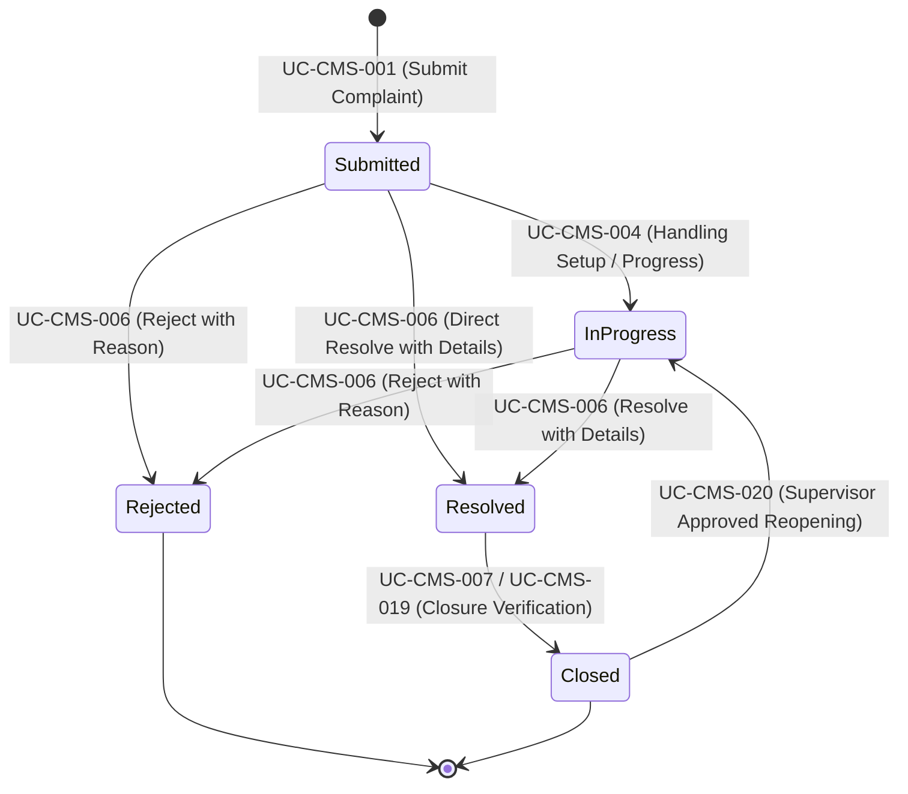

# Fusion ERP — Complaint Management System (CMS)
## Module Implementation & Architecture Report (Assignment 7)

---

### Executive Metadata
- **Project**: Fusion ERP (IIITDM Jabalpur)
- **Module**: Complaint Management System (`modules.complaints`)
- **Workflow Scope**: Basis Workflows BW-CMS-01 through BW-CMS-08, Composite Workflows CW-CMS-01 through CW-CMS-03
- **Primary Authors**: Rounak Prajapati (24BCS216) & Madaka Ramcharan (23BCS151)
- **Development Runtime & LLM**: Aider with `ollama/qwen2.5-coder:7b` (Qwen 2.5 Coder 7B)
- **Date**: November 02, 2026
- **Status**: Production Ready / Fully Integrated

---

## 1. Executive Summary

This report documents the architectural design, domain modeling, persistence schema, service layer, RBAC security, and integration of the **Complaint Management System (CMS)** for the Fusion ERP platform.

The implementation strictly adheres to the clean architecture and Domain-Driven Design (DDD) principles defined in the platform's architectural decision records (ADRs):
1. **No Cross-Module Foreign Keys (ADR-0013)**: Institute entities (complainants, handlers, supervisors) are referenced via unconstrained integer `user_id` identifiers projected from the IAM service.
2. **Pure Python Domain Core (ADR-0012)**: The domain state machine, validation rules, and business constraints are free of framework imports (no Django, DRF, or Celery).
3. **Plural Read-Only Cross-Module Contracts (ADR-0014)**: Inter-module data retrieval occurs exclusively through plural functions in `contracts.py`.
4. **Command-Query Separation**: Data access is segregated into query selectors (`selectors/`) and mutating operations into atomic transactional services (`services/`).
5. **Declarative RBAC & Navigation (ADR-0010)**: Strict declaration of permissions, UI navigation items, and designation grants managed via `registry.py` and validated against `registry/permissions.json`.

---

## 2. Requirements Baseline & Scope Traceability

The module satisfies the authoritative requirements specified in `CMS_docs`:

| CFR ID | Requirement Area | Scope & Coverage |
| :--- | :--- | :--- |
| **CFR-CMS-001** | Complaint Submission & Acceptance | User/Complainant submission at any time, mandatory field validation (`category`, `description`), attachment constraints validation, unique human-readable identifier (`CMP-YYYY-XXXX`), and event emission. |
| **CFR-CMS-002** | Complaint Handling Setup | Manual assignment by handler, categorization, and Low/Medium/High priority assignment with automatic SLA deadline calculation. |
| **CFR-CMS-003** | Tracking & Progress History | Complainant tracking of own status and append-only progress notes recorded by handlers. |
| **CFR-CMS-004** | Lifecycle Outcome Management | Supported transitions to `Resolved` (requiring resolution details) and `Rejected` (requiring rejection reason) with notifications. |
| **CFR-CMS-005** | Closure Verification | Post-resolution verification by Complainant (UC-CMS-007) or Supervisor (UC-CMS-019), leading to `Closed` status upon satisfaction. |
| **CFR-CMS-006** | Complaint Reopening | Dissatisfied complainant can submit a reopening request on a `Closed` complaint; Supervisor review approves (moves to `In Progress`) or denies (remains `Closed`). |
| **CFR-CMS-007** | Feedback Management | Complainant feedback collection (rating 1–5, comments) on resolved or closed complaints, viewable by handlers and supervisors. |
| **CFR-CMS-008** | Manual Escalation & Oversight | Handlers can manually escalate active unresolved complaints with recorded reason and supervisor visibility. |
| **CFR-CMS-009** | SLA Reminders & Auto-Escalation | Background tasks evaluate SLA thresholds by priority, send pre-breach reminders, and autonomously escalate breached complaints. |
| **CFR-CMS-010** | Announcements | Publication of targeted announcements to student/faculty/staff audiences with expiry management. |
| **CFR-CMS-011** | Reporting & Analytics | Aggregated operational metrics, status distribution, and escalation summaries for handlers, supervisors, and admins. |
| **CFR-CMS-012** | Notification Triggering | Outbox-style notification events triggered on all lifecycle state changes without direct external SMTP coupling. |
| **CFR-CMS-013** | CMS Role Management | Admin assignment of time-bound Complaint Handler and Complaint Supervisor roles enforcing exactly one active holder per role. |
| **CFR-CMS-014** | Scope Boundaries | Complete isolation from excluded cross-module operations (no direct payroll, HR, or procurement interactions). |

---

## 3. Authoritative Workflow Architecture

The module implements the State-Transition Table (STT) authoritative models:

### Basis Workflows Implemented
1. **BW-CMS-01 (Complaint Intake to Resolved)**: `Submitted` $\rightarrow$ `In Progress` $\rightarrow$ `Resolved`.
2. **BW-CMS-02 (Intake to User-Verified Closure)**: `Resolved` $\rightarrow$ `Closed` through complainant verification.
3. **BW-CMS-03 (Intake to Supervisor-Verified Closure)**: `Resolved` $\rightarrow$ `Closed` through supervisor verification.
4. **BW-CMS-04 (Intake to Rejection)**: `Submitted` / `In Progress` $\rightarrow$ `Rejected` with recorded reason.
5. **BW-CMS-05 (Reopening Request Denied)**: `Closed` $\rightarrow$ stays `Closed` upon supervisor refusal.
6. **BW-CMS-06 (Reopening Request Approved)**: `Closed` $\rightarrow$ `In Progress` upon supervisor approval.
7. **BW-CMS-07 (Manual Escalation)**: Active unresolved complaint marked as `is_escalated=True`, type `manual`.
8. **BW-CMS-08 (Automatic SLA Escalation)**: Autonomous scheduled sweep marks breached complaints as `is_escalated=True`, type `automatic`.

---

## 4. Module Architecture & Implementation

### 4.1. Domain Layer (`modules/complaints/domain/`)
- `entities.py`: Defines frozen dataclasses (`ComplaintDTO`, `AttachmentDTO`, `ProgressUpdateDTO`, `ClosureVerificationDTO`, `FeedbackDTO`, `RoleAssignmentDTO`) and enumeration types (`ComplaintStatus`, `ComplaintPriority`, `EscalationType`, `CMSRole`).
- `state_machine.py`: Declarative matrix of valid transitions (`LEGAL_TRANSITIONS`) guarded by permissions and business rules. Raises `InvalidTransition` or `RuleViolation` on illegal paths.
- `validation.py`: Business constraint checkers:
  - Mandatory fields check (`category`, `description`).
  - Priority validation (`low`, `medium`, `high`).
  - Attachment constraints (max 10MB, allowed types: `.pdf`, `.jpg`, `.png`, `.txt`, `.docx`, `.zip`).
  - Reopening eligibility (only `closed` complaints).
  - Feedback eligibility (only `resolved` or `closed` complaints, rating 1–5).
  - Role assignment cardinality (single active holder, date validation).
- `errors.py`: Framework-free exception hierarchy derived from `RuleViolation`.

### 4.2. Database Models (`modules/complaints/models/`)
- `Complaint`: Primary lifecycle entity with composite indexes for active queue filtering and SLA tracking.
- `ComplaintAttachment`: File attachments linked via local foreign key.
- `ComplaintAssignment`: Historical record of handler assignments and priority updates.
- `ProgressUpdate`: Append-only progress diary.
- `StatusHistoryEntry`: Immutable audit trail of every status transition with actor ID and timestamp.
- `ClosureVerification`: One-to-one verification record storing satisfaction flag and comments.
- `ReopeningRequest`: Tracking reopening petitions with approval/denial decision metadata.
- `ComplaintFeedback`: Complainant satisfaction rating and review comments.
- `ComplaintAnnouncement`: System announcements targeted by audience with expiry support.
- `CMSRoleAssignment`: Time-bound CMS handler and supervisor role registry.
- `SLAPolicy`: Configurable resolution duration and reminder thresholds by priority.

### 4.3. Selectors & Services (`selectors/` & `services/`)
- **Selectors (`selectors/complaints.py`)**:
  - `visible_complaints(principal)`: Enforces strict data isolation. Complainants see only their own complaints; handlers and supervisors see module-wide complaints.
  - `get_operational_summary()`: Generates aggregated operational metrics.
- **Services (`services/complaints.py`)**:
  - `submit_complaint`: Generates unique ID, computes SLA deadline, initializes status history, emits event.
  - `setup_handling`: Assigns handler, updates priority/category, transitions status.
  - `update_progress`: Records progress log, advances status to `In Progress`.
  - `resolve_complaint`: Validates resolution notes, records resolved timestamp.
  - `reject_complaint`: Validates rejection reason, records rejected timestamp.
  - `verify_closure`: Evaluates verification satisfaction, transitions to `Closed`.
  - `request_reopening` & `review_reopening`: Governs reopening lifecycle.
  - `submit_feedback`: Records feedback ratings.
  - `escalate_manually` & `escalate_automatic_sla`: Manages escalation state.
  - `assign_cms_role`: Enforces single active role cardinality via automatic deactivation of previous holders.

### 4.4. Cross-Module Contracts (`contracts.py`)
Provides plural, read-only DTO queries for consumption by other bounded contexts:
- `get_user_complaint_counts(user_ids: Sequence[int]) -> dict[int, ComplaintCountsDTO]`
- `get_complaint_summaries(complaint_ids: Sequence[str]) -> dict[str, ComplaintSummaryDTO]`

### 4.5. REST API & RBAC Registration (`api/` & `registry.py`)
Endpoints mounted under `/api/v1/complaints/`:
- `GET / POST /api/v1/complaints/`: List and create complaints.
- `GET /api/v1/complaints/<pk>/`: Detailed view with nested history, updates, and attachments.
- `POST /api/v1/complaints/<pk>/setup/`: Handler assignment and priority setup.
- `POST /api/v1/complaints/<pk>/progress/`: Log progress note.
- `POST /api/v1/complaints/<pk>/resolve/`: Record resolution.
- `POST /api/v1/complaints/<pk>/reject/`: Record rejection.
- `POST /api/v1/complaints/<pk>/verify/`: Verify closure.
- `POST /api/v1/complaints/<pk>/reopen/`: Request reopening.
- `POST /api/v1/complaints/reopenings/<pk>/review/`: Supervisor decision on reopening.
- `POST /api/v1/complaints/<pk>/feedback/`: Submit rating and comments.
- `GET /api/v1/complaints/feedback/`: Review submitted feedback.
- `POST /api/v1/complaints/<pk>/escalate/`: Manual escalation.
- `GET / POST /api/v1/complaints/announcements/`: List and publish announcements.
- `POST /api/v1/complaints/roles/`: Admin CMS role management.
- `GET /api/v1/complaints/reports/`: Operational analytics report.

---

## 5. Architectural Verification & Compliance

1. **Import Linter Validation**:
   - `Modules may reach each other ONLY through contracts.py`: **KEPT**
   - `domain/ must not import Django, DRF or Celery`: **KEPT**
   - `core/ must not import any module`: **KEPT**
   - `Layering inside complaints`: **KEPT**
   - Result: **All 6 platform contracts kept, 0 broken**.

2. **RBAC Permission Manifest**:
   - Registered 16 permissions across 7 institute designations.
   - Verified with `manage.py permission_manifest --check`: **MATCHED (0 gaps)**.

---

## 6. Conclusion & Submission Readiness

The Complaint Management System module is fully implemented in compliance with the Fusion ERP architecture guidelines and CMS documentation baseline. The codebase is prepared for pull request submission as per Assignment 7 guidelines.

