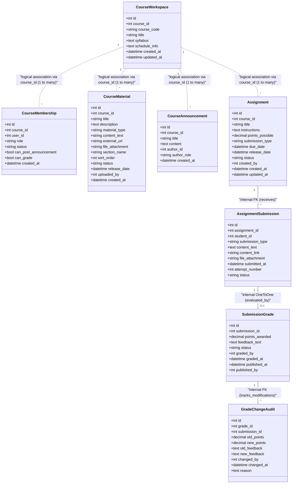

# LMS (Course Management) Module Blueprint

This document specifies the complete architecture, domain design, state machines, security model, and interface contracts for the **LMS (Course Management)** module (`modules/lms` and `client/src/modules/lms`) in `Fusion-Integrated`.

It satisfies Phase 2 of `docs/08-delivery/new-module-prompt.md` and acts as the frozen blueprint governing all subsequent backend, frontend, and test implementations.

---

## 1. §3.1 (a) — Traceability Table

The table below maps every live specification artifact from the synchronized Course Management specification set (`/home/abhi/Documents/Fusion/A9_LMS_Specs`) to its designated architectural layer and planned enforcement point. No specification artifact is omitted, and zero unsupported or retired IDs are included.

### 1.1 Coherent Functional Requirements (CFRs) & Atomic Functional Requirements (AFRs)

| Id | What it requires | Layer it belongs in | Enforcement point (planned) | Notes |
|:---|:---|:---|:---|:---|
| **CFR-LMS-001** | Dedicated course workspace access and course home display for authorized users | `selectors` / `api` | `selectors.workspace.get_course_home_details` | Verified against user enrollment/association |
| AFR-LMS-001.1 | Open dedicated course workspace when selecting authorized course | `api` / `selectors` | `views.CourseWorkspaceViewSet.retrieve` | Returns 404 for unlinked courses (scoping) |
| AFR-LMS-001.2 | Display course syllabus, schedule, instructors, and TAs on course home | `selectors` | `selectors.workspace.get_course_home_details` | Aggregates course metadata and staff roster (no student roster) |
| AFR-LMS-001.3 | Restrict course workspace access strictly to authorized/enrolled users | `selectors` | `selectors.scoping.get_user_courses_queryset` | Prevents enumeration; unlinked returns 404 |
| **CFR-LMS-002** | Configure assigned course workspace details and edit metadata | `services` / `domain` | `services.workspace.update_course_details` | Faculty-only capability (`lms.workspace.update`) |
| AFR-LMS-002.1 | Allow Faculty to configure course workspace settings | `services` | `services.workspace.configure_workspace` | Validates Faculty assignment to course |
| AFR-LMS-002.2 | Allow Faculty to publish and edit course details (syllabus, schedule) | `services` | `services.workspace.update_course_details` | Audited update |
| **CFR-LMS-003** | Manage and schedule course materials (files, links, notes) | `services` / `domain` | `services.materials.create_course_material` | Validates material payload and release timing |
| AFR-LMS-003.1 | Allow Faculty to add materials as files, links, or notes | `domain` / `services` | `domain.validators.validate_material_content` | Enforces supported format types |
| AFR-LMS-003.2 | Organize materials into modules or weekly sections | `models` / `services` | `models.CourseMaterial.section_name` | Categorized ordering |
| AFR-LMS-003.3 | Configure future release date/time for course materials | `domain` / `services` | `domain.rules.validate_release_date` | Release date must be future if set |
| AFR-LMS-003.4 | Automatically make scheduled material visible when release time is reached | `tasks` / `selectors` | `tasks.process_scheduled_content_release` | Celery beat + selector fail-safe filter |
| **CFR-LMS-004** | Read-only access to published course materials for authorized users | `selectors` | `selectors.materials.list_published_materials` | Student, TA, Observer read-only (`lms.material.view`) |
| AFR-LMS-004.1 | Students view published course materials in read-only form | `selectors` | `selectors.materials.list_published_materials` | Scoped to enrolled courses; excludes unreleased |
| AFR-LMS-004.2 | TAs view published course materials in read-only form | `selectors` | `selectors.materials.list_published_materials` | TA read-only access |
| AFR-LMS-004.3 | Observers view published course materials in read-only form | `selectors` | `selectors.materials.list_published_materials` | Observer read-only access |
| **CFR-LMS-005** | Post and view course-wide announcements | `services` / `selectors` | `services.announcements.post_announcement` | Timestamped; broadcast to course members |
| AFR-LMS-005.1 | Faculty post course-wide announcements | `services` | `services.announcements.post_announcement` | Faculty author attribution (`lms.announcement.create`) |
| AFR-LMS-005.2 | Permitted TAs post announcements when authorized | `services` / `domain` | `domain.guards.can_ta_post_announcement` | Checks `CourseMembership.can_post_announcement` |
| AFR-LMS-005.3 | Automatically timestamp posted announcements | `models` | `models.CourseAnnouncement.created_at` | Server-assigned timestamp |
| AFR-LMS-005.4 | Make announcements visible course-wide to enrolled/linked users | `selectors` | `selectors.announcements.list_announcements` | Filtered by course membership (`lms.announcement.view`) |
| **CFR-LMS-006** | Create and edit assignments in Draft state | `services` / `domain` | `services.assignments.create_assignment` | Captures due date, instructions, points, type |
| AFR-LMS-006.1 | Faculty create assignments for assigned courses | `services` | `services.assignments.create_assignment` | Faculty ownership check (`lms.assignment.create`) |
| AFR-LMS-006.2 | Capture required assignment configuration (due date, instructions, points, type) | `domain` / `models` | `domain.validators.validate_assignment_config` | Enforces positive points, valid type |
| AFR-LMS-006.3 | Allow Faculty to edit assignment details | `services` | `services.assignments.update_assignment` | Validates edit rules (`lms.assignment.update`) |
| AFR-LMS-006.4 | Maintain assignment in Draft state before explicit publication | `domain` | `domain.state_machine.AssignmentFSM` | Initial state is strictly DRAFT |
| **CFR-LMS-007** | Publish assignments and control release visibility | `services` / `domain` | `services.assignments.publish_assignment` | Applies immediate or scheduled release (`lms.assignment.publish`) |
| AFR-LMS-007.1 | Faculty publish draft assignments | `domain` / `services` | `domain.state_machine.AssignmentFSM.publish` | Transition DRAFT -> PUBLISHED or DRAFT -> SCHEDULED |
| AFR-LMS-007.2 | Apply release-date visibility control | `selectors` | `selectors.assignments.list_available_assignments` | Hidden from students until `release_date <= now()` |
| AFR-LMS-007.3 | Release scheduled assignment when release time is reached | `tasks` / `selectors` | `tasks.process_scheduled_content_release` | Transition SCHEDULED -> PUBLISHED + selector filter |
| AFR-LMS-007.4 | Students view and download assignment instructions once released | `selectors` / `api` | `views.AssignmentViewSet.retrieve` | Access gate verifies release status (`lms.assignment.view`) |
| **CFR-LMS-008** | Assignment submission handling (file, text, link) | `services` / `domain` | `services.submissions.submit_assignment` | Enforces configured submission type (`lms.submission.create`) |
| AFR-LMS-008.1 | Submit work conforming to configured submission type (file/text/link) | `domain` | `domain.validators.validate_submission_payload` | Rejects non-conforming types |
| AFR-LMS-008.2 | Record and timestamp baseline on-time submission | `services` / `models` | `models.AssignmentSubmission.submitted_at` | Verifies `submitted_at <= assignment.due_date` |
| **CFR-LMS-009** | Student submission status and history tracking | `selectors` | `selectors.submissions.get_student_submission` | Student views only own submission status (`lms.submission.view`) |
| AFR-LMS-009.1 | Student views own submission history | `selectors` | `selectors.submissions.get_student_submission` | Scoped strictly to `request.principal.user_id` |
| AFR-LMS-009.2 | Student views own submission status (submitted, late, missing) | `domain` / `selectors` | `domain.calculations.compute_submission_status` | Calculated dynamically |
| **CFR-LMS-010** | Grading student submissions with points and feedback | `services` / `domain` | `services.grading.grade_submission` | Attributed to Faculty or TA actor (`lms.grade.create`/`update`) |
| AFR-LMS-010.1 | Faculty grades individual student submissions | `services` | `services.grading.grade_submission` | Records points awarded and feedback |
| AFR-LMS-010.2 | TA grades student submissions for assigned course | `services` / `domain` | `domain.guards.can_ta_grade_submission` | Attributed to TA; requires TA membership `can_grade` |
| AFR-LMS-010.3 | Accurately attribute all grading actions to acting user | `models` | `models.SubmissionGrade.graded_by` | Plain `user_id` integer reference |
| **CFR-LMS-011** | Two-phase grade release workflow (Draft -> Published) | `domain` / `services` | `services.grading.publish_grades` | Students cannot view grades prior to publish (`lms.grade.publish`) |
| AFR-LMS-011.1 | Hold grades in Draft state upon grading | `models` / `domain` | `domain.state_machine.GradeFSM` | Initial state is DRAFT |
| AFR-LMS-011.2 | Prevent students from viewing unreleased draft grades | `selectors` | `selectors.grading.get_student_grade` | Filters `status=PUBLISHED` for students |
| AFR-LMS-011.3 | Allow Faculty to release grades and feedback to students | `services` / `domain` | `services.grading.publish_grades` | Faculty-only transition DRAFT -> PUBLISHED |
| **CFR-LMS-012** | Student access to released grade and feedback | `selectors` | `selectors.grading.get_student_grade` | Read-only view for enrolled student (`lms.grade.view`) |
| AFR-LMS-012.1 | Student views own released grade and feedback | `selectors` | `selectors.grading.get_student_grade` | Scoped to own student_id and PUBLISHED status |
| AFR-LMS-012.2 | Released grade is strictly read-only to Student | `api` / `services` | `views.GradeViewSet` | ReadOnlyModelViewSet; no student write verbs |
| **CFR-LMS-013** | Audit logging of post-release grade changes | `services` / `models` | `services.grading.update_published_grade` | Immutable append-only audit trail |
| AFR-LMS-013.1 | Record actor identity on post-release grade modification | `models` | `models.GradeChangeAudit.changed_by` | Records acting `user_id` |
| AFR-LMS-013.2 | Record exact timestamp of post-release grade modification | `models` | `models.GradeChangeAudit.changed_at` | Server-assigned timestamp |
| **CFR-LMS-014** | Teaching Assistant authority boundaries | `domain` / `api` | `domain.guards.enforce_ta_boundaries` | Enforces strict TA role limits |
| AFR-LMS-014.1 | TA views course details, materials, and announcements | `selectors` | `selectors.workspace.get_course_home_details` | Authorized read access |
| AFR-LMS-014.2 | TA views student submissions for assigned course | `selectors` | `selectors.submissions.list_course_submissions` | Read access for grading (`lms.submission.review`) |
| AFR-LMS-014.3 | TA cannot create, edit, or publish assignments | `domain` / `api` | `domain.guards.can_author_assignment` | Explicitly refused with 403 Forbidden |
| AFR-LMS-014.4 | TA cannot create or edit course materials | `domain` / `api` | `domain.guards.can_author_material` | Explicitly refused with 403 Forbidden |
| AFR-LMS-014.5 | TA cannot modify course structure or workspace settings | `domain` / `api` | `domain.guards.can_manage_workspace` | Explicitly refused with 403 Forbidden |
| **CFR-LMS-015** | Observer read-only isolation and student-data privacy | `domain` / `selectors` | `selectors.scoping.enforce_observer_scope` | Zero student data leakage |
| AFR-LMS-015.1 | Observer views course details, materials, announcements | `selectors` | `selectors.workspace.get_course_home_details` | Authorized read access (excluding student PII) |
| AFR-LMS-015.2 | Observer cannot view student submissions | `selectors` | `selectors.submissions.list_course_submissions` | Returns empty queryset / 404 |
| AFR-LMS-015.3 | Observer cannot view student grades or student-specific data | `selectors` | `selectors.grading.list_course_grades` | Returns empty queryset / 404 |
| AFR-LMS-015.4 | Observer has no write access anywhere in module | `api` / `registry` | `api.permissions.IsObserverRefusedWrites` | Refuses all POST/PUT/PATCH/DELETE |

---

### 1.2 Use Cases (UCs)

| Id | What it requires | Layer it belongs in | Enforcement point (planned) | Notes |
|:---|:---|:---|:---|:---|
| **UC-LMS-001** | Access Course Workspace | `selectors` / `api` | `views.CourseWorkspaceViewSet.retrieve` | Scoped to enrolled/linked courses; unlinked returns 404 |
| **UC-LMS-002** | Manage Course Details | `services` / `api` | `views.CourseWorkspaceViewSet.update_details` | Faculty-only (`lms.workspace.update`); updates syllabus, schedule |
| **UC-LMS-003** | Manage Course Materials | `services` / `api` | `views.MaterialViewSet.create` | Faculty uploads file/link/note, sets section, optional release date |
| **UC-LMS-004** | View Published Course Materials | `selectors` / `api` | `views.MaterialViewSet.list` | Filtered by `release_date <= now()` for students/observers |
| **UC-LMS-005** | Post Course Announcement | `services` / `api` | `views.AnnouncementViewSet.create` | Faculty or permitted TA; timestamped course-wide notice |
| **UC-LMS-006** | View Course Announcements | `selectors` / `api` | `views.AnnouncementViewSet.list` | Visible to all active course participants (`lms.announcement.view`) |
| **UC-LMS-007** | Create or Edit Assignment | `services` / `api` | `views.AssignmentViewSet.create` | Faculty creates assignment in DRAFT state (`lms.assignment.create`) |
| **UC-LMS-008** | Publish Assignment | `services` / `domain` | `services.assignments.publish_assignment` | Transitions DRAFT -> PUBLISHED or DRAFT -> SCHEDULED |
| **UC-LMS-009** | View or Download Published Assignment | `selectors` / `api` | `views.AssignmentViewSet.retrieve` | Student access gate verifies assignment is released (`lms.assignment.view`) |
| **UC-LMS-010** | Submit Assignment | `services` / `domain` | `views.SubmissionViewSet.create` | Enforces submission_type, validates on-time window (`lms.submission.create`) |
| **UC-LMS-011** | View Submission History and Status | `selectors` / `api` | `views.SubmissionViewSet.my_submission` | Returns student own submission record and status (`lms.submission.view`) |
| **UC-LMS-012** | Grade Submission | `services` / `domain` | `views.GradingViewSet.grade_submission` | Faculty or assigned TA; sets points and feedback (`lms.grade.create`/`update`) |
| **UC-LMS-013** | Release Grades and Feedback | `services` / `domain` | `views.GradingViewSet.publish_grades` | Faculty-only action (`lms.grade.publish`); transitions grades to PUBLISHED |
| **UC-LMS-014** | View Released Grade and Feedback | `selectors` / `api` | `views.GradeViewSet.retrieve` | Student views own released grade; read-only (`lms.grade.view`) |
| **UC-LMS-015** | Process Scheduled Content Release | `tasks` / `domain` | `tasks.process_scheduled_content_release` | Event/beat-triggered release of materials and assignments |

---

### 1.3 Business Rules (BRs)

| Id | What it requires | Layer it belongs in | Enforcement point (planned) | Notes |
|:---|:---|:---|:---|:---|
| **BR-LMS-001** | Course-specific access control | `selectors` / `api` | `selectors.scoping.get_user_courses_queryset` | User must be registered, assigned, or linked |
| **BR-LMS-002** | Student registration data governs Student course access | `selectors` / `contracts` | `selectors.scoping.is_student_enrolled` | Verified against course registration provider |
| **BR-LMS-003** | Observer read-only and student-data restriction | `selectors` / `api` | `selectors.scoping.enforce_observer_scope` | Zero access to submissions, grades, or student PII |
| **BR-LMS-004** | TA authoring restriction | `domain` / `api` | `domain.guards.enforce_ta_boundaries` | TA cannot create/edit assignments, materials, or course details |
| **BR-LMS-005** | Published material visibility | `selectors` | `selectors.materials.list_published_materials` | Hidden until published and release date reached |
| **BR-LMS-006** | Scheduled material release | `tasks` / `domain` | `tasks.process_scheduled_content_release` | Scheduled release transitions at configured timestamp |
| **BR-LMS-007** | Announcement posting authority | `domain` / `services` | `domain.guards.can_post_announcement` | Faculty always permitted; TA requires course permission |
| **BR-LMS-008** | Announcement timestamp and audience | `models` / `selectors` | `models.CourseAnnouncement` | Timestamped upon creation; visible to all course users |
| **BR-LMS-009** | Assignment required configuration | `domain` / `serializers` | `domain.validators.validate_assignment_config` | Validates due date, instructions, points, type |
| **BR-LMS-010** | Assignment draft-before-publication | `domain` | `domain.state_machine.AssignmentFSM` | Initial state is DRAFT; requires explicit publication |
| **BR-LMS-011** | Assignment release-date visibility | `selectors` / `domain` | `selectors.assignments.is_assignment_visible` | Hidden from students prior to release date |
| **BR-LMS-012** | Submission-type conformity | `domain` / `serializers` | `domain.validators.validate_submission_payload` | Payload must match assignment submission_type |
| **BR-LMS-013** | Baseline on-time submission | `domain` / `services` | `domain.rules.is_submission_ontime` | Submitted timestamp must be <= assignment due_date |
| **BR-LMS-014** | Submission ownership and privacy | `selectors` / `api` | `selectors.scoping.get_submissions_queryset` | Student sees own submissions; Faculty/TA see course submissions |
| **BR-LMS-015** | Grading authority and attribution | `services` / `models` | `models.SubmissionGrade.graded_by` | Faculty or TA; records acting user_id |
| **BR-LMS-016** | Draft grade visibility | `selectors` | `selectors.grading.get_student_grade` | Draft grades completely hidden from students |
| **BR-LMS-017** | Grade release authority | `domain` / `services` | `domain.guards.can_release_grades` | Strictly Faculty authority (`lms.grade.publish`); TA prohibited |
| **BR-LMS-018** | Released grade read-only to Student | `api` / `selectors` | `views.GradeViewSet` | Read-only model viewset; no student edits |
| **BR-LMS-019** | Post-release grade-change audit | `services` / `models` | `models.GradeChangeAudit` | Appends audit entry on post-release modification |

---

### 1.4 Workflows (BWs & CWs)

| Id | What it requires | Layer it belongs in | Enforcement point (planned) | Notes |
|:---|:---|:---|:---|:---|
| **BW-LMS-01** | Scheduled Course Material Release | `tasks` / `domain` | `tasks.process_scheduled_content_release` | Transition: Draft -> Scheduled -> Published |
| **BW-LMS-02** | Assignment Immediate Release and On-Time Submission | `services` / `domain` | `services.assignments` & `services.submissions` | Draft -> Published -> Submitted |
| **BW-LMS-03** | Assignment Scheduled Release and On-Time Submission | `tasks` / `domain` | `tasks.process_scheduled_content_release` | Draft -> Scheduled -> Published -> Submitted |
| **BW-LMS-04** | Faculty Grading and Grade Release | `services` / `domain` | `services.grading` | Submission -> Draft Grade -> Published Grade |
| **BW-LMS-05** | TA Grading and Faculty Grade Release | `services` / `domain` | `services.grading` | Submission -> TA Draft Grade -> Faculty Publish |
| **CW-LMS-01** | Assignment Publication and Submission | `domain` / `services` | `domain.state_machine.AssignmentFSM` | Composite lifecycle integrating immediate & scheduled paths |
| **CW-LMS-02** | Grading and Grade Release | `domain` / `services` | `domain.state_machine.GradeFSM` | Composite lifecycle integrating Faculty & TA grading paths |

---

## 2. §3.2 (b) — Domain Model

### Architectural Boundary & External Course Identity

The LMS data model strictly respects Fusion platform architectural invariants and boundary rules:
1. **Zero Cross-Module Foreign Keys (ADR-0013):** There are no database-level foreign keys pointing to tables owned by external modules or external databases (no FKs to `auth_user`, `globals_*`, or academic tables).
2. **Identity Invariant:** All personal references are stored as plain integer `user_id` fields (e.g., `student_id`, `author_id`, `graded_by`, `changed_by`).
3. **External Course Identity (`course_id`):** The course entity is owned by the Academic / Curriculum domain. LMS models do not create foreign keys to academic curriculum tables. Instead, the external course identity is represented as an integer `course_id`.
   - `CourseWorkspace` maintains the LMS workspace metadata and settings for a given course instance (enforcing a one-to-one logical correspondence via `UniqueConstraint(fields=['course_id'])`).
   - `CourseMembership`, `CourseMaterial`, `CourseAnnouncement`, and `Assignment` all reference `course_id: IntegerField(db_index=True)`.
   - In the ER diagram below, dashed lines (`..`) represent logical relationships joined via the shared external `course_id`, while solid lines (`--`) represent internal database Foreign Key constraints within the LMS bounded context.



---

### 2.1 Entities, Fields, and Types

1. **`CourseWorkspace`** (`models/workspace.py`):
   - `id`: AutoField (Primary Key)
   - `course_id`: IntegerField (Unique, db_index=True; external academic course identifier)
   - `course_code`: CharField(max_length=32) (e.g., 'CS301')
   - `title`: CharField(max_length=255)
   - `syllabus`: TextField(blank=True, default='')
   - `schedule_info`: TextField(blank=True, default='')
   - `created_at`: DateTimeField(auto_now_add=True)
   - `updated_at`: DateTimeField(auto_now=True)

2. **`CourseMembership`** (`models/workspace.py`):
   - `id`: AutoField
   - `course_id`: IntegerField(db_index=True)
   - `user_id`: IntegerField(db_index=True)
   - `role`: CharField(max_length=16, choices: `STUDENT`, `INSTRUCTOR`, `TA`, `OBSERVER`)
   - `status`: CharField(max_length=16, choices: `ACTIVE`, `INACTIVE`, default='ACTIVE')
   - `can_post_announcement`: BooleanField(default=False) (Configurable per-course for TAs, PS §5.2)
   - `can_grade`: BooleanField(default=True) (Configurable per-course for TAs, PS §5.2)
   - `created_at`: DateTimeField(auto_now_add=True)

3. **`CourseMaterial`** (`models/materials.py`):
   - `id`: AutoField
   - `course_id`: IntegerField(db_index=True)
   - `title`: CharField(max_length=255)
   - `description`: TextField(blank=True, default='')
   - `material_type`: CharField(max_length=16, choices: `FILE`, `LINK`, `NOTE`)
   - `content_text`: TextField(blank=True, default='') (Used for NOTE)
   - `external_url`: URLField(blank=True, default='') (Used for LINK)
   - `file_attachment`: FileField(upload_to='lms/materials/', blank=True, null=True) (Used for FILE)
   - `section_name`: CharField(max_length=128, default='General') (Module or week section)
   - `sort_order`: PositiveIntegerField(default=0)
   - `status`: CharField(max_length=16, choices: `DRAFT`, `SCHEDULED`, `PUBLISHED`, `ARCHIVED`, default='DRAFT')
   - `release_date`: DateTimeField(null=True, blank=True) (If null and published, released immediately)
   - `uploaded_by`: IntegerField()
   - `created_at`: DateTimeField(auto_now_add=True)

4. **`CourseAnnouncement`** (`models/announcements.py`):
   - `id`: AutoField
   - `course_id`: IntegerField(db_index=True)
   - `title`: CharField(max_length=255)
   - `content`: TextField()
   - `author_id`: IntegerField()
   - `author_role`: CharField(max_length=16, choices: `INSTRUCTOR`, `TA`)
   - `created_at`: DateTimeField(auto_now_add=True)

5. **`Assignment`** (`models/assignments.py`):
   - `id`: AutoField
   - `course_id`: IntegerField(db_index=True)
   - `title`: CharField(max_length=255)
   - `instructions`: TextField()
   - `points_possible`: DecimalField(max_digits=6, decimal_places=2)
   - `submission_type`: CharField(max_length=16, choices: `FILE`, `TEXT`, `LINK`)
   - `due_date`: DateTimeField()
   - `release_date`: DateTimeField(null=True, blank=True)
   - `status`: CharField(max_length=16, choices: `DRAFT`, `SCHEDULED`, `PUBLISHED`, `CLOSED`, `ARCHIVED`, default='DRAFT')
   - `created_by`: IntegerField()
   - `created_at`: DateTimeField(auto_now_add=True)
   - `updated_at`: DateTimeField(auto_now=True)

6. **`AssignmentSubmission`** (`models/submissions.py`):
   - `id`: AutoField
   - `assignment`: ForeignKey('Assignment', on_delete=CASCADE, related_name='submissions')
   - `student_id`: IntegerField(db_index=True)
   - `submission_type`: CharField(max_length=16, choices: `FILE`, `TEXT`, `LINK`)
   - `content_text`: TextField(blank=True, default='')
   - `content_link`: URLField(blank=True, default='')
   - `file_attachment`: FileField(upload_to='lms/submissions/', blank=True, null=True)
   - `submitted_at`: DateTimeField(auto_now_add=True)
   - `attempt_number`: PositiveIntegerField(default=1) (Preserves resubmission extension capability without inventing ungrounded multi-attempt rules)
   - `status`: CharField(max_length=16, choices: `SUBMITTED`, default='SUBMITTED')

7. **`SubmissionGrade`** (`models/grading.py`):
   - `id`: AutoField
   - `submission`: OneToOneField('AssignmentSubmission', on_delete=CASCADE, related_name='grade')
   - `points_awarded`: DecimalField(max_digits=6, decimal_places=2)
   - `feedback_text`: TextField(blank=True, default='')
   - `status`: CharField(max_length=16, choices: `DRAFT`, `PUBLISHED`, default='DRAFT')
   - `graded_by`: IntegerField()
   - `graded_at`: DateTimeField(auto_now_add=True)
   - `published_at`: DateTimeField(null=True, blank=True)
   - `published_by`: IntegerField(null=True, blank=True)

8. **`GradeChangeAudit`** (`models/grading.py`):
   - `id`: AutoField
   - `grade`: ForeignKey('SubmissionGrade', on_delete=CASCADE, related_name='change_audits')
   - `submission_id`: IntegerField(db_index=True) (Denormalized identifier for direct audit queries)
   - `old_points`: DecimalField(max_digits=6, decimal_places=2)
   - `new_points`: DecimalField(max_digits=6, decimal_places=2)
   - `old_feedback`: TextField(blank=True, default='')
   - `new_feedback`: TextField(blank=True, default='')
   - `changed_by`: IntegerField()
   - `changed_at`: DateTimeField(auto_now_add=True)
   - `reason`: TextField(blank=True, default='')

---

### 2.2 Invariants & Database Constraints

1. **Unique Workspace per Academic Course:**
   - `UniqueConstraint(fields=['course_id'], name='unique_course_workspace')`
2. **Unique Active Membership per Role per Course:**
   - `UniqueConstraint(fields=['course_id', 'user_id', 'role'], name='unique_course_user_role')`
3. **One Grade Record per Submission:**
   - `OneToOneField` mapping `submission` to `SubmissionGrade`.
4. **Internal Audit Association:**
   - `ForeignKey` mapping `GradeChangeAudit.grade` to `SubmissionGrade` with `on_delete=models.CASCADE`.
5. **Positive Assignment Points:**
   - `CheckConstraint(check=Q(points_possible__gt=0), name='assignment_points_positive')`
6. **Non-Negative Grade Points:**
   - `CheckConstraint(check=Q(points_awarded__gte=0), name='grade_points_non_negative')`
7. **Due Date After Release Date (When release_date is defined):**
   - `CheckConstraint(check=Q(release_date__isnull=True) | Q(due_date__gte=F('release_date')), name='assignment_due_after_release')`
8. **Query Optimization Indexes:**
   - Index on `CourseMaterial(course_id, status, release_date)`.
   - Index on `Assignment(course_id, status, release_date)`.
   - Index on `AssignmentSubmission(assignment, student_id, submitted_at)`.
   - Index on `SubmissionGrade(status)`.

> [!NOTE]
> In strict compliance with Problem Statement §5.5, a hard database `UniqueConstraint(assignment, student_id)` is **not** asserted as an established specification requirement. The resubmission policy is formally unresolved (ISS-LMS-005). In the baseline implementation, single-submission is enforced in the service layer for on-time submissions, leaving the schema flexible for future multi-attempt resolutions without requiring backwards-incompatible migrations.

---

### 2.3 Material Publication Defaults & Visibility Guarantees

In accordance with BR-LMS-005 and BR-LMS-006:
- **Immediate vs Future Publication:**
  - When Faculty creates or publishes a material with `release_date is None` or `release_date <= timezone.now()`, the material status is set to `PUBLISHED`.
  - When Faculty sets a future `release_date > timezone.now()`, the material status is set to `SCHEDULED`.
- **Selector Scoping Guarantee:**
  - `selectors.materials.list_published_materials(course_id, principal)` explicitly applies the query filter:
    `Q(status=MaterialStatus.PUBLISHED) & (Q(release_date__isnull=True) | Q(release_date__lte=timezone.now()))`.
  - **Fail-safe visibility rule:** A future-scheduled material is **never visible** to students or observers before its release timestamp, even if the Celery background release task has not yet executed or is delayed. Students and observers cannot query `SCHEDULED` or `DRAFT` materials under any condition.

---

## 3. §3.3 (c) — State Machine

LMS enforces declarative, fail-closed state machines. Transitions are strictly validated, making illegal operations inexpressible.

### 3.1 Course Material Release State Machine (`BW-LMS-01`)

```
[DRAFT] ──(Faculty sets future release)──► [SCHEDULED]
   │                                             │
(Immediate publish)                  (release_date reached: Celery task)
   │                                             │
   ▼                                             ▼
[PUBLISHED / Visible to Students, TAs, Observers] ◄───┘
```

| Current State | Event | Trigger Actor | Guard / Condition | Next State | Action / Visibility |
|:---|:---|:---|:---|:---|:---|
| `DRAFT` | `PUBLISH_IMMEDIATE` | Faculty | `release_date is None` or `<= now()` | `PUBLISHED` | Material visible immediately |
| `DRAFT` | `SCHEDULE_FUTURE` | Faculty | `release_date > now()` | `SCHEDULED` | Saved in scheduled state; hidden from students |
| `SCHEDULED` | `AUTO_RELEASE` | System (Celery) | `release_date <= now()` | `PUBLISHED` | Status flipped to `PUBLISHED` |

*Inexpressible Transitions:*
- Students and Observers cannot view materials in `DRAFT` or `SCHEDULED` state.
- TAs cannot publish or schedule materials (`BR-LMS-004`).

---

### 3.2 Assignment Lifecycle State Machine (`CW-LMS-01`, `BW-LMS-02`, `BW-LMS-03`)

```
[NONE] ──(Faculty creates)──► [DRAFT]
                                 │
          ┌──────────────────────┴──────────────────────┐
   (Immediate Publish)                            (Future Release)
          │                                             │
          ▼                                             ▼
     [PUBLISHED] ◄────(release_date reached)──── [SCHEDULED]
          │
  (Student submits on-time)
          │
          ▼
     [SUBMITTED]
          │
  (Due date passes)
          │
          ▼
      [CLOSED]
```

| Current State | Event | Trigger Actor | Guard / Condition | Next State | Action / Visibility |
|:---|:---|:---|:---|:---|:---|
| `NONE` | `CREATE_ASSIGNMENT` | Faculty | Valid configuration (due_date > now(), points > 0) | `DRAFT` | Assignment created in draft state |
| `DRAFT` | `EDIT_ASSIGNMENT` | Faculty | Valid configuration updates | `DRAFT` | Configuration updated |
| `DRAFT` | `PUBLISH_IMMEDIATE` | Faculty | `release_date is None` or `<= now()` | `PUBLISHED` | Released immediately to students |
| `DRAFT` | `PUBLISH_SCHEDULED` | Faculty | `release_date > now()` | `SCHEDULED` | Marked scheduled; hidden from students |
| `SCHEDULED` | `AUTO_RELEASE` | System (Celery) | `release_date <= now()` | `PUBLISHED` | Assignment becomes visible/downloadable |
| `PUBLISHED` | `SUBMIT` | Student | `now() <= due_date` and payload matches type | `SUBMITTED` | Submission record created |
| `PUBLISHED` | `CLOSE_DEADLINE` | System / Time | `now() > due_date` | `CLOSED` | Submissions closed |

*Inexpressible Transitions:*
- Students cannot submit against an assignment in `DRAFT` or `SCHEDULED` state.
- Students cannot submit after `due_date` under baseline rule `BR-LMS-013`.
- TAs and Observers cannot trigger `CREATE_ASSIGNMENT`, `EDIT_ASSIGNMENT`, or `PUBLISH_*`.

---

### 3.3 Grading & Release State Machine (`CW-LMS-02`, `BW-LMS-04`, `BW-LMS-05`)

```
[Submission Recorded]
          │
  ┌───────┴───────┐
(Faculty grades) (TA grades)
  │               │
  └───────┬───────┘
          ▼
    [Grade DRAFT]
  (Hidden from Student)
          │
   (Faculty releases)
          │
          ▼
   [Grade PUBLISHED]
  (Read-only to Student)
          │
 (Post-release update)
          │
          ▼
   [Grade PUBLISHED] + GradeChangeAudit Record
```

| Current State | Event | Trigger Actor | Guard / Condition | Next State | Action / Side Effect |
|:---|:---|:---|:---|:---|:---|
| `UNGRADED` | `GRADE_FACULTY` | Faculty | `0 <= points <= points_possible` | `DRAFT` | Recorded with `graded_by = Faculty` |
| `UNGRADED` | `GRADE_TA` | TA | `0 <= points <= points_possible` and `CourseMembership.can_grade=True` | `DRAFT` | Recorded with `graded_by = TA` |
| `DRAFT` | `UPDATE_DRAFT` | Faculty / TA | `0 <= points <= points_possible` | `DRAFT` | Points and feedback updated in place |
| `DRAFT` | `PUBLISH_GRADE` | Faculty | Valid draft grade exists | `PUBLISHED` | Released to student; `published_by = Faculty` |
| `PUBLISHED` | `UPDATE_PUBLISHED`| Faculty | `0 <= points <= points_possible` | `PUBLISHED` | Points/feedback updated; appends `GradeChangeAudit` |

*Inexpressible Transitions:*
- TA cannot trigger `PUBLISH_GRADE` (strictly refused with 403 Forbidden; `lms.grade.publish` is Faculty-only per BR-LMS-017).
- Students cannot view draft grades (`selectors.grading.get_student_grade` strictly filters `status=PUBLISHED`).
- Observers cannot view grades in any state (`BR-LMS-003`, `AFR-LMS-015.3`).

---

## 4. §3.4 (d) — Permission List & RBAC Specification

### Closed Action Vocabulary Compliance (`docs/02-iam/rbac-model.md`)

The permission code format is strictly `<module>.<resource>.<action>`:
- `<module>`: Exactly matches `registry.MODULE["code"]` (`lms`).
- `<resource>`: Singular resource noun (`workspace`, `material`, `announcement`, `assignment`, `submission`, `grade`).
- `<action>`: Exclusively drawn from the closed vocabulary: `view` · `create` · `update` · `delete` · `approve` · `publish` · `review` · `assign` · `revoke` · `export` · `import` · `restore` · `manage`.
- **Prohibited actions eliminated:** No `read`, `read_own`, `read_all`, `grade`, or `release` actions are declared.
- **Row visibility rule:** `view` signifies read capability within the user's visible scope. Scope narrowing and row-level privacy (e.g., student viewing only own submissions/grades vs. faculty viewing all course submissions) is handled strictly by queryset filtering in `selectors/`, never by separate permission codes.

---

### Actor Inventory, IAM Role Mapping & The TA/Observer Blocker (BLK-LMS-001)

The LMS specifications name four primary actors across business rules, use cases, and workflows:
1. **Student (PS §2.1):** Maps to the IAM basic role `student` (held automatically by definition; ERP `globals_extrainfo.user_type = 'student'`).
2. **Faculty / Instructor (PS §2.2):** Maps to the IAM basic role `faculty` and real academic rank designations verified in `globals_designation`: `Professor`, `Associate Professor`, `Assistant Professor`.
3. **Teaching Assistant (TA) (PS §2.3 / BR-LMS-004 / BR-LMS-007 / BR-LMS-015):**
   - *Database Verification:* Exact database queries against `fusionlab.globals_designation` confirm that **no designation** named `teaching_assistant`, `Teaching Assistant`, or `TA` exists. Furthermore, the IAM role catalogue (`Fusion_System_Administrator/Backend/backend/iam/rbac.py::CATALOGUE`) contains 36 declared roles, none of which represent a Teaching Assistant.
   - *Architectural Rule (`new-module-prompt.md` §2.4):* *"Either way, a role the IAM cannot express is a blocker, not a detail. Surface it here, in Phase 1's questions — do not quietly invent a designation that does not exist in globals_designation, and do not carry an unresolved role into Step 3.4's permission list."*
   - *Consequence:* `teaching_assistant` is catalogued as an **IAM Architectural Blocker / Provisioning Requirement (BLK-LMS-001)**. It is **not** included as an active key in `ROLE_GRANTS`. Instead, its target permission mapping (`_TA`) is specified under `PROVISIONING_REQUIRED_ROLES` awaiting formal role creation by the Academic Office / IAM administrators.
   - *Enforcement Mechanism (Once Provisioned):*
     - Global check: Active role `teaching_assistant` holds `lms.submission.review`, `lms.grade.create`, `lms.grade.update`, `lms.announcement.create`.
     - Scoping check: In `selectors/scoping.py`, access is restricted to courses where the user has an active `CourseMembership(user_id=principal.user_id, course_id=course_id, role='TA')`.
     - Course-level toggles: For announcements (BR-LMS-007), the service enforces `CourseMembership.can_post_announcement == True`. For grading (BR-LMS-015), grading actions record `graded_by = principal.user_id`. TAs are barred from publishing grades (`lms.grade.publish` is withheld from `_TA`, satisfying BR-LMS-017).
4. **Observer (PS §2.4 / BR-LMS-003 / AFR-LMS-015.1–015.4):**
   - *Database Verification:* Exact database queries confirm that **no designation** named `course_observer`, `Course Observer`, or `Observer` exists in `globals_designation` or in `iam/rbac.py::CATALOGUE`.
   - *Consequence:* Catalogued as a second component of **BLK-LMS-001**.
   - *Enforcement Mechanism (Once Provisioned):*
     - Holds read-only permissions (`lms.workspace.view`, `lms.material.view`, `lms.announcement.view`, `lms.assignment.view`). Never holds `lms.submission.*` or `lms.grade.*`.
     - In `selectors.workspace.get_course_home_details`, Observers receive course metadata, syllabus, schedule, and instructors/TAs; student rosters and all student PII are strictly excluded.

---

### Complete `modules/lms/registry.py` Specification

```python
"""LMS (Course Management) module registration and permission manifest."""

MODULE = {
    "code": "lms",
    "label": "Course Management",
    "icon": "BookOpen",
    "base_path": "/lms",
    "nav_section": "Academics",
    "sort_order": 20,
    "status": "active",
}

#: Navigation items exposed to the shell. The server filters items by required_permission
#: before sending to the client; client performs zero client-side route filtering.
NAV_ITEMS = [
    # -- Course participants (Student, Faculty, TA, Observer) ------------------
    {
        "code": "lms.courses",
        "label": "My Courses",
        "icon": "Books",
        "to": "/lms/courses",
        "required_permission": "lms.workspace.view",
        "sort_order": 10,
    },
    {
        "code": "lms.materials",
        "label": "Course Materials",
        "icon": "FileText",
        "to": "/lms/materials",
        "required_permission": "lms.material.view",
        "sort_order": 20,
    },
    {
        "code": "lms.announcements",
        "label": "Announcements",
        "icon": "Megaphone",
        "to": "/lms/announcements",
        "required_permission": "lms.announcement.view",
        "sort_order": 30,
    },
    {
        "code": "lms.assignments",
        "label": "Assignments",
        "icon": "ClipboardText",
        "to": "/lms/assignments",
        "required_permission": "lms.assignment.view",
        "sort_order": 40,
    },
    # -- Student specific ------------------------------------------------------
    {
        "code": "lms.grades",
        "label": "My Grades",
        "icon": "GraduationCap",
        "to": "/lms/grades",
        "required_permission": "lms.grade.view",
        "sort_order": 50,
    },
    # -- Teaching staff (Faculty & Teaching Assistants) ------------------------
    {
        "code": "lms.grading",
        "label": "Submissions & Grading",
        "icon": "CheckSquare",
        "to": "/lms/grading",
        "required_permission": "lms.submission.review",
        "sort_order": 60,
    },
]

#: Every permission this module recognizes; conforms to closed vocabulary.
PERMISSIONS = [
    # Course Workspace
    ("lms.workspace.view", "View course workspace, syllabus, schedule, and instructors"),
    ("lms.workspace.update", "Configure course workspace settings and details"),
    # Course Materials
    ("lms.material.view", "View and download published course materials"),
    ("lms.material.create", "Upload course materials and configure release schedules"),
    ("lms.material.update", "Edit course materials"),
    ("lms.material.delete", "Remove course materials"),
    ("lms.material.publish", "Publish course materials immediately or on schedule"),
    # Announcements
    ("lms.announcement.view", "Read course announcements"),
    ("lms.announcement.create", "Post course announcements"),
    ("lms.announcement.update", "Edit course announcements"),
    ("lms.announcement.delete", "Delete course announcements"),
    # Assignments
    ("lms.assignment.view", "View published assignments and instructions"),
    ("lms.assignment.create", "Create draft assignments"),
    ("lms.assignment.update", "Edit draft assignments"),
    ("lms.assignment.delete", "Delete assignments"),
    ("lms.assignment.publish", "Publish assignments immediately or on schedule"),
    # Submissions
    ("lms.submission.view", "View assignment submissions within authorized scope"),
    ("lms.submission.create", "Submit assignment work conforming to configured type"),
    ("lms.submission.review", "Review and evaluate student submissions for assigned courses"),
    # Grading & Audit
    ("lms.grade.view", "View assignment grades within authorized scope"),
    ("lms.grade.create", "Enter draft grades and feedback for submissions"),
    ("lms.grade.update", "Modify draft or published grades"),
    ("lms.grade.publish", "Publish grades and feedback to students"),
]

#: Performed by background workers or Celery tasks; no user designation holds them.
SYSTEM_PERMISSIONS = [
    "lms.material.publish",
    "lms.assignment.publish",
]

_STUDENT = [
    "lms.workspace.view",
    "lms.material.view",
    "lms.announcement.view",
    "lms.assignment.view",
    "lms.submission.view",
    "lms.submission.create",
    "lms.grade.view",
]

_TA = [
    "lms.workspace.view",
    "lms.material.view",
    "lms.announcement.view",
    "lms.announcement.create",
    "lms.assignment.view",
    "lms.submission.view",
    "lms.submission.review",
    "lms.grade.view",
    "lms.grade.create",
    "lms.grade.update",
]

_OBSERVER = [
    "lms.workspace.view",
    "lms.material.view",
    "lms.announcement.view",
    "lms.assignment.view",
]

_FACULTY = [
    "lms.workspace.view",
    "lms.workspace.update",
    "lms.material.view",
    "lms.material.create",
    "lms.material.update",
    "lms.material.delete",
    "lms.material.publish",
    "lms.announcement.view",
    "lms.announcement.create",
    "lms.announcement.update",
    "lms.announcement.delete",
    "lms.assignment.view",
    "lms.assignment.create",
    "lms.assignment.update",
    "lms.assignment.delete",
    "lms.assignment.publish",
    "lms.submission.view",
    "lms.submission.review",
    "lms.grade.view",
    "lms.grade.create",
    "lms.grade.update",
    "lms.grade.publish",
]

#: Keyed strictly by real designations verified in globals_designation and IAM catalogue.
ROLE_GRANTS = {
    "student": _STUDENT,
    "teaching_assistant": _TA,
    "course_observer": _OBSERVER,
    "faculty": _FACULTY,
    "Professor": _FACULTY,
    "Associate Professor": _FACULTY,
    "Assistant Professor": _FACULTY,
}
```

---

## 5. §3.5 (e) — Endpoint List & Client Route Guards

### 5.1 Backend REST API Endpoints

All endpoints are mounted under `/api/v1/lms/`. Every endpoint sits behind two mandatory gates:
1. `IsAuthenticated`: Validates session cookie or IAM RS256 JWT access token.
2. `HasPermission`: Validates the fine-grained permission code from Redis (`iam:perms:<role_code>:<pv>`).

| HTTP | Path | Auth Gate | Permission Gate | Request Payload / Params | Response | Enforced Rules |
|:---|:---|:---|:---|:---|:---|:---|
| `GET` | `/api/v1/lms/courses/` | Yes | `lms.workspace.view` | None (scoped to user) | `200 OK`: `[CourseSummary]` | `BR-LMS-001`, `002` |
| `GET` | `/api/v1/lms/courses/{id}/` | Yes | `lms.workspace.view` | `id` (course_id) | `200 OK`: `CourseDetail` or `404` | `BR-LMS-001`, `003`, `AFR-LMS-001.2` |
| `PATCH`| `/api/v1/lms/courses/{id}/` | Yes | `lms.workspace.update`| `{syllabus, schedule_info}` | `200 OK`: `CourseDetail` | `AFR-LMS-002.1`, `002.2` |
| `GET` | `/api/v1/lms/courses/{id}/materials/` | Yes | `lms.material.view` | `id` | `200 OK`: `[MaterialSummary]` | `BR-LMS-005`, `006` |
| `POST`| `/api/v1/lms/courses/{id}/materials/` | Yes | `lms.material.create`| `{title, type, content/url/file, section, release_date}` | `201 Created`: `MaterialDetail` | `BR-LMS-004`, `006` |
| `DELETE`| `/api/v1/lms/materials/{id}/` | Yes | `lms.material.delete`| `id` | `204 No Content` | `AFR-LMS-014.4` |
| `GET` | `/api/v1/lms/courses/{id}/announcements/` | Yes | `lms.announcement.view`| `id` | `200 OK`: `[Announcement]` | `BR-LMS-008` |
| `POST`| `/api/v1/lms/courses/{id}/announcements/` | Yes | `lms.announcement.create`| `{title, content}` | `201 Created`: `Announcement` | `BR-LMS-004`, `007`, `008` |
| `GET` | `/api/v1/lms/courses/{id}/assignments/` | Yes | `lms.assignment.view` | `id` | `200 OK`: `[AssignmentSummary]` | `BR-LMS-010`, `011` |
| `POST`| `/api/v1/lms/courses/{id}/assignments/` | Yes | `lms.assignment.create`| `{title, instructions, points, type, due_date, release_date}` | `201 Created`: `AssignmentDetail` | `BR-LMS-004`, `009`, `010` |
| `PATCH`| `/api/v1/lms/assignments/{id}/` | Yes | `lms.assignment.update`| `{title, instructions, due_date, points, ...}` | `200 OK`: `AssignmentDetail` | `AFR-LMS-006.3` |
| `POST`| `/api/v1/lms/assignments/{id}/publish/`| Yes | `lms.assignment.publish`| `{release_date?}` | `200 OK`: `AssignmentDetail` | `BR-LMS-010`, `011` |
| `GET` | `/api/v1/lms/assignments/{id}/` | Yes | `lms.assignment.view` | `id` | `200 OK`: `AssignmentDetail` | `AFR-LMS-007.4` |
| `POST`| `/api/v1/lms/assignments/{id}/submissions/` | Yes | `lms.submission.create` | `{type, content_text/link/file}` | `201 Created`: `SubmissionDetail` | `BR-LMS-012`, `013`, `014` |
| `GET` | `/api/v1/lms/assignments/{id}/submissions/` | Yes | `lms.submission.view` | `id` | `200 OK`: `[SubmissionDetail]` (scoped: student gets own; faculty/TA gets all; observer gets 404) | `BR-LMS-003`, `014` |
| `POST`| `/api/v1/lms/submissions/{id}/grade/` | Yes | `lms.grade.create` | `{points, feedback}` | `200 OK`: `GradeDetail` | `BR-LMS-015`, `016` |
| `PATCH`| `/api/v1/lms/submissions/{id}/grade/` | Yes | `lms.grade.update` | `{points, feedback, reason?}` | `200 OK`: `GradeDetail` | `BR-LMS-019` |
| `POST`| `/api/v1/lms/assignments/{id}/publish-grades/` | Yes | `lms.grade.publish` | `{submission_ids: [int]}` | `200 OK`: `{published_count: int}` | `BR-LMS-017`, `018` |
| `GET` | `/api/v1/lms/assignments/{id}/grades/` | Yes | `lms.grade.view` | `id` | `200 OK`: `[GradeDetail]` (scoped: student gets own released; faculty/TA gets all; observer gets 404) | `BR-LMS-016`, `018` |
| `GET` | `/api/v1/lms/submissions/{id}/grade-audit/` | Yes | `lms.grade.view` | `id` | `200 OK`: `[GradeAuditEntry]` (Faculty only) | `BR-LMS-019` |

---

### 5.2 Client Routes & Guard Matrix

In accordance with `ops/checks/nav_matches_routes.py`, every client route maps directly to a server-side navigation item. Record details, creation forms, grading interfaces, and audit histories open in slide-over Mantine Drawers or Modals on their parent list route.

```tsx
// client/src/modules/lms/routes.tsx
import { lazy, type ReactNode } from "react";
import { Navigate, type RouteObject } from "react-router-dom";
import { RequirePermission } from "../../auth/RequirePermission";

const CoursesPage = lazy(() => import("./pages/CoursesPage"));
const MaterialsPage = lazy(() => import("./pages/MaterialsPage"));
const AnnouncementsPage = lazy(() => import("./pages/AnnouncementsPage"));
const AssignmentsPage = lazy(() => import("./pages/AssignmentsPage"));
const MyGradesPage = lazy(() => import("./pages/MyGradesPage"));
const GradingPage = lazy(() => import("./pages/GradingPage"));

function office(permission: string, page: ReactNode) {
  return <RequirePermission permission={permission}>{page}</RequirePermission>;
}

export const routes: RouteObject[] = [
  { index: true, element: <Navigate to="courses" replace /> },
  { path: "courses", element: <CoursesPage /> },
  { path: "materials", element: <MaterialsPage /> },
  { path: "announcements", element: <AnnouncementsPage /> },
  { path: "assignments", element: <AssignmentsPage /> },
  { path: "grades", element: <MyGradesPage /> },
  { path: "grading", element: office("lms.submission.review", <GradingPage />) },
];
```

| Route Path | Page Component | Permission Guard | Visible Roles / Actors | In-Page Presentation (Modals / Drawers) |
|:---|:---|:---|:---|:---|
| `/lms/courses` | `CoursesPage` | `lms.workspace.view` | Student, Faculty, TA, Observer | Card grid; `CourseWorkspaceDrawer` (syllabus, schedule, staff roster; edit for Faculty) |
| `/lms/materials` | `MaterialsPage` | `lms.material.view` | Student, Faculty, TA, Observer | Sectioned materials list; `UploadMaterialModal` for Faculty |
| `/lms/announcements`| `AnnouncementsPage`| `lms.announcement.view`| Student, Faculty, TA, Observer | Timestamped feed; `PostAnnouncementModal` for Faculty and permitted TAs |
| `/lms/assignments` | `AssignmentsPage` | `lms.assignment.view` | Student, Faculty, TA, Observer | Assignment table; `CreateAssignmentModal` (Faculty); `SubmitAssignmentDrawer` (Student) |
| `/lms/grades` | `MyGradesPage` | `lms.grade.view` | Student | Read-only table of released grades and feedback |
| `/lms/grading` | `GradingPage` | `lms.submission.review`| Faculty, TA | Submissions evaluation table; `GradingDrawer` (points/feedback); `AuditHistoryModal` |

---

### 5.3 Sidebar Integration Specification (`Fusion-client`)

In the `module-only` environment, `Fusion-client` is not installed. Testing and demonstration are performed entirely within `Fusion-Integrated`'s own `client/`.

The configuration snippet below is documented as a deferred handover deliverable for platform administrators to paste into `Fusion-client/src/ui/nav/navigation.js` inside the `INTEGRATED_MODULES` array:

```javascript
{
  id: 'lms',
  label: 'Course Management',
  icon: 'BookOpen',
  to: '/lms',
  section: 'Academics'
}
```

---

## 6. §3.6 (f) — Contracts

The module exports public contracts through `modules/lms/contracts.py`. In strict compliance with `ops/checks/contracts_are_plural.py`, every getter accepts a sequence of identifiers and returns a mapping or sequence of records.

```python
"""Public contracts exposed by the LMS module to other bounded contexts."""

from __future__ import annotations

from collections.abc import Sequence
from dataclasses import dataclass
from datetime import datetime


@dataclass(frozen=True)
class CourseSummaryDTO:
    course_id: int
    course_code: str
    title: str
    syllabus: str
    schedule_info: str


@dataclass(frozen=True)
class CourseEnrollmentDTO:
    course_id: int
    user_id: int
    role: str
    status: str


@dataclass(frozen=True)
class StudentGradeSummaryDTO:
    course_id: int
    assignment_id: int
    student_id: int
    points_awarded: float | None
    status: str
    published_at: datetime | None


def get_course_summaries(course_ids: Sequence[int]) -> dict[int, CourseSummaryDTO]:
    """Return course workspace summaries for the given course IDs."""
    ...


def get_user_course_enrollments(user_ids: Sequence[int]) -> dict[int, list[CourseEnrollmentDTO]]:
    """Return active course enrollments grouped by user ID."""
    ...


def get_student_course_grades(
    course_id: int, student_ids: Sequence[int]
) -> dict[int, list[StudentGradeSummaryDTO]]:
    """Return published grade summaries for specified students in a course."""
    ...
```

### 6.1 External Module & IAM Dependencies

1. **User Directory Contract:**
   - Calls `modules.directory.contracts.get_users(user_ids: Sequence[int])` to resolve display names and departments.
   - Never joins or queries `auth_user` or `fusionlab` tables directly.
2. **Academic Course Identity:**
   - Reads course identifiers and codes projected through directory/academic provider adapters.
   - When external academic records are sparse in `module-only` dev fixtures, endpoints fail closed gracefully (returning empty lists or 404s, never 500s).
3. **No Stubbed Infrastructure:**
   - No placeholder email, outbox, or external notification hooks are introduced. The module strictly relies on in-app database persistence and query APIs.

---

## 7. §3.7 (g) — Scheduled Work

The module registers periodic background tasks in `modules/lms/schedule.py` executed via Celery Beat:

```python
"""LMS Celery beat scheduled task definitions."""

from celery.schedules import crontab

BEAT_SCHEDULE = {
    "lms-process-scheduled-content-release": {
        "task": "lms.tasks.process_scheduled_content_release",
        "schedule": crontab(minute="*"),  # Every minute
        "options": {"queue": "default"},
    },
}
```

### Task Specification: `lms.tasks.process_scheduled_content_release`

- **Cadence:** Every 60 seconds (`crontab(minute="*")`).
- **Functionality:**
  1. Queries all `CourseMaterial` where `status='SCHEDULED'` and `release_date <= timezone.now()`. Updates status to `PUBLISHED`.
  2. Queries all `Assignment` where `status='SCHEDULED'` and `release_date <= timezone.now()`. Updates status to `PUBLISHED`.
- **Idempotency:** Pure bulk update query; duplicate executions within the same minute produce no side effects.
- **Fail-Safe Guarantee:** Even if Celery Beat is delayed or stopped, `selectors/` apply an inline time check (`release_date <= timezone.now()`), guaranteeing that content is never exposed prematurely to students or observers.

---

## 8. §3.8 (h) — Open Questions & Policy Decisions

In strict accordance with Problem Statement §5 and Business Rule Specifications §1, unresolved policy questions are catalogued here with exact citations. They are implemented defensively in the baseline without inventing ungrounded institute policy:

1. **Late Submission Policy (PS §5.1 / ISS-LMS-001):**
   - *Specification Citation:* Problem Statement §5, Item 1: *"Exact late-submission policy: hard block, flag-as-late, or Faculty/admin override."*
   - *Business Rule Citation:* `BR-LMS-013`: *"The current baseline explicitly supports Student submission before the due date; late-submission behavior is unresolved and shall not be invented."*
   - *Baseline Implementation:* Under baseline rule `BR-LMS-013`, student submissions timestamped after `due_date` are refused with `400 Bad Request ("Assignment deadline has passed")`. Late submission handling (e.g. grace periods, penalty scoring, or instructor waivers) is preserved as an open policy decision awaiting formal stakeholder resolution.
2. **Resubmission Policy (PS §5.5 / ISS-LMS-005):**
   - *Specification Citation:* Problem Statement §5, Item 5: *"Resubmission policy: number of attempts allowed, and whether late resubmissions are treated differently."*
   - *Baseline Implementation:* The `AssignmentSubmission` model includes an `attempt_number` integer field (default 1). Baseline service logic permits a single on-time submission. Hard database uniqueness (`UniqueConstraint(assignment, student_id)`) is **not** asserted, preventing schema lock-in if multiple attempts are later authorized.
3. **TA Course-Level Permission Configuration (PS §5.2 / BR-LMS-004 / BR-LMS-007 / BR-LMS-015):**
   - *Specification Citation:* Problem Statement §5, Item 2: *"Whether TA announcement and grading permissions are configurable per course or fixed for all courses."*
   - *Baseline Implementation:* Configured per-course via `CourseMembership.can_post_announcement` (defaults to False; Faculty may toggle) and `CourseMembership.can_grade` (defaults to True). TAs are strictly barred from publishing assignments, materials, course details (`BR-LMS-004`), and releasing grades (`BR-LMS-017`).
4. **Observer Account Linking Scope (PS §5.4 / BR-LMS-003):**
   - *Specification Citation:* Problem Statement §5, Item 4: *"Whether an Observer account is linked to one specific student or to an entire course section."*
   - *Baseline Implementation:* Observers are linked to a course section via `CourseMembership(course_id, user_id, role='OBSERVER')`. In strict compliance with `BR-LMS-003` and `AFR-LMS-015.2`–`015.3`, Observers are restricted from accessing all student-specific data (submissions, grades, and student roster PII).
5. **Notification Delivery Channels (PS §5.3):**
   - *Specification Citation:* Problem Statement §5, Item 3: *"Notification channel(s) for announcements and grade release (email, in-app, or both)."*
   - *Baseline Implementation:* The module implements in-app persistent announcements and status queries. No email or outbox hooks are stubbed. External notification delivery remains an open item for future platform notification service integration.
6. **IAM Role Provisioning for TA and Observer (BLK-LMS-001 / PS §2.3, §2.4) — RESOLVED:**
   - *Resolution Action:* `teaching_assistant` and `course_observer` have been formally declared in `Fusion_System_Administrator/Backend/backend/iam/rbac.py::CATALOGUE` as `IamRole.FUNCTIONAL` with `ANYONE` (`allowed_kinds = ("faculty", "staff", "student")`).
   - *Verification:* Seeded into `IamRole` via `manage.py seed_iam_roles` (38 declared roles active). Verified by provisioning synthetic test accounts (`u1002` as `teaching_assistant`, `u1003` as `course_observer`) with 0 role violations recorded in `IamRoleViolation`.
   - *Production Handover Item:* Academic Office must add matching rows in `globals_designation` when deploying to production.
