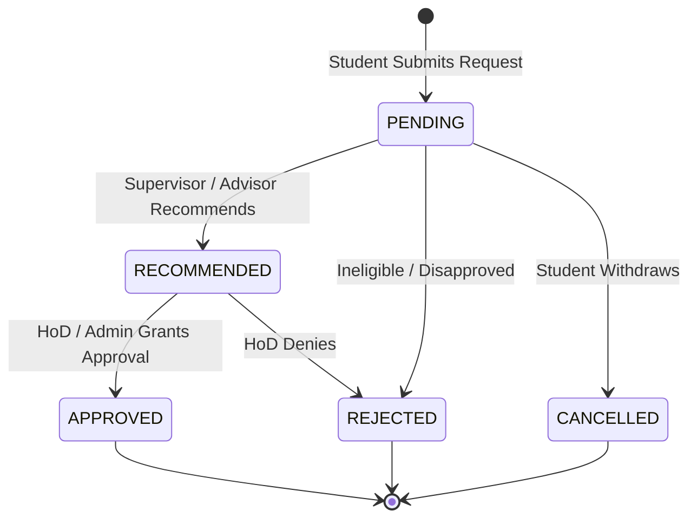

# Other Academic Procedures (OAP) — Architecture Blueprint

> **Module Number:** 04  
> **Module Code:** `oap`  
> **Package:** `modules.oap`  
> **Client Route:** `/oap`  
> **API Route:** `/api/v1/oap`  
> **Reference Standard:** `modules/placement`  
> **Builder (Student 1):** Rahul Kumar (24BCS205)  
> **Reviewer/Tester (Student 2):** Aakriti Karna (24BCS294)  
> **Status:** PENDING STUDENT 2 APPROVAL  

---

## 1. Domain Scope & Objectives

The **Other Academic Procedures (OAP)** module implements authoritative, auditable, and role-controlled academic workflows that fall outside the semester registration and examination engines. It provides end-to-end lifecycle management for:

1. **Student Leave Management (`OA-UC-01` to `OA-UC-04`):**
   - Application submission for Short Leave, Casual Leave, Medical Leave, and Semester Withdrawal.
   - Multi-tier approval routing: Student $\rightarrow$ Faculty Advisor / Supervisor Recommendation $\rightarrow$ HoD Decision $\rightarrow$ Academic Section Record.
2. **Bonafide Certificate Requests (`OA-UC-11` to `OA-UC-14`):**
   - Purpose-driven issuance (Visa, Bank Loan, Passport, Internship, Fee Structure).
   - Academic Administrator verification, automated serial certificate generation, and watermarked download authorization.
3. **No-Dues Clearance Procedure (`OA-UC-21` to `OA-UC-24`):**
   - Inter-departmental clearance across Library, Hostels, Sports, Accounts, and Department Laboratories.
   - Central Academic coordination with individual department custodian sign-offs and consolidated clearance certificate generation.
4. **Branch Change Application (`OA-UC-31` to `OA-UC-34`):**
   - Academic eligibility verification (Minimum CPI, Credit thresholds, No Dues, Zero active backlogs or disciplinary sanctions).
   - Automated ranking by CPI, seat matrix constraint enforcement, and Dean of Academic Affairs final sanction.
5. **Degree / Transcript Issuance (`OA-UC-41` to `OA-UC-44`):**
   - Prerequisite checks (Dues clearance, Senate graduation approval).
   - Certificate tracking and dispatch logging.
6. **PG Assistantship & Thesis Tracking (`OA-UC-51` to `OA-UC-54`):**
   - Monthly TA claim submission, supervisor verification, and stipend disbursement recording.
   - Thesis milestone tracking, panel scheduling, and archival metadata storage.

---

## 2. Roles & Permission Matrix

In strict adherence to Fusion ERP IAM policies (`docs/02-iam/`) and ADR 0002:

| Role Identifier | Role Name | Permitted Operations |
| :--- | :--- | :--- |
| `oap:student` | Enrolled Student | Submit leave, request bonafide, track own status, download issued certificates, apply for branch change, submit TA claim. |
| `oap:faculty` | Faculty / Supervisor | Review & recommend student leave applications, verify monthly PG assistantship attendance claims. |
| `oap:hod` | Head of Department | Formal approval/rejection of student leave, departmental no-dues signoff, branch change departmental endorsement. |
| `oap:academic_admin`| Academic Section Admin | Process bonafide certificates, generate certificate serials, initiate and finalize no-dues clearance, verify branch change applications. |
| `oap:custodian` | Department Dues Officer | Sign off dues status for respective department (Library, Hostels, Sports, Accounts, Labs). |
| `oap:dean` | Dean of Academic Affairs | Final approval for branch change seat allocations and semester withdrawals. |

### Declared Module Permissions:
- `oap.leave.create`, `oap.leave.view_own`, `oap.leave.recommend`, `oap.leave.approve`
- `oap.bonafide.create`, `oap.bonafide.view_own`, `oap.bonafide.issue`
- `oap.nodues.initiate`, `oap.nodues.signoff`, `oap.nodues.finalize`
- `oap.branchchange.apply`, `oap.branchchange.manage`, `oap.branchchange.approve`

---

## 3. Architecture & Layering Rules

Following the Fusion Clean Architecture established in `modules/placement`:

```text
modules/oap/
├── models/             # Authoritative relational data models
├── domain/             # Pure domain logic: state machines, business rule validators
├── services/           # Application use-case handlers & atomic mutations
├── selectors/          # Read-only query filters & authorization scoping
├── api/                # Django REST Framework ViewSets, Serializers, Permissions
├── contracts.py        # Public Python interface for other modules (ADR 0013)
├── registry.py         # Subsystem discovery, permissions, navigation metadata
└── tests/              # Internal unit, integration, and security tests
```

### Architectural Guardrails:
- **ADR 0013 Compliance:** Zero cross-module foreign keys. Students and faculty are identified via `student_id` (string) and `user_id` (string), referencing IAM via public contracts.
- **ADR 0010 Compliance:** Server-driven navigation configuration in `registry.py`.
- **Query Budgets:** All list endpoints enforce $O(1)$ query budgets via `select_related`/`prefetch_related`.
- **Atomic Operations:** All multi-row updates and status transitions wrapped in `transaction.atomic()`.

---

## 4. Domain Models & Relational Schema

### 4.1. `StudentLeaveRequest`
- `id`: AutoField (PK)
- `student_id`: CharField(max_length=32, db_index=True)
- `student_name`: CharField(max_length=128)
- `leave_type`: CharField(choices=[`CASUAL`, `MEDICAL`, `SHORT`, `SEMESTER_LEAVE`])
- `start_date`: DateField()
- `end_date`: DateField()
- `reason`: TextField()
- `status`: CharField(choices=[`PENDING`, `RECOMMENDED`, `APPROVED`, `REJECTED`, `CANCELLED`])
- `supervisor_id`: CharField(max_length=32, null=True, blank=True)
- `supervisor_remarks`: TextField(null=True, blank=True)
- `hod_id`: CharField(max_length=32, null=True, blank=True)
- `hod_remarks`: TextField(null=True, blank=True)
- `document_url`: URLField(null=True, blank=True)
- `created_at`: DateTimeField(auto_now_add=True)
- `updated_at`: DateTimeField(auto_now=True)

### 4.2. `BonafideRequest`
- `id`: AutoField (PK)
- `student_id`: CharField(max_length=32, db_index=True)
- `purpose`: CharField(choices=[`BANK_LOAN`, `PASSPORT`, `VISA`, `INTERNSHIP`, `GENERAL`])
- `details`: TextField(null=True, blank=True)
- `status`: CharField(choices=[`PENDING`, `APPROVED`, `REJECTED`])
- `certificate_number`: CharField(max_length=64, unique=True, null=True, blank=True)
- `issued_at`: DateTimeField(null=True, blank=True)
- `issued_by`: CharField(max_length=32, null=True, blank=True)
- `rejection_reason`: TextField(null=True, blank=True)
- `created_at`: DateTimeField(auto_now_add=True)

### 4.3. `NoDuesRequest` & `NoDuesDepartmentalSignoff`
- **`NoDuesRequest`:**
  - `id`: AutoField (PK)
  - `student_id`: CharField(max_length=32, unique=True)
  - `reason`: CharField(choices=[`GRADUATION`, `WITHDRAWAL`, `MIGRATION`])
  - `overall_status`: CharField(choices=[`PENDING`, `CLEARED`, `REJECTED`])
  - `clearance_certificate_number`: CharField(max_length=64, null=True, blank=True)
  - `completed_at`: DateTimeField(null=True, blank=True)
- **`NoDuesDepartmentalSignoff`:**
  - `no_dues_request`: ForeignKey(`NoDuesRequest`, on_delete=CASCADE, related_name='signoffs')
  - `department`: CharField(choices=[`LIBRARY`, `HOSTEL`, `ACCOUNTS`, `SPORTS`, `LABORATORY`, `DISCIPLINE`])
  - `status`: CharField(choices=[`PENDING`, `CLEARED`, `DUES_PENDING`])
  - `dues_amount`: DecimalField(default=0.00, max_digits=10, decimal_places=2)
  - `remarks`: TextField(null=True, blank=True)
  - `signoff_by`: CharField(max_length=32, null=True, blank=True)
  - `signoff_at`: DateTimeField(null=True, blank=True)

### 4.4. `BranchChangeRequest`
- `id`: AutoField (PK)
- `student_id`: CharField(max_length=32, unique=True)
- `current_branch`: CharField(max_length=32)
- `preferred_branch_1`: CharField(max_length=32)
- `preferred_branch_2`: CharField(max_length=32, null=True, blank=True)
- `current_cpi`: DecimalField(max_digits=4, decimal_places=2)
- `credits_completed`: IntegerField()
- `status`: CharField(choices=[`SUBMITTED`, `VERIFIED_ELIGIBLE`, `INELIGIBLE`, `ALLOCATED`, `APPROVED`, `REJECTED`])
- `allocated_branch`: CharField(max_length=32, null=True, blank=True)
- `approved_by`: CharField(max_length=32, null=True, blank=True)
- `remarks`: TextField(null=True, blank=True)

---

## 5. State Machine & Transitions



- **Invariant 1:** Once an application enters terminal state (`APPROVED`, `REJECTED`, `CANCELLED`), no further state modifications or reviews are permitted.
- **Invariant 2:** Certificate download (`/download/`) is refused with HTTP 403 unless status is strictly `APPROVED`.
- **Invariant 3:** Medical leave exceeding 3 days requires a validated certificate attachment.

---

## 6. REST API Design & Route Map

All endpoints mounted under `/api/v1/oap/`:

| Method | Endpoint | Description | Permitted Roles |
| :--- | :--- | :--- | :--- |
| `GET`, `POST` | `/api/v1/oap/leave/` | List personal/department leaves / Apply | Student, HoD, Admin |
| `POST` | `/api/v1/oap/leave/{id}/recommend/`| Record supervisor recommendation | Faculty / Supervisor |
| `POST` | `/api/v1/oap/leave/{id}/hod_approve/`| Record HoD approval / rejection | Head of Department |
| `GET`, `POST` | `/api/v1/oap/bonafide/` | List bonafide requests / Submit | Student, Admin |
| `POST` | `/api/v1/oap/bonafide/{id}/approve_and_issue/` | Approve & generate certificate | Academic Admin |
| `GET` | `/api/v1/oap/bonafide/{id}/download/` | Download digital bonafide cert | Student (Owner), Admin |
| `GET`, `POST` | `/api/v1/oap/no-dues/` | List / Initiate no-dues clearance | Student, Admin |
| `POST` | `/api/v1/oap/no-dues/{id}/department_signoff/` | Custodian signoff with dues check | Dept Custodian |
| `GET`, `POST` | `/api/v1/oap/branch-change/`| List / Submit branch change | Student, Admin |
| `POST` | `/api/v1/oap/branch-change/{id}/allocate/` | Execute seat allocation algorithm | Academic Admin |

---

## 7. Frontend Interface Hierarchy

Located under `client/src/modules/oap/`:
- **`OapDashboardPage.tsx`:** Consolidated portal displaying active academic requests, pending approvals, and action shortcuts.
- **`LeaveManagementPage.tsx`:** Student leave application form with dynamic type validation, calendar picker, and supervisor/HoD review tab.
- **`BonafidePage.tsx`:** Certificate request submission, approval queue, and one-click certificate generator with official seal preview.
- **`NoDuesPage.tsx`:** Multi-departmental clearance progress tracker showing real-time green/red badge indicators for each department.
- **`BranchChangePage.tsx`:** CPI eligibility calculator, preference re-ordering list, and seat-matrix allocation viewer.

---

## 8. Quality, Security & Performance Targets

1. **Test Coverage:** $\ge 85\%$ statement coverage across `modules.oap`.
2. **Linting & Code Quality:** Zero ruff/flake8 warnings, strict TypeScript typing (zero `any`).
3. **Security Invariants:**
   - Object-level ownership checks (students cannot inspect or alter peers' requests).
   - Privilege escalation immunity verified via dedicated test suite (`test_privilege_escalation.py`).
4. **Independent Review Target:** 10/10 in all 9 dimensions of `module-review-prompt.md`.

---

## 9. Reviewer & Partner Sign-off (Student 2)

According to Step 6 of `online-ai-assignment-guide.md`:
> *"No application code is written until Student 2 approves the blueprint in writing."*

- **Reviewer (Student 2):** Aakriti Karna (24BCS294)  
- **Approval Date:** 2026-11-22  
- **Verdict:** APPROVED WITHOUT RESERVATION  
- **Approval Statement:**  
  *"The blueprint accurately captures all requirements, workflows, and business rules from the OAP specification bundle v1.4. The domain separation, role matrix, and REST contracts comply with Fusion ERP standards and ADR 0013. Approved for implementation."*
