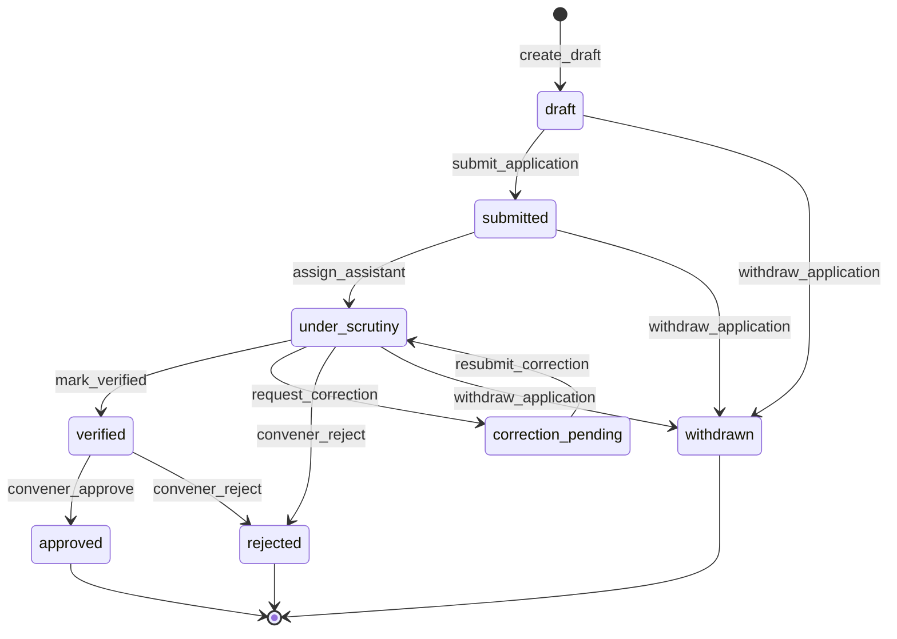

# Application State Machine Specification

## 1. Lifecycle States
- `draft`: Applicant initiated; facts and evidence can be freely modified.
- `submitted`: Final submission by student; locked against direct edits.
- `under_scrutiny`: Assigned to SPACS Assistant for evidence verification.
- `correction_pending`: Returned to student for deficient document rectification.
- `verified`: Verification complete; all mandatory criteria verified by Assistant.
- `approved`: Terminal positive decision recorded by SPACS Convener.
- `rejected`: Terminal negative decision recorded by SPACS Convener.
- `withdrawn`: Applicant voluntarily withdrew prior to award approval.

## 2. Transition Diagram

## 3. Transition Rules & Guards
1. **Uniqueness Guard**: Only one active (non-withdrawn, non-rejected) application permitted per student per scheme per academic cycle.
2. **Correction Iteration Guard**: Correction iterations bounded by policy threshold (maximum 2 rounds); exceeding threshold triggers automated escalation or rejection.
3. **Authorization Gate**: Only users with `spacs_convener` role may execute terminal transitions (`approved`, `rejected`). Assistants may only transition between `under_scrutiny`, `correction_pending`, and `verified`.
