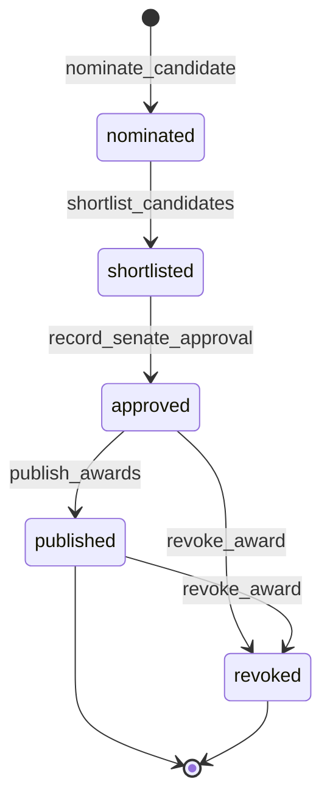

# Award State Machine Specification

## 1. Lifecycle States
- `nominated`: Candidate nominated by department, faculty, or automated academic criteria query.
- `shortlisted`: Filtered candidate meeting preliminary CPI and departmental clearance gates.
- `approved`: Formally approved by Director / Senate with recorded institutional reference.
- `published`: Publicly disseminated on portal and convocation bulletin.
- `revoked`: Post-approval sanction revoked due to disciplinary or academic breach.

## 2. Transition Diagram

## 3. Transition Guards
1. **Committee Quorum Guard**: Evaluation scores require minimum active committee member participation. Scores must strictly reside in [0, 100].
2. **Senate Clearance Guard**: Transition from `shortlisted` to `approved` requires a non-empty `approval_reference` matching Senate resolution conventions.
3. **Publication Lock**: Award outcomes cannot be modified once in `published` status.
