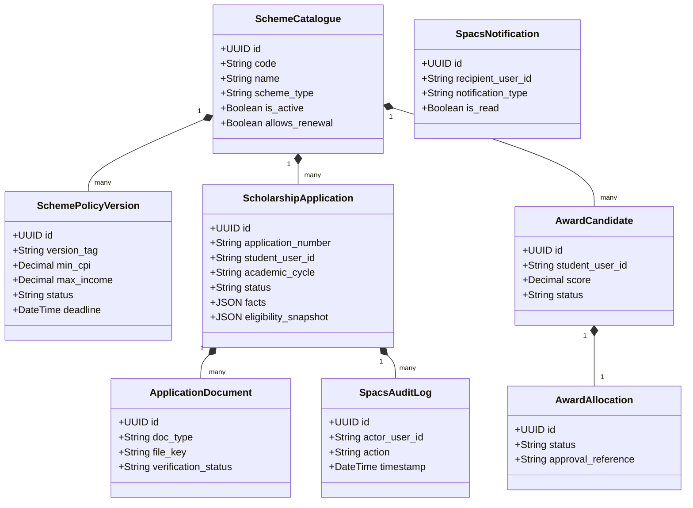

# SPACS Domain Model

## 1. Overview
The Awards and Scholarships (`spacs`) module manages institute-administered financial aid opportunities, merit scholarships, and convocation awards within Fusion ERP. It provides digital workflows for catalog publishing, policy-driven application submission, evidence verification, committee evaluation, Senate/Director approval tracking, and immutable audit logging.

## 2. Core Aggregates and Entities

### 2.1 SchemeCatalogue & SchemePolicyVersion
- **SchemeCatalogue**: The root definition of an institutional scholarship or award opportunity (e.g. Merit-cum-Means, Director's Gold Medal, Convocation Proficiency Prize).
- **SchemePolicyVersion**: Immutable versioned parameters governing eligibility criteria, financial ceilings, evaluation weightages, and submission windows. Changes to scheme rules require issuing a new policy version without altering past application baselines.

### 2.2 ScholarshipApplication & ApplicationDocument
- **ScholarshipApplication**: Represents a student's submission for a scholarship in a given academic cycle. Contains applicant declarations (`facts`), system evaluation results (`eligibility_snapshot`), and lifecycle status.
- **ApplicationDocument**: Uploaded certified evidence (income certificate, caste certificate, grade card) linked to an application, subject to assistant verification and cryptographic storage key references.

### 2.3 AwardCandidate & AwardAllocation
- **AwardCandidate**: Candidates nominated for competitive convocation medals and awards. Supports multi-member committee scoring and ranking.
- **AwardAllocation**: Final allocation record requiring Senate or Board approval reference before public dissemination.

### 2.4 Audit & Notifications
- **SpacsAuditLog**: Append-only compliance log capturing actor ID, event type, prior state, new state, and timestamp for all lifecycle transitions.
- **SpacsNotification**: Multi-channel outbox recording messages sent to students, assistants, conveners, and committee members.
