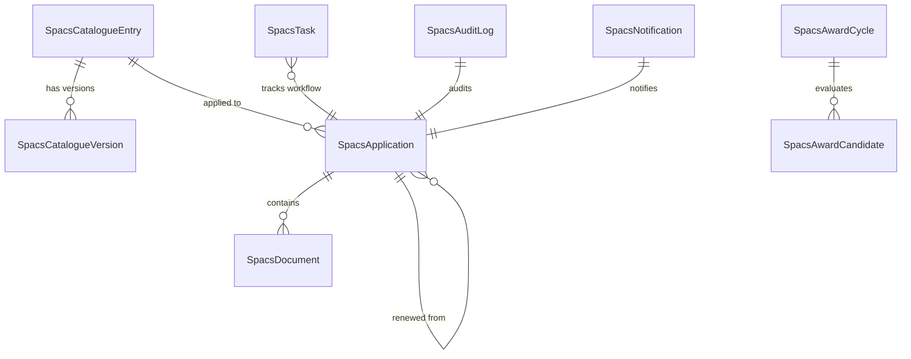

# SPACS Domain Model — Module 4: Awards and Scholarships

This document describes the persistence models, database constraints, relationships, and integrity rules implemented in `modules/spacs/models/__init__.py`.

## Entity-Relationship Diagram

## Entity Details

### 1. `SpacsCatalogueEntry` (`spacs_catalogue_entry`)
Stores scholarship and award schemes configured by the Convener.

| Column | Type | Constraints | Description |
| :--- | :--- | :--- | :--- |
| `id` | BigAutoField | PRIMARY KEY | Internal ID |
| `scheme_code` | VARCHAR(64) | UNIQUE, NOT NULL | Unique scheme identifier (e.g. `MCM-2026`) |
| `name` | VARCHAR(255) | NOT NULL | Human-readable scheme name |
| `scheme_type` | VARCHAR(32) | NOT NULL | `scholarship`, `award`, or `financial_aid` |
| `description` | TEXT | BLANK | Scheme description and benefits |
| `status` | VARCHAR(32) | DEFAULT 'draft' | `draft`, `published`, or `retired` |
| `version` | INTEGER | DEFAULT 1 | Version counter |
| `min_cpi` | DECIMAL(4, 2) | DEFAULT 0.00 | Minimum academic CPI cutoff |
| `max_family_income` | DECIMAL(12, 2) | NULLABLE | Maximum annual household income limit |
| `application_window_start` | TIMESTAMPTZ | NULLABLE | Start of application window |
| `application_window_end` | TIMESTAMPTZ | NULLABLE | End of application window |
| `renewal_allowed` | BOOLEAN | DEFAULT FALSE | Whether scheme permits renewals |
| `renewal_window_start` | TIMESTAMPTZ | NULLABLE | Renewal application opening |
| `renewal_window_end` | TIMESTAMPTZ | NULLABLE | Renewal application deadline |
| `required_documents` | JSONB | DEFAULT [] | List of required document types |
| `policy_approval_ref` | VARCHAR(128) | BLANK | Reference to Senate/BOG approval resolution |
| `created_by_user_id` | INTEGER | NOT NULL | Staff user ID who created entry |
| `created_at` | TIMESTAMPTZ | DEFAULT NOW() | Creation timestamp |
| `updated_at` | TIMESTAMPTZ | AUTO_NOW | Last modified timestamp |

### 2. `SpacsCatalogueVersion` (`spacs_catalogue_version`)
Immutable historical snapshots of catalogue criteria at each publication.

| Column | Type | Constraints | Description |
| :--- | :--- | :--- | :--- |
| `id` | BigAutoField | PRIMARY KEY | Internal ID |
| `catalogue_entry_id` | BIGINT | FK -> `spacs_catalogue_entry` | Parent scheme |
| `version` | INTEGER | NOT NULL | Scheme version at snapshot time |
| `min_cpi` | DECIMAL(4, 2) | NOT NULL | Minimum CPI at this version |
| `max_family_income` | DECIMAL(12, 2) | NULLABLE | Maximum income at this version |
| `required_documents` | JSONB | DEFAULT [] | Required documents list |
| `policy_approval_ref` | VARCHAR(128) | NOT NULL | Senate resolution reference |
| `effective_from` | DATE | NOT NULL | Effective start date |
| `effective_to` | DATE | NULLABLE | Effective end date |
| `created_at` | TIMESTAMPTZ | DEFAULT NOW() | Snapshot creation time |

*Unique Constraint*: `('catalogue_entry_id', 'version')`.

### 3. `SpacsApplication` (`spacs_application`)
Scholarship applications submitted by students.

| Column | Type | Constraints | Description |
| :--- | :--- | :--- | :--- |
| `id` | BigAutoField | PRIMARY KEY | Internal DB ID |
| `application_id` | VARCHAR(64) | UNIQUE, NOT NULL | External UUID reference ID |
| `catalogue_entry_id` | BIGINT | FK -> `spacs_catalogue_entry` | Scheme applied for |
| `catalogue_version` | INTEGER | DEFAULT 1 | Scheme version locked at submission |
| `applicant_user_id` | INTEGER | INDEX, NOT NULL | Enrolled student ID |
| `academic_cycle` | VARCHAR(32) | NOT NULL | Academic year (e.g. `2026-27`) |
| `state` | VARCHAR(32) | DEFAULT 'draft' | Lifecycle state machine status |
| `is_renewal` | BOOLEAN | DEFAULT FALSE | Whether this is a renewal |
| `parent_application_id` | BIGINT | NULLABLE, FK -> self | Prior application if renewal |
| `cpi` | DECIMAL(4, 2) | NULLABLE | Student's reported/verified CPI |
| `family_income` | DECIMAL(12, 2) | NULLABLE | Student's annual family income |
| `application_data` | JSONB | DEFAULT {} | Application payload & form fields |
| `verification_notes` | TEXT | BLANK | Assistant audit & review notes |
| `verification_checklist` | JSONB | DEFAULT {} | Authenticity checklist responses |
| `defect_notes` | TEXT | BLANK | Reason for correction request |
| `decision_actor_user_id` | INTEGER | NULLABLE | Convener who made final decision |
| `decision_reason` | TEXT | BLANK | Reason for decision (mandatory on rejection) |
| `submitted_at` | TIMESTAMPTZ | NULLABLE | Timestamp of submission |
| `decision_at` | TIMESTAMPTZ | NULLABLE | Timestamp of final decision |
| `created_at` | TIMESTAMPTZ | DEFAULT NOW() | Record creation timestamp |
| `updated_at` | TIMESTAMPTZ | AUTO_NOW | Record update timestamp |

### 4. `SpacsDocument` (`spacs_document`)
Supporting uploaded documents attached to applications.

| Column | Type | Constraints | Description |
| :--- | :--- | :--- | :--- |
| `id` | BigAutoField | PRIMARY KEY | Internal ID |
| `application_id` | BIGINT | FK -> `spacs_application` | Associated application |
| `user_id` | INTEGER | INDEX, NOT NULL | Uploader / owner student ID |
| `document_type` | VARCHAR(64) | NOT NULL | Type (income, caste, grade sheet, etc.) |
| `file_path` | VARCHAR(512) | NOT NULL | Secure storage path |
| `valid_until` | DATE | NULLABLE | Expiry / revalidation date |
| `is_verified` | BOOLEAN | DEFAULT FALSE | Assistant authenticity flag |
| `uploaded_at` | TIMESTAMPTZ | DEFAULT NOW() | Upload timestamp |

### 5. `SpacsAwardCycle` (`spacs_award_cycle`)
Manages annual convocation awards and prize nomination cycles.

| Column | Type | Constraints | Description |
| :--- | :--- | :--- | :--- |
| `id` | BigAutoField | PRIMARY KEY | Internal ID |
| `scheme_code` | VARCHAR(64) | NOT NULL | Associated award scheme code |
| `academic_cycle` | VARCHAR(32) | NOT NULL | Academic year |
| `state` | VARCHAR(32) | DEFAULT 'open' | Lifecycle state |
| `convener_user_id` | INTEGER | NOT NULL | Convener in charge |
| `approval_evidence` | VARCHAR(255) | BLANK | BOG/Senate approval resolution ref |
| `created_at` | TIMESTAMPTZ | DEFAULT NOW() | Creation timestamp |
| `published_at` | TIMESTAMPTZ | NULLABLE | Publication timestamp |

*Unique Constraint*: `('scheme_code', 'academic_cycle')`.

### 6. `SpacsAwardCandidate` (`spacs_award_candidate`)
Shortlisted or nominated candidates evaluated for a convocation award.

| Column | Type | Constraints | Description |
| :--- | :--- | :--- | :--- |
| `id` | BigAutoField | PRIMARY KEY | Internal ID |
| `award_cycle_id` | BIGINT | FK -> `spacs_award_cycle` | Associated cycle |
| `student_user_id` | INTEGER | INDEX, NOT NULL | Candidate student ID |
| `cpi` | DECIMAL(4, 2) | DEFAULT 0.00 | Student academic CPI |
| `academic_standing` | VARCHAR(64) | DEFAULT 'good' | Conduct / academic standing |
| `shortlisted` | BOOLEAN | DEFAULT FALSE | Committee shortlist indicator |
| `evaluation_score` | DECIMAL(5, 2) | NULLABLE | Committee numerical score |
| `committee_recommendation` | VARCHAR(64) | BLANK | Recommendation (`winner`, `runner_up`, etc.) |
| `remarks` | TEXT | BLANK | Evaluation remarks |

*Unique Constraint*: `('award_cycle_id', 'student_user_id')`.

### 7. `SpacsAuditLog` (`spacs_audit_log`)
Immutable append-only audit trail for compliance and governance (BR-SPACS-021).

| Column | Type | Constraints | Description |
| :--- | :--- | :--- | :--- |
| `id` | BigAutoField | PRIMARY KEY | Internal ID |
| `event_type` | VARCHAR(64) | NOT NULL | Event name |
| `entity_type` | VARCHAR(64) | NOT NULL | `application`, `scheme`, `award`, `task` |
| `entity_id` | VARCHAR(64) | NOT NULL | Reference ID of target entity |
| `actor_user_id` | INTEGER | NOT NULL | ID of acting user |
| `details` | JSONB | DEFAULT {} | Event payload & parameters |
| `timestamp` | TIMESTAMPTZ | DEFAULT NOW() | Immutable event timestamp |

*Protection*: Overridden `save()` and `delete()` prevent any update or removal of saved records.
