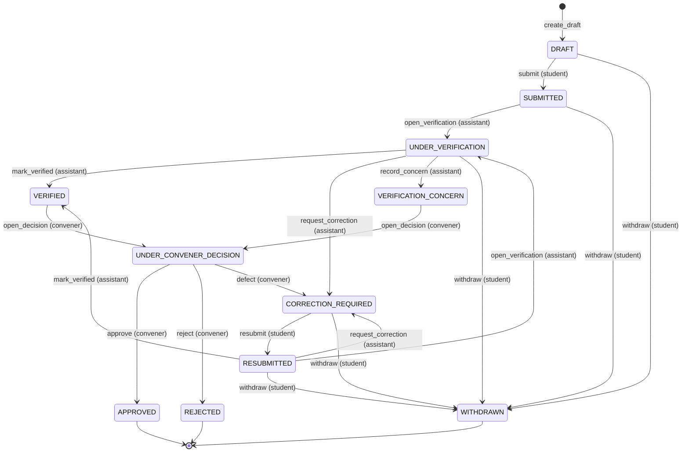
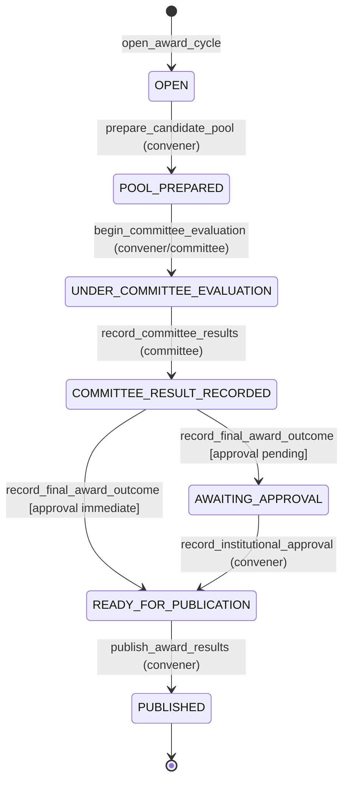

# SPACS State Machine Specifications — Module 4: Awards and Scholarships

This document specifies the declarative finite state machines governing the lifecycles of scholarship applications and convocation award cycles in `modules/spacs/domain/state_machine.py`.

## Application State Machine

### Complete Declarative Transition Table

| Source State | Action / Event | Target State | Actor Role | Spec Obligation |
| :--- | :--- | :--- | :--- | :--- |
| `draft` | `submit` | `submitted` | `student` | `BW-SPACS-01` |
| `draft` | `submit_renewal` | `submitted` | `student` | `BW-SPACS-06` |
| `draft` | `withdraw` | `withdrawn` | `student` | `BW-SPACS-05` |
| `submitted` | `open_verification` | `under_verification` | `spacs_assistant` | `BW-SPACS-01` |
| `submitted` | `withdraw` | `withdrawn` | `student` | `BW-SPACS-05` |
| `under_verification` | `mark_verified` | `verified` | `spacs_assistant` | `BW-SPACS-01` |
| `under_verification` | `request_correction` | `correction_required` | `spacs_assistant` | `BW-SPACS-02` |
| `under_verification` | `record_concern` | `verification_concern` | `spacs_assistant` | `BW-SPACS-04` |
| `under_verification` | `withdraw` | `withdrawn` | `student` | `BW-SPACS-05` |
| `correction_required` | `resubmit` | `resubmitted` | `student` | `BW-SPACS-02` |
| `correction_required` | `withdraw` | `withdrawn` | `student` | `BW-SPACS-05` |
| `resubmitted` | `open_verification` | `under_verification` | `spacs_assistant` | `BW-SPACS-02` |
| `resubmitted` | `mark_verified` | `verified` | `spacs_assistant` | `BW-SPACS-02` |
| `resubmitted` | `request_correction` | `correction_required` | `spacs_assistant` | `BW-SPACS-02` |
| `resubmitted` | `withdraw` | `withdrawn` | `student` | `BW-SPACS-05` |
| `verified` | `open_decision` | `under_convener_decision` | `spacs_convener` | `BW-SPACS-03` |
| `verification_concern` | `open_decision` | `under_convener_decision` | `spacs_convener` | `BW-SPACS-04` |
| `under_convener_decision` | `approve` | `approved` | `spacs_convener` | `BW-SPACS-03` |
| `under_convener_decision` | `reject` | `rejected` | `spacs_convener` | `BW-SPACS-04` |
| `under_convener_decision` | `defect` | `correction_required` | `spacs_convener` | `BW-SPACS-04` |

---

## Award Cycle State Machine

### Complete Award Declarative Transition Table

| Source State | Action / Event | Target State | Actor Role | Spec Obligation |
| :--- | :--- | :--- | :--- | :--- |
| `open` | `prepare_pool` | `pool_prepared` | `spacs_convener` | `BW-SPACS-08` |
| `pool_prepared` | `evaluate` | `under_committee_evaluation` | `spacs_committee_member` | `BW-SPACS-08` |
| `pool_prepared` | `evaluate` | `under_committee_evaluation` | `spacs_convener` | `BW-SPACS-08` |
| `under_committee_evaluation` | `record_results` | `committee_result_recorded` | `spacs_committee_member` | `BW-SPACS-08` |
| `under_committee_evaluation` | `record_results` | `committee_result_recorded` | `spacs_convener` | `BW-SPACS-08` |
| `committee_result_recorded` | `submit_for_approval` | `ready_for_publication` | `spacs_convener` | `BW-SPACS-09` |
| `committee_result_recorded` | `submit_pending_approval` | `awaiting_approval` | `spacs_convener` | `BW-SPACS-11` |
| `awaiting_approval` | `confirm_approval` | `ready_for_publication` | `spacs_convener` | `BW-SPACS-11` |
| `ready_for_publication` | `publish` | `published` | `spacs_convener` | `BW-SPACS-09` |

---

## Enforcement Principles

1. **Inexpressibility of Illegal Transitions**: Transition resolution is strictly looked up against frozen tuple sets (`APPLICATION_TRANSITIONS` and `AWARD_TRANSITIONS`). No fallback or implicit state changes exist; attempting an undeclared transition immediately raises `InvalidTransitionError`.
2. **Actor Role Verification**: The transition resolver validates the actor's authorized role against `actor_role` on the transition definition.
3. **Database Auditability**: Every state transition emits an immutable `SpacsAuditLog` record containing previous and new state, actor ID, and event payload.
