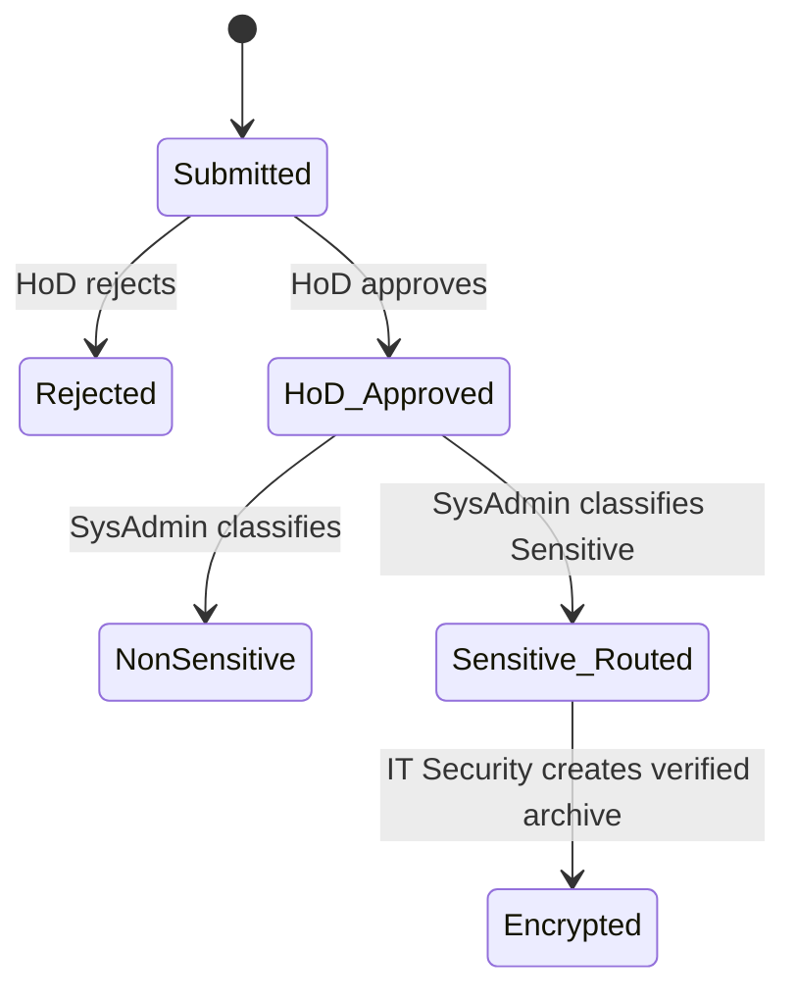

# BADMS state machines

The allowed transitions are implemented in `modules/badms/domain/transitions.py`. Services validate actor scope and transaction boundaries before persisting each transition. `next_state` rejects any unlisted action/state pair.

## Secure archive

| Current state | Action | Result |
|---|---|---|
| Submitted | HoD approves | HoD Approved |
| Submitted | HoD rejects | Rejected |
| HoD Approved | SysAdmin assigns Sensitive | Classified Sensitive / Routed to IT Security |
| HoD Approved | SysAdmin assigns another supported classification | Classified Non-Sensitive / Policy Applied |
| Classified Sensitive / Routed to IT Security | IT Security creates verified encrypted archive | Sensitive Archive Encrypted |

Classification assigns a retention deadline from the institute's policy map. If a classification has no valid configured duration, the operation fails closed. Sensitive archive creation requires the configured secure storage service and checksum verification.

## Restoration

| Current state | Condition/action | Result |
|---|---|---|
| Not requested | User requests non-Sensitive archive | Restoration Requested / Standard Path |
| Not requested | User requests Sensitive archive | Sensitive Restoration Pending Approval |
| Sensitive Restoration Pending Approval | SysAdmin rejects | Rejected |
| Sensitive Restoration Pending Approval | SysAdmin approves | Approved for Restoration |
| Restoration Requested / Standard Path | SysAdmin executes after checks | Restored |
| Approved for Restoration | SysAdmin executes after checks | Restored |

No separate HoD restoration approval is present; the current synchronized problem statement assigns approval for Sensitive restoration to SysAdmin.

## Storage extension

| Current state | HoD action | Result |
|---|---|---|
| Submitted | Reject | Rejected |
| Submitted | Approve | Approved |

Approval records the decision and sends the requester a notice. Post-approval storage allocation is outside the defined workflow.

## Backup run

Backup runs use `running`, `success`, or `failure`. A run begins when an authorized manual or scheduled task creates the record. It reaches success only after the artifact is saved and the stored SHA-256 matches the source; operational errors record failure and enqueue configured notifications.

## Diagram

