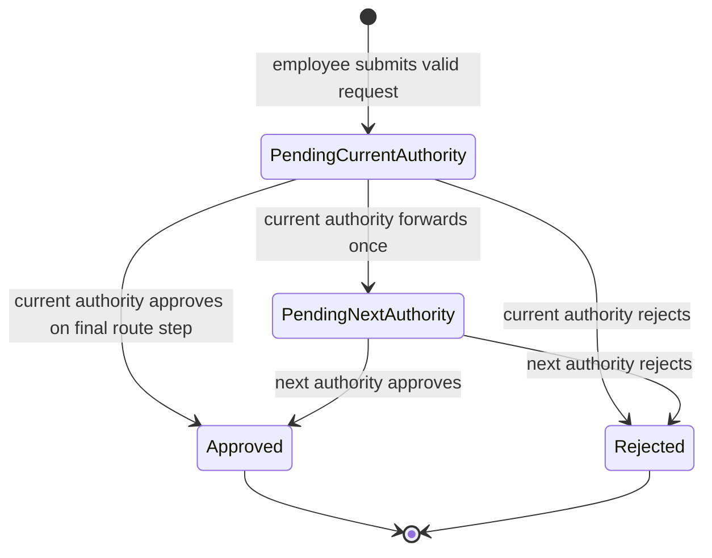

# HR-EIS leave state machine

The configured route has one authority for direct approval or rejection, or two authorities when the first authority forwards once. A route cannot contain more than two steps.

Submission validates the supported type, positive duration, justification, configured eligibility, available balance, and route. Approval deducts the duration transactionally and appends a ledger entry. Submission, forwarding, approval, rejection, and balance changes are audit events. No cancellation transition is specified or implemented.

Forwarding from `PendingNextAuthority` is refused; it is not a state transition.
