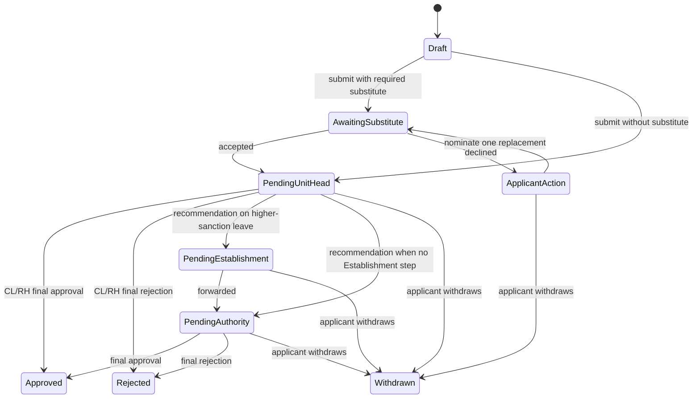

# Leave request workflow states

Each request has one status and a separate ordered set of workflow tasks. Only a pending task may be
acted on. Queued tasks are activated after the preceding review is recorded.

## New leave

A Unit Head's Not Recommended result on higher-sanction leave still routes to the next authority.
Director-applicant requests use the Director self-sanction task. Substitute response and workflow
task records are audited separately.

## Follow-up requests

| Request | Entry condition | Decision effect |
|---|---|---|
| Cancellation | Existing approved leave; before its start | Same applicable hierarchy. Approval marks the original cancelled and reverses its account debit; rejection preserves it. |
| Extension | Ongoing approved EL, COL, or VL | Same leave eligibility and route; approval posts only the incremental interval. |
| Resumption | Approved EL, COL, or VL; employee has returned | Original final authority reviews actual return date. Normal: no adjustment. Early/late: adjust to actual leave period. |
| Offline sanctioned entry | Authorized administrator has evidence of prior sanction | Direct account/history synchronization, without a second approval workflow. |

## Immediate withdrawal

Before final approval, the employee may withdraw at any time. The request becomes Withdrawn
immediately, every pending or queued workflow task is terminated, and remaining assigned reviewers
are notified. Stale actions fail because task and request state are checked inside the transaction.
