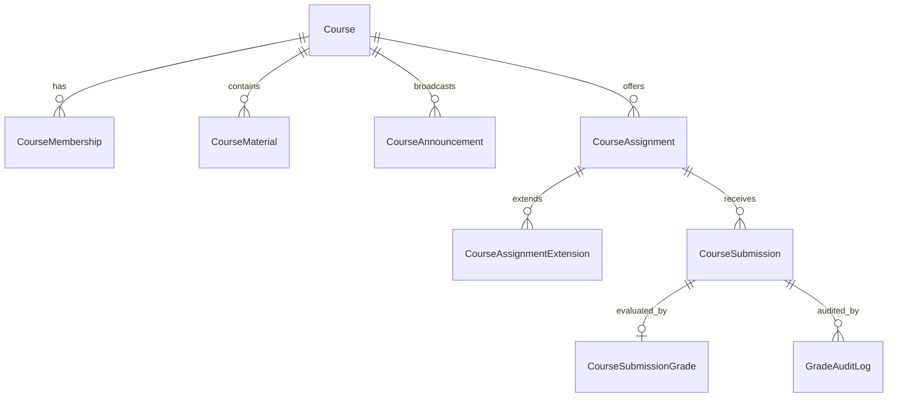

# LMS (Course Management) Domain Model

**Module Code**: `lms`  
**Standard**: Conforming to `docs/03-platform/platform-structure.md` and ADR-0013.

---

## 1. Entity Overview

---

## 2. Model Specifications

### 2.1 Course (`lms_course`)
- `code` (CharField, unique, primary key representation)
- `title` (CharField)
- `description` (TextField)
- `syllabus` (TextField)
- `schedule_info` (TextField)
- `status` (CharField: `draft`, `published`)

### 2.2 CourseMembership (`lms_course_membership`)
- `course` (ForeignKey -> Course)
- `user_id` (IntegerField, db_index=True)
- `role` (CharField: `faculty`, `ta`, `student`, `observer`)
- Unique constraint: `(course, user_id)`

### 2.3 CourseMaterial (`lms_course_material`)
- `course` (ForeignKey -> Course)
- `title` (CharField)
- `section_title` (CharField)
- `section_type` (CharField: `module`, `week`)
- `material_type` (CharField: `file`, `link`, `note`)
- `file` (FileField)
- `link_url` (URLField)
- `content_text` (TextField)
- `status` (CharField: `draft`, `published`, `scheduled`)
- `release_at` (DateTimeField, nullable)

### 2.4 CourseAnnouncement (`lms_course_announcement`)
- `course` (ForeignKey -> Course)
- `title` (CharField)
- `content` (TextField)
- `created_by_user_id` (IntegerField)
- `author_role` (CharField)

### 2.5 CourseAssignment (`lms_course_assignment`)
- `course` (ForeignKey -> Course)
- `title` (CharField)
- `instructions` (TextField)
- `submission_type` (CharField: `file`, `text`, `link`)
- `points_possible` (DecimalField, max_digits=6, decimal_places=2)
- `due_at` (DateTimeField)
- `release_at` (DateTimeField, nullable)
- `closes_at` (DateTimeField, nullable)
- `allow_late` (BooleanField, default=False)
- `status` (CharField: `draft`, `published`, `scheduled`)

### 2.6 CourseAssignmentExtension (`lms_course_assignment_extension`)
- `assignment` (ForeignKey -> CourseAssignment)
- `user_id` (IntegerField)
- `extended_due_at` (DateTimeField)
- `reason` (TextField)
- Unique constraint: `(assignment, user_id)`

### 2.7 CourseSubmission (`lms_course_submission`)
- `assignment` (ForeignKey -> CourseAssignment)
- `student_user_id` (IntegerField)
- `attempt_number` (IntegerField, default=1)
- `submission_type` (CharField)
- `file` (FileField)
- `content_text` (TextField)
- `link_url` (URLField)
- `submitted_at` (DateTimeField)
- `is_latest` (BooleanField, default=True)
- `status` (CharField: `submitted`, `evaluated`)

### 2.8 CourseSubmissionGrade (`lms_course_submission_grade`)
- `submission` (OneToOneField -> CourseSubmission)
- `assignment` (ForeignKey -> CourseAssignment)
- `student_user_id` (IntegerField)
- `score` (DecimalField, max_digits=6, decimal_places=2)
- `status` (CharField: `draft`, `released`)
- `graded_by_user_id` (IntegerField)
- `graded_at` (DateTimeField)

### 2.9 GradeAuditLog (`lms_grade_audit_log`)
- `submission` (ForeignKey -> CourseSubmission)
- `old_score` (DecimalField, max_digits=6, decimal_places=2)
- `new_score` (DecimalField, max_digits=6, decimal_places=2)
- `actor_user_id` (IntegerField)
- `created_at` (DateTimeField, auto_now_add=True)
