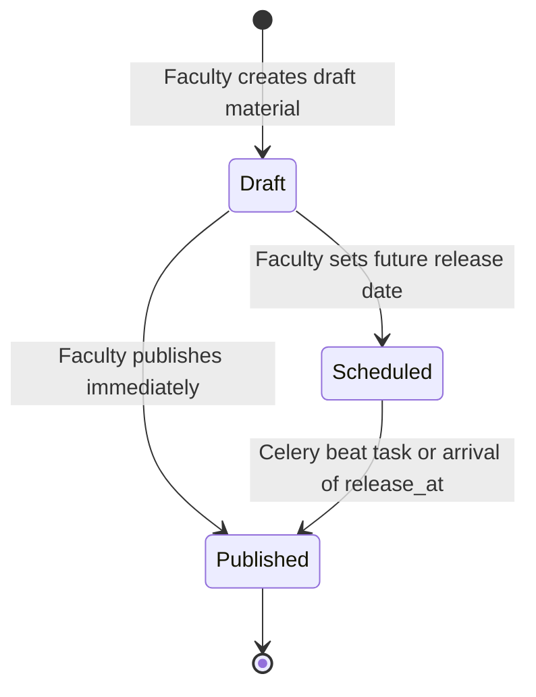
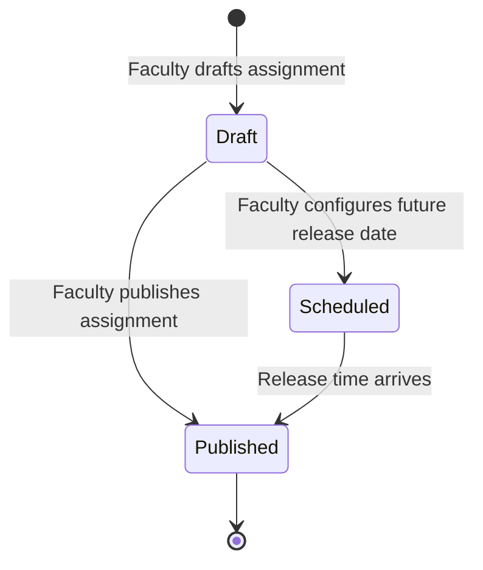
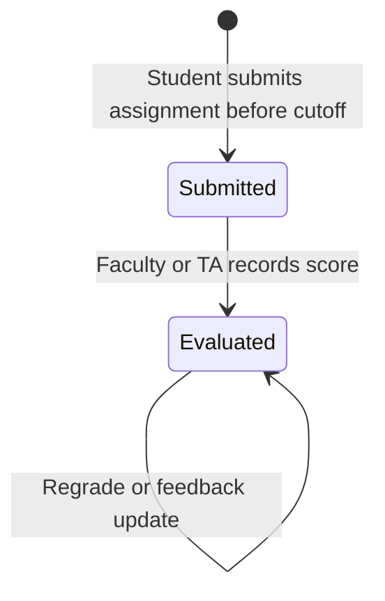
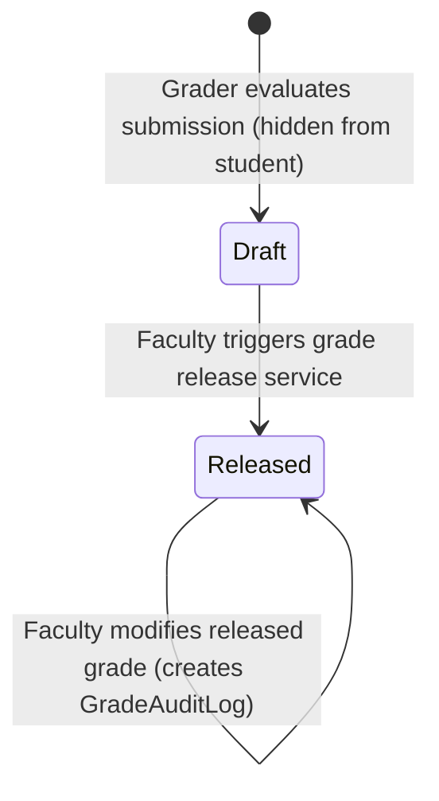

# LMS (Course Management) State Machines

**Module Code**: `lms`

---

## 1. Course Material Lifecycle

---

## 2. Course Assignment Lifecycle

---

## 3. Student Submission Lifecycle

---

## 4. Evaluation and Grade Release Lifecycle

