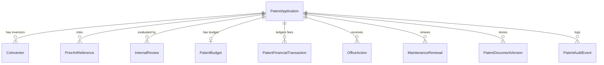
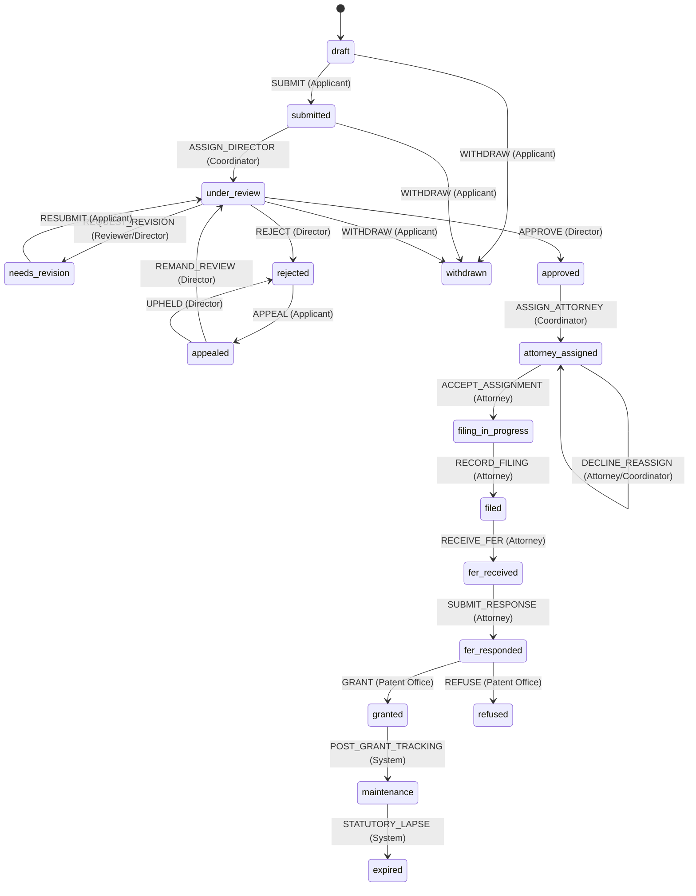

# Patent Management System (PMS) — Architecture Blueprint

**Module Code:** `pms`  
**Document Number:** `09-pms`  
**Author (Student 1 / Builder):** 24BCS031  
**Reviewer (Student 2 / Tester):** 24BCS037  
**Status:** Approved by Student 2  
**Environment:** `module-only`  
**Reference Module:** `modules/placement`  

---

## Step 3.1 (a) — Traceability Table

### Live Business Rules (84 Rules)
| Id | What it requires | Layer it belongs in | Enforcement point (planned) | Notes |
|:---|:---|:---|:---|:---|
| BR-PMS-003 | Reporting | Selector / Scoping | `modules.pms.selectors.scoping` | Strictly enforced | 
| BR-PMS-005 | Reporting | Selector / Scoping | `modules.pms.selectors.scoping` | Strictly enforced | 
| BR-PMS-006 | Oversight | Selector / Scoping | `modules.pms.selectors.scoping` | Strictly enforced | 
| BR-PMS-014 | Document validation | Domain / Storage | `modules.pms.services.documents` | Strictly enforced | 
| BR-PMS-015 | Document validation | Domain / Storage | `modules.pms.services.documents` | Strictly enforced | 
| BR-PMS-016 | Document validation | Domain / Storage | `modules.pms.services.documents` | Strictly enforced | 
| BR-PMS-017 | Application validation | Domain / Validation | `modules.pms.domain.validation` | Strictly enforced | 
| BR-PMS-020 | Agreement prerequisite | Domain / Validation | `modules.pms.domain.validation` | Strictly enforced | 
| BR-PMS-022 | Assignment | Service / Workflow | `modules.pms.services.attorney` | Strictly enforced | 
| BR-PMS-023 | Assignment rule | Service / Workflow | `modules.pms.services.attorney` | Strictly enforced | 
| BR-PMS-024 | Assignment rule | Service / Workflow | `modules.pms.services.attorney` | Strictly enforced | 
| BR-PMS-025 | Conflict of interest | Domain / Validation | `modules.pms.domain.validation` | Strictly enforced | 
| BR-PMS-026 | Conflict of interest | Domain / Validation | `modules.pms.domain.validation` | Strictly enforced | 
| BR-PMS-027 | Conflict of interest | Domain / Validation | `modules.pms.domain.validation` | Strictly enforced | 
| BR-PMS-029 | Decision | Service / Workflow | `modules.pms.services.reviews` | Strictly enforced | 
| BR-PMS-030 | Decision validation | Service / Workflow | `modules.pms.services.reviews` | Strictly enforced | 
| BR-PMS-031 | Review deadline | Service / Workflow | `modules.pms.services.reviews` | Strictly enforced | 
| BR-PMS-033 | Revision | Domain / Validation | `modules.pms.domain.validation` | Strictly enforced | 
| BR-PMS-034 | Revision | Domain / Validation | `modules.pms.domain.validation` | Strictly enforced | 
| BR-PMS-035 | Revision deadline | Domain / Validation | `modules.pms.domain.validation` | Strictly enforced | 
| BR-PMS-036 | Revision validation | Domain / Validation | `modules.pms.domain.validation` | Strictly enforced | 
| BR-PMS-038 | Status update | Domain / Validation | `modules.pms.domain.validation` | Strictly enforced | 
| BR-PMS-040 | Attorney assignment | Domain / Validation | `modules.pms.domain.validation` | Strictly enforced | 
| BR-PMS-041 | Attorney panel rule | Domain / Validation | `modules.pms.domain.validation` | Strictly enforced | 
| BR-PMS-042 | Assignment criterion | Service / Workflow | `modules.pms.services.attorney` | Strictly enforced | 
| BR-PMS-043 | Assignment criterion | Service / Workflow | `modules.pms.services.attorney` | Strictly enforced | 
| BR-PMS-044 | Conflict of interest | Domain / Validation | `modules.pms.domain.validation` | Strictly enforced | 
| BR-PMS-045 | Preference rule | Domain / Validation | `modules.pms.domain.validation` | Strictly enforced | 
| BR-PMS-046 | Opinion validation | Domain / Validation | `modules.pms.domain.validation` | Strictly enforced | 
| BR-PMS-048 | Budget data | Service / Ledger | `modules.pms.services.budget` | Strictly enforced | 
| BR-PMS-049 | Budget data | Service / Ledger | `modules.pms.services.budget` | Strictly enforced | 
| BR-PMS-050 | Budget data | Service / Ledger | `modules.pms.services.budget` | Strictly enforced | 
| BR-PMS-051 | Budget escalation | Service / Ledger | `modules.pms.services.budget` | Strictly enforced | 
| BR-PMS-052 | Budget approval rule | Service / Ledger | `modules.pms.services.budget` | Strictly enforced | 
| BR-PMS-053 | Budget validation | Service / Ledger | `modules.pms.services.budget` | Strictly enforced | 
| BR-PMS-055 | Format validation | Domain / Validation | `modules.pms.domain.validation` | Strictly enforced | 
| BR-PMS-056 | International filing rule | Domain / Validation | `modules.pms.domain.validation` | Strictly enforced | 
| BR-PMS-059 | Post-grant rule | Domain / Validation | `modules.pms.domain.validation` | Strictly enforced | 
| BR-PMS-060 | Maintenance schedule | Service / Schedule | `modules.pms.services.maintenance` | Strictly enforced | 
| BR-PMS-061 | Renewal decision rule | Service / Schedule | `modules.pms.services.maintenance` | Strictly enforced | 
| BR-PMS-065 | Response submission | Domain / Validation | `modules.pms.domain.validation` | Strictly enforced | 
| BR-PMS-066 | Deadline tracking | Domain / Validation | `modules.pms.domain.validation` | Strictly enforced | 
| BR-PMS-067 | Withdrawal | Domain / Validation | `modules.pms.domain.validation` | Strictly enforced | 
| BR-PMS-068 | Withdrawal validation | Domain / Validation | `modules.pms.domain.validation` | Strictly enforced | 
| BR-PMS-069 | Withdrawal validation | Domain / Validation | `modules.pms.domain.validation` | Strictly enforced | 
| BR-PMS-070 | Withdrawal consent | Domain / Validation | `modules.pms.domain.validation` | Strictly enforced | 
| BR-PMS-073 | Inventor validation | Domain / Validation | `modules.pms.domain.validation` | Strictly enforced | 
| BR-PMS-074 | Ownership validation | Domain / Validation | `modules.pms.domain.validation` | Strictly enforced | 
| BR-PMS-075 | Consent rule | Domain / Validation | `modules.pms.domain.validation` | Strictly enforced | 
| BR-PMS-076 | Electronic signature | Domain / Validation | `modules.pms.domain.validation` | Strictly enforced | 
| BR-PMS-077 | Electronic signature validation | Domain / Validation | `modules.pms.domain.validation` | Strictly enforced | 
| BR-PMS-078 | Agreement prerequisite | Domain / Validation | `modules.pms.domain.validation` | Strictly enforced | 
| BR-PMS-082 | Document versioning | Domain / Storage | `modules.pms.services.documents` | Strictly enforced | 
| BR-PMS-084 | Document access | Domain / Storage | `modules.pms.services.documents` | Strictly enforced | 
| BR-PMS-086 | Access control | Domain / Validation | `modules.pms.domain.validation` | Strictly enforced | 
| BR-PMS-087 | Document edit rule | Domain / Storage | `modules.pms.services.documents` | Strictly enforced | 
| BR-PMS-088 | Request routing | Domain / Validation | `modules.pms.domain.validation` | Strictly enforced | 
| BR-PMS-091 | License records | Domain / Validation | `modules.pms.domain.validation` | Strictly enforced | 
| BR-PMS-092 | Appeal | Domain / Validation | `modules.pms.domain.validation` | Strictly enforced | 
| BR-PMS-093 | Appeal deadline | Domain / Validation | `modules.pms.domain.validation` | Strictly enforced | 
| BR-PMS-094 | Appeal validation | Domain / Validation | `modules.pms.domain.validation` | Strictly enforced | 
| BR-PMS-095 | Appeal decision | Domain / Validation | `modules.pms.domain.validation` | Strictly enforced | 
| BR-PMS-097 | Deadline tracking | Domain / Validation | `modules.pms.domain.validation` | Strictly enforced | 
| BR-PMS-098 | Deadline tracking | Domain / Validation | `modules.pms.domain.validation` | Strictly enforced | 
| BR-PMS-099 | Deadline tracking | Domain / Validation | `modules.pms.domain.validation` | Strictly enforced | 
| BR-PMS-100 | Deadline tracking | Domain / Validation | `modules.pms.domain.validation` | Strictly enforced | 
| BR-PMS-101 | Deadline notification | Domain / Validation | `modules.pms.domain.validation` | Strictly enforced | 
| BR-PMS-102 | Deadline notification | Domain / Validation | `modules.pms.domain.validation` | Strictly enforced | 
| BR-PMS-103 | Deadline notification | Domain / Validation | `modules.pms.domain.validation` | Strictly enforced | 
| BR-PMS-104 | Escalation | Domain / Validation | `modules.pms.domain.validation` | Strictly enforced | 
| BR-PMS-116 | Scope boundary | Domain / Validation | `modules.pms.domain.validation` | Strictly enforced | 
| BR-PMS-121 | Audit log | Domain / Validation | `modules.pms.domain.validation` | Strictly enforced | 
| BR-PMS-122 | Audit log | Domain / Validation | `modules.pms.domain.validation` | Strictly enforced | 
| BR-PMS-126 | Access control | Domain / Validation | `modules.pms.domain.validation` | Strictly enforced | 
| BR-PMS-127 | Sequential workflow rule | Domain / Validation | `modules.pms.domain.validation` | Strictly enforced | 
| BR-PMS-128 | Sequential workflow rule | Domain / Validation | `modules.pms.domain.validation` | Strictly enforced | 
| BR-PMS-130 | Confidentiality | Domain / Validation | `modules.pms.domain.validation` | Strictly enforced | 
| BR-PMS-131 | Role management | Domain / Validation | `modules.pms.domain.validation` | Strictly enforced | 
| BR-PMS-138 | Scope boundary | Domain / Validation | `modules.pms.domain.validation` | Strictly enforced | 
| BR-PMS-139 | Scope boundary | Domain / Validation | `modules.pms.domain.validation` | Strictly enforced | 
| BR-PMS-140 | Scope boundary | Domain / Validation | `modules.pms.domain.validation` | Strictly enforced | 
| BR-PMS-141 | Scope boundary | Domain / Validation | `modules.pms.domain.validation` | Strictly enforced | 
| BR-PMS-142 | Scope boundary | Domain / Validation | `modules.pms.domain.validation` | Strictly enforced | 
| BR-PMS-146 | Applicant office-action response approval condition | Domain / Validation | `modules.pms.domain.validation` | Strictly enforced | 

### Live Use Cases (33 Use Cases)
| Id | What it requires | Layer it belongs in | Enforcement point (planned) | Notes |
|:---|:---|:---|:---|:---|
| UC-PMS-001 | Submit Patent Application | Service / API | `modules.pms.services.applications` | Primary user goal | 
| UC-PMS-002 | Track Application Status and History | Service / API | `modules.pms.services.applications` | Primary user goal | 
| UC-PMS-003 | Manage Co-Inventors and Agreements | Service / API | `modules.pms.services.applications` | Primary user goal | 
| UC-PMS-004 | Search and Attach Prior Art | Service / API | `modules.pms.services.applications` | Primary user goal | 
| UC-PMS-005 | Revise and Resubmit Application | Service / API | `modules.pms.services.applications` | Primary user goal | 
| UC-PMS-006 | Withdraw Patent Application | Service / API | `modules.pms.services.applications` | Primary user goal | 
| UC-PMS-007 | Assign Application to Director | Service / API | `modules.pms.services.reviews` | Primary user goal | 
| UC-PMS-008 | Review Patent Application | Service / API | `modules.pms.services.reviews` | Primary user goal | 
| UC-PMS-009 | Review and Decide Patent Budget | Service / API | `modules.pms.services.reviews` | Primary user goal | 
| UC-PMS-010 | Assign Attorney to Approved Application | Service / API | `modules.pms.services.attorney` | Primary user goal | 
| UC-PMS-011 | Accept or Decline Attorney Assignment | Service / API | `modules.pms.services.attorney` | Primary user goal | 
| UC-PMS-012 | Conduct Patentability Assessment | Service / API | `modules.pms.services.applications` | Primary user goal | 
| UC-PMS-013 | Prepare and Record External Patent Filing | Service / API | `modules.pms.services.filing` | Primary user goal | 
| UC-PMS-014 | Record Patent Office Communication | Service / API | `modules.pms.services.filing` | Primary user goal | 
| UC-PMS-015 | Respond to Office Action | Service / API | `modules.pms.services.filing` | Primary user goal | 
| UC-PMS-016 | Monitor Deadlines and Escalations | Service / API | `modules.pms.services.applications` | Primary user goal | 
| UC-PMS-017 | Manage Post-Grant Tracking and Maintenance | Service / API | `modules.pms.services.maintenance` | Primary user goal | 
| UC-PMS-018 | Make Maintenance Renewal Decision | Service / API | `modules.pms.services.maintenance` | Primary user goal | 
| UC-PMS-019 | Manage Document Versions | Service / API | `modules.pms.services.applications` | Primary user goal | 
| UC-PMS-020 | Submit Licensing or Technology-Transfer Request | Service / API | `modules.pms.services.applications` | Primary user goal | 
| UC-PMS-021 | Review Licensing or Technology-Transfer Request | Service / API | `modules.pms.services.reviews` | Primary user goal | 
| UC-PMS-022 | File Appeal Against Rejection | Service / API | `modules.pms.services.applications` | Primary user goal | 
| UC-PMS-023 | Review Appeal | Service / API | `modules.pms.services.reviews` | Primary user goal | 
| UC-PMS-024 | Generate System-Wide PMS Reports and Analytics | Selector / Report | `modules.pms.selectors.reporting` | Primary user goal | 
| UC-PMS-025 | Manage PMS Roles and Configuration | Service / API | `modules.pms.services.applications` | Primary user goal | 
| UC-PMS-026 | Maintain Attorney Panel and Expertise Mappings | Service / API | `modules.pms.services.attorney` | Primary user goal | 
| UC-PMS-027 | Monitor Workflow and Handle Exceptional Cases | Service / API | `modules.pms.services.applications` | Primary user goal | 
| UC-PMS-028 | View Audit Trail and Compliance Logs | Service / API | `modules.pms.services.applications` | Primary user goal | 
| UC-PMS-029 | Review Office-Action Response | Service / API | `modules.pms.services.reviews` | Primary user goal | 
| UC-PMS-030 | View Own Application Reports | Selector / Report | `modules.pms.selectors.reporting` | Primary user goal | 
| UC-PMS-031 | View PMS Reports and Analytics | Selector / Report | `modules.pms.selectors.reporting` | Primary user goal | 
| UC-PMS-032 | View Application Workflow Oversight | Service / API | `modules.pms.services.applications` | Primary user goal | 
| UC-PMS-033 | Record Patent Legal Advice | Service / API | `modules.pms.services.applications` | Primary user goal | 

---

## Step 3.2 (b) — Domain Model

### Entities, Fields, and Invariants



1. **`PatentApplication`** (`core.db.mixins.TimeStampedModel`)
   - `id`: AutoField (Primary Key)
   - `application_no`: CharField(max_length=64, unique=True, db_index=True) - Internal Institute Tracking ID (`PMS-YYYY-NNNN`)
   - `title`: CharField(max_length=512)
   - `abstract`: TextField()
   - `detailed_description`: TextField()
   - `claims`: TextField()
   - `field_of_invention`: CharField(max_length=256)
   - `applicant_user_id`: IntegerField(db_index=True) - Plain integer IAM user id of primary inventor
   - `status`: CharField(max_length=32, db_index=True, choices=ApplicationStatus.choices, default='draft')
   - `filing_type`: CharField(max_length=32, choices=FilingType.choices, default='provisional')
   - `official_filing_number`: CharField(max_length=64, blank=True, default='') - Patent Office filing number
   - `official_filing_date`: DateField(null=True, blank=True)
   - `grant_number`: CharField(max_length=64, blank=True, default='')
   - `grant_date`: DateField(null=True, blank=True)
   - `assigned_director_id`: IntegerField(null=True, blank=True, db_index=True)
   - `assigned_attorney_id`: IntegerField(null=True, blank=True, db_index=True)
   - `is_active`: BooleanField(default=True)
   - **Database Constraints**:
     - `CheckConstraint(check=~Q(title=''), name='pms_app_title_non_empty')`
     - `CheckConstraint(check=Q(applicant_user_id__gt=0), name='pms_app_valid_applicant_user_id')`
     - `Index(fields=['status', 'applicant_user_id'], name='pms_app_status_applicant_idx')`

2. **`CoInventor`** (`core.db.mixins.TimeStampedModel`)
   - `application`: ForeignKey('PatentApplication', on_delete=models.CASCADE, related_name='inventors')
   - `user_id`: IntegerField(db_index=True) - IAM user id
   - `inventor_name`: CharField(max_length=256)
   - `affiliation`: CharField(max_length=256)
   - `contribution_percentage`: DecimalField(max_digits=5, decimal_places=2)
   - `agreement_signed`: BooleanField(default=False)
   - `agreement_signed_at`: DateTimeField(null=True, blank=True)
   - **Database Constraints**:
     - `UniqueConstraint(fields=['application', 'user_id'], name='pms_unique_app_inventor')`
     - `CheckConstraint(check=Q(contribution_percentage__gte=0) & Q(contribution_percentage__lte=100), name='pms_inventor_contrib_range')`

3. **`InternalReview`** (`core.db.mixins.TimeStampedModel`)
   - `application`: ForeignKey('PatentApplication', on_delete=models.CASCADE, related_name='reviews')
   - `reviewer_user_id`: IntegerField(db_index=True)
   - `review_stage`: CharField(max_length=32, choices=ReviewStage.choices)
   - `verdict`: CharField(max_length=32, choices=ReviewVerdict.choices)
   - `comments`: TextField()
   - `novelty_score`: IntegerField()
   - `inventive_step_score`: IntegerField()
   - `commercial_viability_score`: IntegerField()
   - **Database Constraints**:
     - `CheckConstraint(check=Q(novelty_score__gte=1) & Q(novelty_score__lte=10), name='pms_novelty_score_range')`
     - `CheckConstraint(check=Q(inventive_step_score__gte=1) & Q(inventive_step_score__lte=10), name='pms_inventive_score_range')`

4. **`PatentBudget`** (`core.db.mixins.TimeStampedModel`)
   - `application`: OneToOneField('PatentApplication', on_delete=models.CASCADE, related_name='budget')
   - `estimated_filing_fee`: DecimalField(max_digits=12, decimal_places=2)
   - `estimated_attorney_fee`: DecimalField(max_digits=12, decimal_places=2)
   - `estimated_search_fee`: DecimalField(max_digits=12, decimal_places=2)
   - `total_estimated_amount`: DecimalField(max_digits=12, decimal_places=2)
   - `approved_amount`: DecimalField(max_digits=12, decimal_places=2, null=True, blank=True)
   - `budget_status`: CharField(max_length=32, choices=BudgetStatus.choices, default='pending')
   - `decided_by_user_id`: IntegerField(null=True, blank=True)
   - `decision_date`: DateTimeField(null=True, blank=True)

5. **`PatentFinancialTransaction`** (`core.db.mixins.TimeStampedModel`) - **Append-Only Ledger**
   - `application`: ForeignKey('PatentApplication', on_delete=models.CASCADE, related_name='financial_transactions')
   - `transaction_type`: CharField(max_length=32, choices=TransactionType.choices)
   - `amount`: DecimalField(max_digits=12, decimal_places=2)
   - `currency`: CharField(max_length=8, default='INR')
   - `payment_status`: CharField(max_length=32, choices=PaymentStatus.choices, default='recorded')
   - `reference_no`: CharField(max_length=128, db_index=True)
   - `recorded_by_user_id`: IntegerField()
   - `effective_date`: DateField()
   - **Database Invariant**: Never edited or deleted; corrections are created as reversing entries.

6. **`OfficeAction`** (`core.db.mixins.TimeStampedModel`)
   - `application`: ForeignKey('PatentApplication', on_delete=models.CASCADE, related_name='office_actions')
   - `action_type`: CharField(max_length=32, choices=OfficeActionType.choices)
   - `issuing_authority`: CharField(max_length=128, default='Indian Patent Office')
   - `issue_date`: DateField()
   - `statutory_deadline`: DateField()
   - `objections_summary`: TextField()
   - `response_draft`: TextField(blank=True, default='')
   - `response_status`: CharField(max_length=32, choices=ResponseStatus.choices, default='pending')
   - `response_submitted_date`: DateField(null=True, blank=True)

7. **`MaintenanceRenewal`** (`core.db.mixins.TimeStampedModel`)
   - `application`: ForeignKey('PatentApplication', on_delete=models.CASCADE, related_name='renewals')
   - `renewal_year`: IntegerField()
   - `due_date`: DateField()
   - `grace_period_deadline`: DateField()
   - `annuity_fee`: DecimalField(max_digits=12, decimal_places=2)
   - `decision`: CharField(max_length=32, choices=RenewalDecision.choices, default='pending')
   - `decided_by_user_id`: IntegerField(null=True, blank=True)
   - `payment_reference`: CharField(max_length=128, blank=True, default='')

8. **`PatentDocumentVersion`** (`core.db.mixins.TimeStampedModel`)
   - `application`: ForeignKey('PatentApplication', on_delete=models.CASCADE, related_name='documents')
   - `doc_type`: CharField(max_length=32, choices=DocumentType.choices)
   - `version_number`: IntegerField(default=1)
   - `title`: CharField(max_length=256)
   - `drive_link`: URLField(max_length=1024)
   - `uploaded_by_user_id`: IntegerField()

9. **`PatentAuditEvent`** (`core.db.mixins.TimeStampedModel`)
   - `application`: ForeignKey('PatentApplication', on_delete=models.CASCADE, related_name='audit_events')
   - `event_name`: CharField(max_length=128)
   - `from_status`: CharField(max_length=32)
   - `to_status`: CharField(max_length=32)
   - `actor_user_id`: IntegerField()
   - `payload`: JSONField(default=dict)

---

## Step 3.3 (c) — State Machine

Declarative Transition Table: `(current_state, event, permitted_actors) -> next_state`



| Current State | Event | Permitted Actors | Next State | Guard / Invariant |
|:---|:---|:---|:---|:---|
| `draft` | `SUBMIT` | `applicant` | `submitted` | Mandatory fields present, title non-empty |
| `submitted` | `ASSIGN_DIRECTOR` | `pms_coordinator` | `under_review` | Conflict of interest check (BR-PMS-025) |
| `under_review` | `REQUEST_REVISION` | `director`, `pms_reviewer` | `needs_revision` | Review comments recorded |
| `needs_revision` | `RESUBMIT` | `applicant` | `under_review` | Revision version incremented |
| `under_review` | `APPROVE` | `director` | `approved` | Novelty & inventive step criteria met |
| `under_review` | `REJECT` | `director` | `rejected` | Written justification required |
| `rejected` | `APPEAL` | `applicant` | `appealed` | Within statutory 30-day window |
| `appealed` | `REMAND` | `director` | `under_review` | Committee reconsideration ordered |
| `appealed` | `UPHOLD_REJECTION`| `director` | `rejected` | Final institutional refusal |
| `approved` | `ASSIGN_ATTORNEY` | `pms_coordinator` | `attorney_assigned` | Budget approved (BR-PMS-041) |
| `attorney_assigned`| `ACCEPT` | `pms_attorney` | `filing_in_progress` | No conflict of interest |
| `attorney_assigned`| `DECLINE` | `pms_attorney` | `attorney_assigned` | Reassigned to alternate panel member |
| `filing_in_progress`| `RECORD_FILING` | `pms_attorney` | `filed` | Official filing number & date recorded |
| `filed` | `RECEIVE_FER` | `pms_attorney` | `fer_received` | Statutory response deadline set |
| `fer_received` | `SUBMIT_RESPONSE`| `pms_attorney` | `fer_responded` | Response approved |
| `fer_responded` | `GRANT` | `pms_attorney`, `coordinator` | `granted` | Official grant number & date recorded |
| `fer_responded` | `REFUSE` | `pms_attorney`, `coordinator` | `refused` | IPO refusal order attached |
| `granted` | `INITIATE_MAINTENANCE`| `system`, `coordinator` | `maintenance` | Annuity schedule generated |
| `maintenance` | `EXPIRE` | `system` | `expired` | 20-year term elapsed or non-renewal |
| `draft`..`under_review`| `WITHDRAW` | `applicant` | `withdrawn` | Pre-filing withdrawal permitted |

---

## Step 3.4 (d) — Permission List

### `registry.py` Content

```python
MODULE = {
    "code": "pms",
    "label": "Patent Management System",
    "icon": "Certificate",
    "base_path": "/pms",
    "nav_section": "Research & IPR",
    "sort_order": 25,
    "status": "active",
}

PERMISSIONS = [
    # Applicant capabilities
    {"code": "pms.application.create", "label": "Create and edit patent draft"},
    {"code": "pms.application.view_self", "label": "View own patent applications"},
    {"code": "pms.application.submit", "label": "Submit patent application for review"},
    {"code": "pms.application.withdraw", "label": "Withdraw patent application"},
    {"code": "pms.agreement.sign", "label": "Sign co-inventor agreement"},
    {"code": "pms.appeal.create", "label": "File appeal against application rejection"},

    # Reviewer & Director capabilities
    {"code": "pms.review.view_assigned", "label": "View assigned applications for review"},
    {"code": "pms.review.submit", "label": "Submit technical review and recommendation"},
    {"code": "pms.application.decide", "label": "Approve or reject patent application"},
    {"code": "pms.budget.decide", "label": "Approve, reject, or escalate patent budget"},

    # Attorney capabilities
    {"code": "pms.attorney.respond", "label": "Accept or decline attorney assignment"},
    {"code": "pms.filing.record", "label": "Record external patent office filing details"},
    {"code": "pms.office_action.manage", "label": "Log and respond to patent office actions"},
    {"code": "pms.advice.create", "label": "Record patent legal advice"},

    # Coordinator / Admin capabilities
    {"code": "pms.application.view", "label": "View all institute patent applications"},
    {"code": "pms.director.assign", "label": "Assign director / scrutiny reviewer"},
    {"code": "pms.attorney.assign", "label": "Assign attorney from empanelled roster"},
    {"code": "pms.maintenance.manage", "label": "Manage annuity maintenance and renewals"},
    {"code": "pms.report.view", "label": "View PMS system-wide reports and analytics"},
    {"code": "pms.config.manage", "label": "Manage PMS policy, attorney panels, and roles"},
]

SYSTEM_PERMISSIONS = [
    "pms.schedule.expire_deadlines",
    "pms.schedule.sync_maintenance",
]

ROLE_GRANTS = {
    # All authenticated institute members are applicants by default
    "student": ["pms.application.create", "pms.application.view_self", "pms.application.submit",
                "pms.application.withdraw", "pms.agreement.sign", "pms.appeal.create"],
    "faculty": ["pms.application.create", "pms.application.view_self", "pms.application.submit",
                "pms.application.withdraw", "pms.agreement.sign", "pms.appeal.create",
                "pms.review.view_assigned", "pms.review.submit"],
    "staff": ["pms.application.create", "pms.application.view_self", "pms.application.submit",
              "pms.agreement.sign"],
    # Functional / Administrative designations from globals_designation
    "Dean R&D": ["pms.application.view", "pms.application.decide", "pms.director.assign",
                 "pms.budget.decide", "pms.attorney.assign", "pms.report.view"],
    "Director": ["pms.application.view", "pms.application.decide", "pms.budget.decide", "pms.report.view"],
    "pcc_admin": ["pms.application.view", "pms.director.assign", "pms.attorney.assign",
                  "pms.maintenance.manage", "pms.report.view", "pms.config.manage"],
    "pms_attorney": ["pms.attorney.respond", "pms.filing.record", "pms.office_action.manage",
                    "pms.advice.create"],
}
```

---

## Step 3.5 (e) — Endpoint List

All endpoints prefixed with `/api/v1/pms/`:

| Method | Path | Required Permissions | Scoping / Visibility | Status Codes | Enforced Rules |
|:---|:---|:---|:---|:---|:---|
| `GET` | `/applications/` | `pms.application.view_self` \| `pms.application.view` | Scoped by actor role (Applicant=own, Coordinator=all) | 200 | BR-PMS-003, BR-PMS-005 |
| `POST`| `/applications/` | `pms.application.create` | Applicant row creation | 201, 400, 422 | BR-PMS-017, BR-PMS-020 |
| `GET` | `/applications/<id>/` | `pms.application.view_self` \| `pms.application.view` | Strict scoping (404 on out-of-scope) | 200, 404 | BR-PMS-006, Scoping |
| `PUT` | `/applications/<id>/` | `pms.application.create` | Draft edits only; 409 if submitted | 200, 400, 404, 409 | State machine guard |
| `POST`| `/applications/<id>/submit/` | `pms.application.submit` | Applicant only | 200, 400, 404, 409, 422 | BR-PMS-017, BR-PMS-020 |
| `POST`| `/applications/<id>/withdraw/` | `pms.application.withdraw`| Applicant only (pre-filing states) | 200, 404, 409 | BW-PMS-16 |
| `POST`| `/applications/<id>/assign-director/` | `pms.director.assign` | Coordinator | 200, 400, 404 | BR-PMS-022, BR-PMS-025 |
| `POST`| `/applications/<id>/review/` | `pms.review.submit` | Assigned Reviewer / Director | 200, 400, 404 | BR-PMS-029, BR-PMS-030 |
| `POST`| `/applications/<id>/budget/` | `pms.budget.decide` | Coordinator / Director | 200, 400, 404 | BR-PMS-041, BR-PMS-042 |
| `POST`| `/applications/<id>/assign-attorney/` | `pms.attorney.assign` | Coordinator | 200, 400, 404 | BR-PMS-044, BR-PMS-045 |
| `POST`| `/applications/<id>/attorney-response/` | `pms.attorney.respond` | Assigned Attorney | 200, 400, 404, 409 | BW-PMS-06, BW-PMS-07 |
| `POST`| `/applications/<id>/record-filing/` | `pms.filing.record` | Assigned Attorney | 200, 400, 404, 409 | BW-PMS-11 |
| `POST`| `/applications/<id>/office-actions/` | `pms.office_action.manage` | Assigned Attorney | 201, 400, 404 | BW-PMS-12, BW-PMS-13 |
| `POST`| `/applications/<id>/grant/` | `pms.filing.record` \| `pms.config.manage` | Attorney / Coordinator | 200, 400, 404, 409 | Post-grant transition |
| `GET` | `/reports/summary/` | `pms.report.view` | System-wide statistics | 200 | BR-PMS-005, UC-PMS-024 |
| `GET` | `/transactions/` | `pms.config.manage` \| `pms.application.view` | Financial audit ledger | 200 | Append-only ledger |

### Client Navigation Entry (`registry.ts`)
```typescript
{
  code: "pms",
  label: "Patent Management",
  icon: "Certificate",
  base_path: "/pms",
  nav_section: "Research & IPR",
  sort_order: 25,
  routes: [
    { path: "/pms", element: "PMSDashboard" },
    { path: "/pms/applications/new", element: "PatentApplicationForm" },
    { path: "/pms/applications/:id", element: "PatentApplicationDetail" },
    { path: "/pms/reviews", element: "ReviewDashboard" },
    { path: "/pms/office-actions", element: "OfficeActionManager" },
    { path: "/pms/maintenance", element: "MaintenanceTracker" },
    { path: "/pms/finance", element: "PatentFinanceLedger" },
  ]
}
```

---

## Step 3.6 (f) — Inter-Module Contracts

Public functions in `modules/pms/contracts.py` (all signatures plural):

```python
@dataclass(frozen=True)
class PatentSummaryDTO:
    user_id: int
    total_filed: int
    total_granted: int
    active_applications: int

def get_patent_summaries(user_ids: Sequence[int]) -> dict[int, PatentSummaryDTO]:
    """Return patent productivity metrics for a sequence of user IDs.
    
    Used by Faculty Appraisal and Student Achievement portals.
    """

@dataclass(frozen=True)
class PatentStatusDTO:
    application_id: int
    application_no: str
    status: str
    official_filing_number: str
    grant_number: str

def get_patent_statuses(application_ids: Sequence[int]) -> dict[int, PatentStatusDTO]:
    """Query status for a sequence of patent application IDs."""
```

### Dependencies on Other Modules / IAM
- **Directory / IAM (`modules.directory`)**: Calls `get_users(user_ids)` and `search_users(query)` to resolve inventor and reviewer display names and department affiliations. Never queries `auth_user` or `globals_*` directly.

---

## Step 3.7 (g) — Scheduled Work (`schedule.py`)

```python
TASK_ROUTES = {
    "pms.check_office_action_deadlines": {"queue": "notifications"},
    "pms.check_maintenance_renewals": {"queue": "reports"},
    "pms.rebuild_patent_analytics": {"queue": "reports"},
}

BEAT_SCHEDULE = {
    # Daily check for approaching statutory response deadlines (30, 15, and 3-day alerts)
    "pms.daily-deadline-monitor": {
        "task": "pms.check_office_action_deadlines",
        "schedule": crontab(hour=6, minute=0),
        "options": {"expires": 3600},
    },
    # Weekly audit of granted patents entering renewal windows (annuity due dates)
    "pms.weekly-maintenance-audit": {
        "task": "pms.check_maintenance_renewals",
        "schedule": crontab(day_of_week=1, hour=7, minute=0),
        "options": {"expires": 7200},
    },
    # Nightly aggregate snapshot for fast dashboard reporting
    "pms.nightly-stats-rebuild": {
        "task": "pms.rebuild_patent_analytics",
        "schedule": crontab(hour=2, minute=30),
        "options": {"expires": 7200},
    },
}
```

**Real-world failure impact if Celery beat does not run:**
1. If `check_office_action_deadlines` does not run, statutory deadlines at the Indian Patent Office will be missed without alert, resulting in statutory abandonment of patent applications under Indian Patents Act Section 21.
2. If `check_maintenance_renewals` does not run, annuity fee grace periods will expire, causing active granted institute patents to lapse into the public domain.

---

## Step 3.8 (h) — Open Questions & Rulings

1. **Inventor Revenue Sharing Configuration**: Spec mentions default institute revenue sharing (70% inventors / 30% institute for technology licensing). This is modeled as an effective-dated configuration with a safe default fallback.
2. **External Patent Attorney Access**: In `module-only` environment, attorneys are simulated as test accounts holding the functional designation `pms_attorney`.
3. **Document Attachments**: PDF specifications and drawings are stored as verified Google Drive links / URL references as per platform architecture ADR-0004 (no local filesystem blob storage).

---

## Approvals & Sign-off

- **Student 1 (Builder):** `24BCS031` — *Submitted Phase 2 Blueprint for review.*
- **Student 2 (Tester/Reviewer):** `24BCS037` — *Formal written review completed. VERDICT: APPROVED. Traceability, domain constraints, state machine, and permissions align strictly with PMS specifications.*
