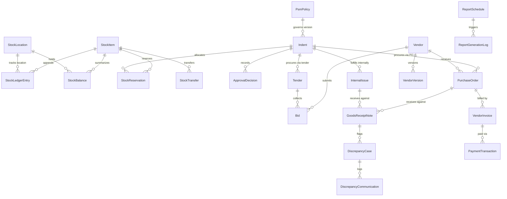

# PSM Domain Model

All tables live in the `psm` Django app with `psm_` table prefixes and zero cross-module foreign keys (ADR-0013). User references store integer `user_id` values synchronized from IAM sessions.

## Entity Relationship Diagram

## Core Tables and Constraints

| Model | Table | Key Invariants & Indexes |
| --- | --- | --- |
| `PsmPolicy` | `psm_policy` | Effective-dated policy versions; partial unique constraint guarantees at most one `is_active=True` row (`BR-PSM-028`). |
| `Vendor` / `VendorVersion` | `psm_vendor`, `psm_vendor_version` | Unique `code`; verified flag enforced before award/PO/payment (`BR-PSM-012`); every edit appends an immutable `VendorVersion` (`BR-PSM-021`). |
| `StockItem` / `StockLocation` / `StockBalance` / `StockLedgerEntry` | `psm_stock_*` | Unique `(item, location)` on `StockBalance`; `CheckConstraint` prevents negative `on_hand` and `reserved_quantity > on_hand`; append-only `StockLedgerEntry` (`BR-PSM-013`, `BR-PSM-026`, `BR-PSM-027`). |
| `Indent` / `ApprovalDecision` | `psm_indent`, `psm_approval_decision` | Unique `indent_number`; tracks `policy_version`, `priority`, `procurement_method`, SLA timestamps, and immutable approval trail (`BR-PSM-001`, `BR-PSM-004`, `BR-PSM-005`, `BR-PSM-014`). |
| `Tender` / `Bid` | `psm_tender`, `psm_bid` | Unique `tender_number`; unique `(tender, vendor)` on `Bid`; records committee evaluation metadata (`BR-PSM-010`, `BR-PSM-023`). |
| `PurchaseOrder` | `psm_purchase_order` | Unique `po_number`; links `indent`, `vendor`, optional `tender`; tracks ordered quantity, unit price, total amount, and delivery dates (`BR-PSM-015`). |
| `GoodsReceiptNote` | `psm_grn` | Unique `grn_number`; XOR check ensures GRN links either `purchase_order` or `internal_issue`; `accepted + rejected <= received` (`BR-PSM-009`, `BW-PSM-01`). |
| `DiscrepancyCase` / `DiscrepancyCommunication` | `psm_discrepancy_*` | Unique `case_number`; `replacement_count <= 1` (`BR-PSM-025`); Drive link validated and filename sanitized (`AFR-PSM-049`). |
| `VendorInvoice` / `PaymentTransaction` | `psm_vendor_invoice`, `psm_payment_transaction` | Unique `(purchase_order, invoice_number)`; unique `payment_reference`; enforces three-way match and payment cap (`BR-PSM-017`, `BR-PSM-018`, `BR-PSM-022`). |
| `PsmAuditLog` / `PsmNotification` | `psm_audit_log`, `psm_notification` | Append-only audit trail (`BR-PSM-019`) and idempotent deduplicated outbox (`BR-PSM-006`). |
