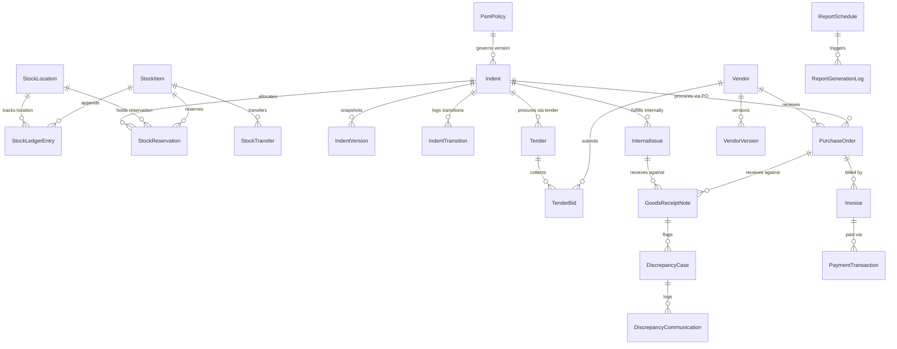

# PSM Domain Model

All tables live in the `psm` Django app with `psm_` table prefixes and zero cross-module foreign keys (ADR-0013). User references store integer `user_id` values synchronized from IAM sessions. Live stock balances (`on_hand`, `reserved`, `allocable`) are computed dynamically from the append-only `StockLedgerEntry` and `StockReservation` tables via `modules/psm/selectors/stock.py`.

## Entity Relationship Diagram

## Core Tables and Constraints

| Model | Table | Key Invariants & Indexes |
| --- | --- | --- |
| `PsmPolicy` | `psm_policy` | Effective-dated policy versions; partial unique constraint guarantees at most one `is_active=True` row (`BR-PSM-028`). |
| `Vendor` / `VendorVersion` | `psm_vendor`, `psm_vendor_version` | Unique `code`; verified flag enforced before award/PO/payment (`BR-PSM-012`); every edit appends an immutable `VendorVersion` (`BR-PSM-021`). |
| `StockItem` / `StockLocation` / `StockLedgerEntry` / `StockReservation` | `psm_stock_*` | Append-only `StockLedgerEntry` (`quantity_delta != 0`); `StockReservation` (`quantity > 0`) serialized via `StockItem.select_for_update()` (`BR-PSM-013`, `BR-PSM-026`, `BR-PSM-027`). |
| `InternalIssue` / `StockTransfer` | `psm_internal_issue`, `psm_stock_transfer` | Links active reservations to internal dispatches and inter-departmental transfers with dual-ledger posting (`BW-PSM-01`, `BW-PSM-08`, `BR-PSM-027`). |
| `Indent` / `IndentVersion` / `IndentTransition` | `psm_indent`, `psm_indent_version`, `psm_indent_transition` | Unique `indent_number` (when submitted); tracks `policy`, `priority`, `procurement_method`, SLA timestamps, immutable versions, and transition audit trail (`BR-PSM-001`, `BR-PSM-004`, `BR-PSM-005`, `BR-PSM-014`). |
| `Tender` / `TenderBid` | `psm_tender`, `psm_tender_bid` | Unique `tender_number`; unique `(tender, vendor)` on `TenderBid`; records committee evaluation metadata (`BR-PSM-010`, `BR-PSM-023`). |
| `PurchaseOrder` | `psm_purchase_order` | Unique `po_number`; links `indent`, `vendor`, optional `tender`; tracks ordered quantity, unit price, total amount, delivery schedule, and declarative status (`BR-PSM-015`, `AFR-PSM-041`, `AFR-PSM-042`). |
| `GoodsReceiptNote` | `psm_grn` | Unique `grn_number`; XOR check ensures GRN links either `purchase_order` or `internal_issue`; `psm_grn_qty_balance` enforces `accepted + rejected = received` (`BR-PSM-009`, `BW-PSM-01`). |
| `DiscrepancyCase` / `DiscrepancyCommunication` | `psm_discrepancy_*` | Unique `case_number`; `replacement_count <= 1` (`BR-PSM-025`); Drive `evidence_url` validated and `evidence_filename` sanitized (`AFR-PSM-049`); atomic stock and invoice adjustments on resolve (`AFR-PSM-054`, `AFR-PSM-055`). |
| `Invoice` / `PaymentTransaction` | `psm_invoice`, `psm_payment_transaction` | Unique `(vendor, invoice_number)`; unique `payment_reference`; enforces three-way match and payment cap (`BR-PSM-017`, `BR-PSM-018`, `BR-PSM-022`). |
| `PsmAuditLog` / `PsmNotification` / `ReportSchedule` / `ReportGenerationLog` | `psm_audit_log`, `psm_notification`, `psm_report_*` | Append-only audit trail (`BR-PSM-019`), deduplicated outbox (`BR-PSM-006`), and scheduled report execution logs (`PSM-UC-031`, `PSM-UC-035`). |
