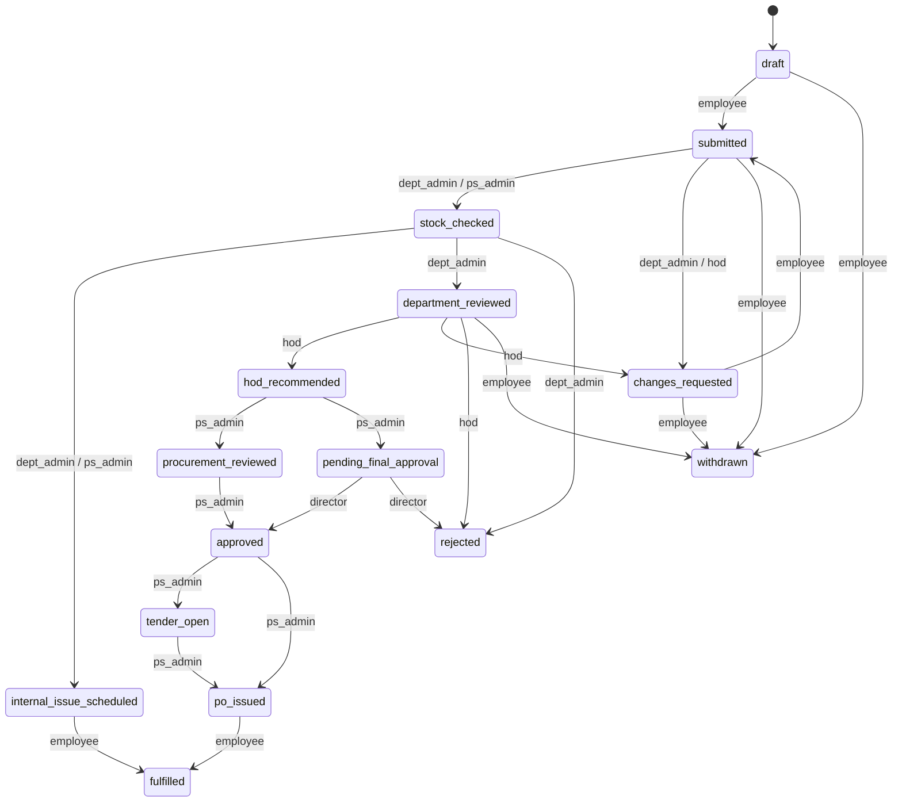

# PSM State Machines

Every lifecycle transition is declared in `modules/psm/domain/state_machine.py` and resolved through `sm.resolve(entity, from_state, to_state, actor_lane)`. No view or service mutates a `status` field directly.

## Indent Lifecycle

## Procurement, Receipt, Finance, and Transfer Lifecycles

| Entity | States | Terminal States |
| --- | --- | --- |
| `InternalIssue` | `scheduled` -> `picking_scheduled` -> `dispatched` -> `completed` | `completed` |
| `StockTransfer` | `requested` -> `dispatched` -> `completed`; `requested` -> `cancelled` | `completed`, `cancelled` |
| `Tender` | `draft` -> `published` -> `evaluated` -> `awarded`; `draft`/`published` -> `cancelled` | `awarded`, `cancelled` |
| `PurchaseOrder` | `issued` -> `in_transit` / `partially_received` -> `received` -> `closed`; `issued` -> `cancelled` | `closed`, `cancelled` |
| `GoodsReceiptNote` | `accepted` / `partial` -> `confirmed`; `rejected` | `confirmed`, `rejected` |
| `DiscrepancyCase` | `open` -> `in_progress` -> `resolved` -> `closed` | `closed` |
| `VendorInvoice` | `submitted` -> `verified` / `on_hold`; `on_hold` -> `verified`; `verified` -> `partially_paid` / `paid`; `partially_paid` -> `paid` | `paid` |
