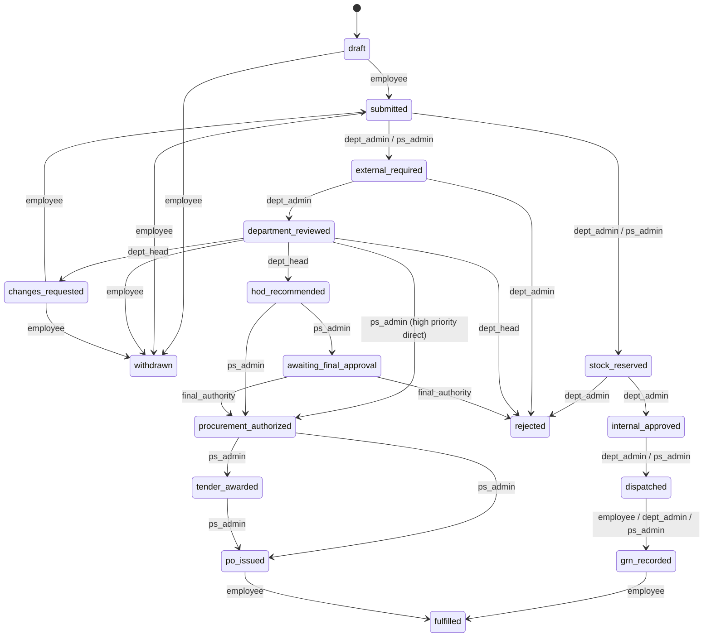

# PSM State Machines

Every lifecycle transition is declared in `modules/psm/domain/state_machine.py` and resolved through `sm.resolve(entity, from_state, to_state, actor_lane)`. No view or service mutates a managed `status` field directly.

## Indent Lifecycle

## PurchaseOrder, Tender, Transfer, Discrepancy, and Invoice Lifecycles

| Entity | Declarative States | Legal Transitions | Terminal States |
| --- | --- | --- | --- |
| `PurchaseOrder` | `issued`, `in_transit`, `partially_delivered`, `delivered`, `closed`, `cancelled` | `issued -> in_transit / partially_delivered / delivered / cancelled`; `in_transit -> partially_delivered / delivered / cancelled`; `partially_delivered -> partially_delivered / delivered`; `delivered -> closed` | `closed`, `cancelled` |
| `Tender` | `draft`, `published`, `evaluated`, `awarded`, `cancelled` | `draft -> published / cancelled`; `published -> evaluated / cancelled`; `evaluated -> awarded` | `awarded`, `cancelled` |
| `StockTransfer` | `requested`, `dispatched`, `completed`, `cancelled` | `requested -> dispatched / cancelled`; `dispatched -> completed` | `completed`, `cancelled` |
| `DiscrepancyCase` | `open`, `replacement_awaited`, `resolved`, `closed` | `open -> replacement_awaited / resolved`; `replacement_awaited -> resolved`; `resolved -> closed` | `closed` |
| `Invoice` | `submitted`, `verified`, `on_hold`, `partially_paid`, `paid` | `submitted -> verified / on_hold`; `on_hold -> verified`; `verified -> on_hold / partially_paid / paid`; `partially_paid -> partially_paid / paid` | `paid` |
| `InternalIssue` | `approved`, `picking_scheduled`, `dispatched`, `grn_recorded`, `completed` | `approved -> picking_scheduled / dispatched`; `picking_scheduled -> dispatched`; `dispatched -> grn_recorded`; `grn_recorded -> completed` | `completed` |
| `GoodsReceiptNote` | `accepted`, `partial`, `rejected`, `confirmed` | `accepted / partial -> confirmed` | `confirmed`, `rejected` |
