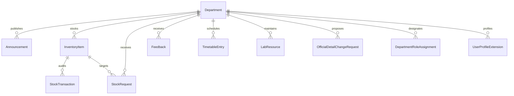
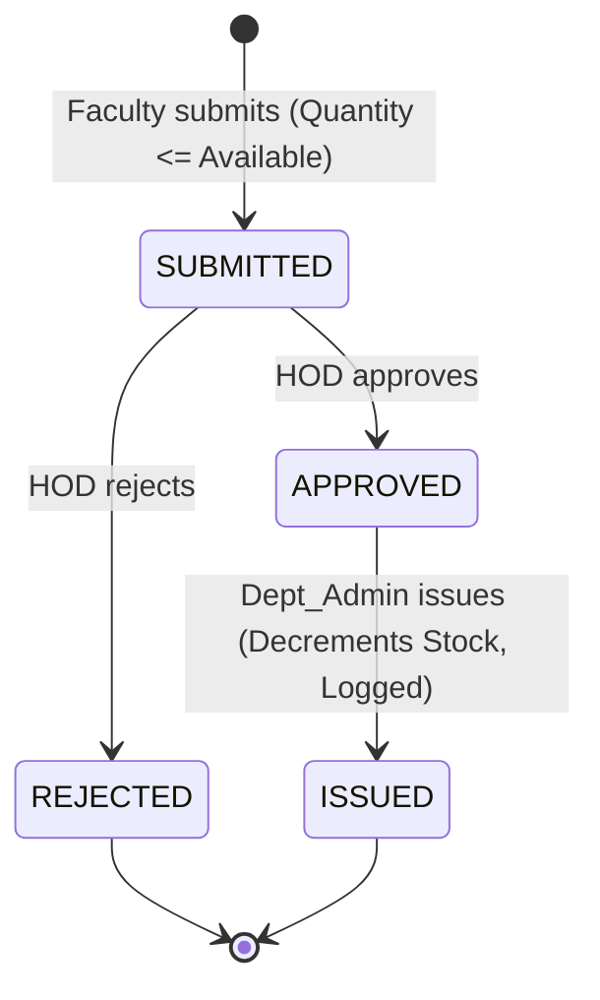
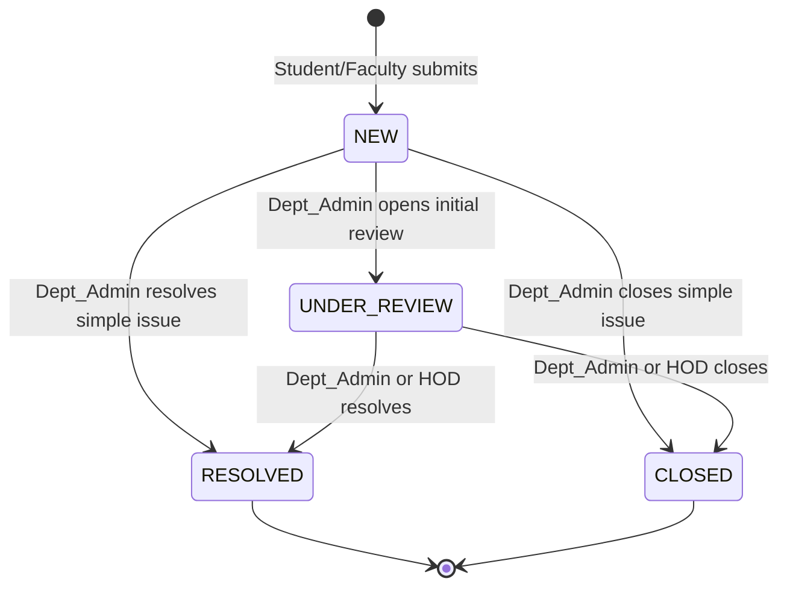
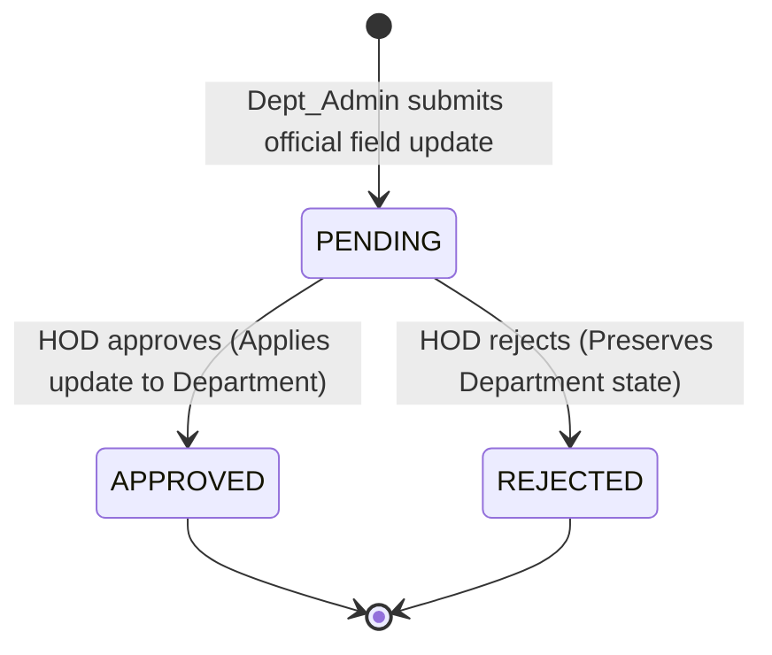
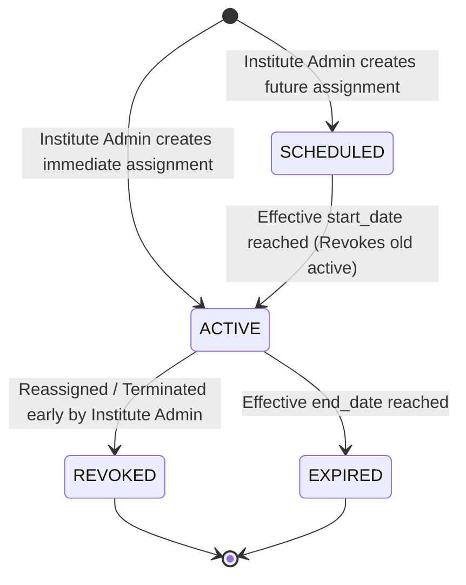

# Department (DEPT) Module — Architecture Blueprint

> **Module:** Department (`dept`)  
> **Prefixes:** `CFR-DEPT-`, `AFR-DEPT-`, `UC-DEPT-`, `BR-DEPT-`, `BW-DEPT-`, `CW-DEPT-`  
> **Environment:** `module-only`  
> **Status:** Phase 2 Blueprint — Awaiting Student 2 Approval  

---

## 1. Overview & Single Responsibility

The Department (`dept`) module digitizes and streamlines administrative, academic, communication, inventory, feedback, profile, resource, timetable, department-detail, and department-role governance within an institute department. It strictly acts as a modular bounded context, never duplicating IAM role management or ERP identity storage, enforcing strict multi-department data isolation and least-privilege role-based access control.

---

## 2. Traceability Matrix (§3.1 / Step 3.1 (a))

| ID | Obligation / Requirement | Target Layer | Enforcement Point | Notes |
|---|---|---|---|---|
| **CFR-DEPT-001** | Publish Targeted Department Announcements | `services/` | `AnnouncementService.create_announcement` | Validates target scope (role, program, year) |
| **CFR-DEPT-002** | Deliver Relevant Announcements | `selectors/` | `AnnouncementSelector.list_visible_for_principal` | Filters by viewer relevance & dept scope |
| **CFR-DEPT-003** | Maintain Active Announcements | `services/` | `AnnouncementService.update_status`, `.edit_content` | Restricted strictly to HOD |
| **CFR-DEPT-004** | Maintain Inventory Records & Audit Trail | `services/` | `InventoryService.create_item`, `.record_transaction` | Immutable stock transaction log |
| **CFR-DEPT-005** | Process Stock Requests to Final Outcome | `domain/`, `services/` | `StockRequestStateMachine`, `StockService.process_decision` | Validates availability before HOD approval |
| **CFR-DEPT-006** | Provide Faculty Issued-Stock History | `selectors/` | `StockSelector.list_issued_for_faculty` | Scoped to requesting faculty member |
| **CFR-DEPT-007** | Submit Confidential Feedback | `services/` | `FeedbackService.submit_feedback` | Captures confidential student/faculty issues |
| **CFR-DEPT-008** | Review and Resolve Feedback | `services/` | `FeedbackService.review_by_admin`, `.resolve_feedback` | Dept_Admin initial review; Admin/HOD resolve |
| **CFR-DEPT-009** | Manage Department User Profiles | `services/` | `ProfileService.update_profile_extension` | Dept_Admin profile management |
| **CFR-DEPT-010** | Enforce Department Profile Visibility | `selectors/` | `ProfileSelector.serialize_with_privacy_mask` | Strict role-based field masking (BR-DEPT-019) |
| **CFR-DEPT-011** | Manage Conflict-Free Timetables | `domain/`, `services/` | `TimetableConflictValidator`, `TimetableService.save` | Pre-save slot overlap detection |
| **CFR-DEPT-012** | Manage and View Lab Resource Profiles | `services/`, `selectors/` | `LabResourceService.save`, `LabSelector.list_active` | Admin manages; Faculty/Students view |
| **CFR-DEPT-013** | Provide Student Academic Information | `selectors/` | `AcademicInfoSelector.get_program_timetable` | Student timetable & academic view |
| **CFR-DEPT-014** | Update General Department Information | `services/` | `DepartmentService.update_general_info` | Dept_Admin updates non-official fields |
| **CFR-DEPT-015** | Control Official Department Changes | `domain/`, `services/` | `OfficialChangeStateMachine`, `DepartmentService.decide` | HOD approval required for official fields |
| **CFR-DEPT-016** | Maintain Department Role Assignments | `services/` | `DepartmentRoleService.assign_role`, `.apply_transitions` | Institute Admin authority; single active HOD/Admin |
| **AFR-DEPT-001..003** | Announcement validation & filtering | `domain/`, `selectors/` | `AnnouncementValidator`, `AnnouncementSelector` | Relevance matching logic |
| **AFR-DEPT-004..006** | Announcement HOD controls | `services/` | `AnnouncementService` | Edit, hide, delete checks |
| **AFR-DEPT-007..008** | Stock catalog & audit log | `models/`, `services/` | `StockTransaction` (append-only) | Audit immutability |
| **AFR-DEPT-009..015** | Stock request lifecycle | `domain/`, `services/` | `StockRequestStateMachine`, `StockService` | Guarded transitions |
| **AFR-DEPT-016** | Issued stock history | `selectors/` | `StockSelector` | Scoped queries |
| **AFR-DEPT-017..024** | Feedback submission & routing | `domain/`, `services/` | `FeedbackStateMachine`, `FeedbackService` | Confidentiality & review routing |
| **AFR-DEPT-025..028** | Profile management & privacy | `selectors/`, `services/` | `ProfileSelector.mask_profile` | Field-level privacy matrix |
| **AFR-DEPT-029..031** | Timetable management & conflicts | `domain/`, `models/` | `TimetableOverlapValidator`, DB ExclusionConstraint | Disallows overlapping room/instructor slots |
| **AFR-DEPT-034..037** | Lab resource profiles | `services/`, `selectors/` | `LabResourceService` | Equipment inventory & specs |
| **AFR-DEPT-038..040** | Student program & timetable views | `selectors/` | `TimetableSelector` | Filtered program schedule |
| **AFR-DEPT-041..046** | Event notifications | `services/` | `NotificationDispatcher` (internal event dispatch) | Emits notifications to target actors |
| **AFR-DEPT-047..053** | Role assignments & tenure | `models/`, `services/` | `DepartmentRoleAssignment`, DB UniqueConstraint | Exactly 1 active HOD, 1 active Dept_Admin |
| **BR-DEPT-001** | Announcement Creation Authority | `api/permissions.py` | `HasPermission('dept.announcement.create')` | Faculty, Dept_Admin, HOD only |
| **BR-DEPT-002** | Announcement Visibility Filtering | `selectors/` | `AnnouncementSelector.list_visible_for_principal` | Role, program, year relevance |
| **BR-DEPT-003** | Announcement Publication Completeness | `domain/` | `AnnouncementValidator.validate_publication` | Title, body, target scope non-empty |
| **BR-DEPT-004** | Announcement Modification Authority | `api/permissions.py` | `HasPermission('dept.announcement.manage')` | HOD only |
| **BR-DEPT-005** | Stock Request Eligibility | `api/permissions.py` | `HasPermission('dept.stock_request.create')` | Faculty only |
| **BR-DEPT-006** | HOD Stock Approval Authority | `api/permissions.py` | `HasPermission('dept.stock_request.approve')` | HOD only |
| **BR-DEPT-007** | Stock Issuance Control | `api/permissions.py`, `services/` | `HasPermission('dept.stock_request.issue')`, `StockService` | Dept_Admin only; decrements inventory |
| **BR-DEPT-008** | Feedback Submission Eligibility | `api/permissions.py` | `HasPermission('dept.feedback.create')` | Student & Faculty only |
| **BR-DEPT-009** | Feedback Resolution Authority | `api/permissions.py`, `services/` | `FeedbackService.resolve_feedback` | Dept_Admin (simple) or HOD (oversight) |
| **BR-DEPT-010** | Timetable Conflict Validation | `domain/`, `models/` | `TimetableConflictValidator`, DB constraint | Overlap detection for room & instructor |
| **BR-DEPT-011** | Official Dept Data Approval Requirement | `domain/` | `OfficialChangeStateMachine` | Changes to official fields require HOD decision |
| **BR-DEPT-012** | Department Resource Visibility | `selectors/` | `LabSelector.list_for_actor` | Faculty/Student view |
| **BR-DEPT-013** | HOD Official Update Decision Authority | `api/permissions.py` | `HasPermission('dept.detail.approve')` | HOD only |
| **BR-DEPT-015** | Stock Availability Validation | `services/` | `StockService.validate_availability` | Pre-submission stock quantity check |
| **BR-DEPT-016** | Stock Movement Audit Immutability | `models/` | `StockTransaction` (no update/delete methods) | Immutable append-only audit trail |
| **BR-DEPT-017** | Feedback Confidentiality & Access | `selectors/` | `FeedbackSelector` | Submitter + Dept_Admin/HOD only |
| **BR-DEPT-018** | Feedback Initial Review Responsibility | `services/` | `FeedbackService.mark_under_review` | Dept_Admin first reviewer |
| **BR-DEPT-019** | Profile Visibility Matrix | `selectors/` | `ProfileSelector.apply_visibility_rules` | Student vs Faculty vs Admin field access |
| **BR-DEPT-021** | Central Dept Role Assignment Authority | `api/permissions.py` | `HasPermission('dept.role_assignment.manage')` | Institute Admin only |
| **BR-DEPT-022** | Unique Active Department Roles | `models/` | DB Partial Unique Constraint: `(dept, role) WHERE status='ACTIVE'` | Max 1 active HOD, 1 active Dept_Admin |
| **BR-DEPT-023** | Department Role Tenure | `domain/`, `models/` | `RoleAssignmentValidator` | Requires valid `[start_date, end_date]` interval |
| **BR-DEPT-024** | Role Reassignment Access Transition | `services/` | `DepartmentRoleService.transition_roles` | Immediate outgoing revoke + incoming grant |
| **BW-DEPT-01** | Stock Request Approved and Issued | `domain/` | `StockRequestStateMachine` | SUBMITTED -> APPROVED -> ISSUED |
| **BW-DEPT-02** | Stock Request Rejected by HOD | `domain/` | `StockRequestStateMachine` | SUBMITTED -> REJECTED |
| **CW-DEPT-01** | Stock Request, Approval & Issuance Lifecycle | `services/` | `StockService` | Full composite lifecycle |
| **BW-DEPT-03** | Feedback Disposed by Dept_Admin | `domain/` | `FeedbackStateMachine` | NEW -> UNDER_REVIEW -> RESOLVED/CLOSED |
| **BW-DEPT-04** | Feedback Disposed with HOD Oversight | `domain/` | `FeedbackStateMachine` | UNDER_REVIEW -> HOD_REVIEW -> RESOLVED/CLOSED |
| **CW-DEPT-02** | Feedback Handling Lifecycle | `services/` | `FeedbackService` | Full composite feedback lifecycle |
| **BW-DEPT-05** | Official Dept Change Approved | `domain/` | `OfficialChangeStateMachine` | PENDING -> APPROVED |
| **BW-DEPT-06** | Official Dept Change Rejected | `domain/` | `OfficialChangeStateMachine` | PENDING -> REJECTED |
| **CW-DEPT-03** | Official Dept Change Lifecycle | `services/` | `DepartmentService` | Full composite change lifecycle |
| **BW-DEPT-07** | HOD Role Reassignment & Headship Sync | `services/` | `DepartmentRoleService.sync_headship` | Active HOD becomes authoritative Headship |
| **BW-DEPT-08** | Dept_Admin Reassignment & Access Transition | `services/` | `DepartmentRoleService.transition_roles` | Immediate revoke outgoing, grant incoming |
| **CW-DEPT-04** | Department Role Reassignment Lifecycle | `services/` | `DepartmentRoleService` | Full composite role assignment lifecycle |

---

## 3. Domain Model & Invariants (§3.2 / Step 3.2 (b))

All models live under `modules/dept/models/` in `fusion_integrated`. Cross-module foreign keys are strictly prohibited (ADR-0013); external entities (users, designations) are stored as scalar identifiers (`user_id: str/int`).

### 3.1 Entities and Schema Definition



#### 1. `Department` (`models/department.py`)
- `id`: AutoField / Slug (e.g. `code`: `"CSE"`, primary key).
- `name`: CharField(max_length=150) — Official name.
- `description`: TextField(blank=True) — General overview.
- `core_policies`: TextField(blank=True) — Core department policies.
- `created_at`, `updated_at`: DateTimeField.
- *Invariant:* Headship identity is NOT stored as a static field here; it is projected/derived dynamically from the active `DepartmentRoleAssignment` for role `HOD`.

#### 2. `Announcement` (`models/announcements.py`)
- `id`: UUIDField(primary_key=True, default=uuid4).
- `department`: ForeignKey(Department, on_delete=CASCADE, related_name="announcements").
- `title`: CharField(max_length=255).
- `content`: TextField().
- `author_id`: CharField(max_length=64).
- `author_role`: CharField(max_length=32).
- `target_role`: CharField(max_length=32, default="ALL") — `ALL`, `STUDENT`, `FACULTY`, `DEPT_ADMIN`.
- `target_program`: CharField(max_length=64, default="ALL") — e.g. `B.Tech`, `M.Tech`, `ALL`.
- `target_academic_year`: IntegerField(null=True, blank=True) — e.g. `2026`, `None` for all.
- `status`: CharField(max_length=16, choices=[('ACTIVE', 'Active'), ('HIDDEN', 'Hidden'), ('DELETED', 'Deleted')], default='ACTIVE').
- `created_at`, `updated_at`: DateTimeField.
- *DB Indexes:* `(department, status, created_at)`.

#### 3. `InventoryItem` (`models/inventory.py`)
- `id`: UUIDField(primary_key=True, default=uuid4).
- `department`: ForeignKey(Department, on_delete=CASCADE, related_name="inventory_items").
- `item_code`: CharField(max_length=64).
- `name`: CharField(max_length=255).
- `category`: CharField(max_length=64, choices=[('EQUIPMENT', 'Equipment'), ('CONSUMABLE', 'Consumable'), ('FURNITURE', 'Furniture'), ('OTHER', 'Other')]).
- `quantity`: IntegerField(default=0) — Must satisfy `CheckConstraint(check=Q(quantity >= 0))`.
- `unit`: CharField(max_length=32, default="units").
- `created_at`, `updated_at`: DateTimeField.
- *Constraints:* `UniqueConstraint(fields=['department', 'item_code'], name='unique_dept_inventory_item')`.

#### 4. `StockTransaction` (`models/inventory.py`)
- `id`: UUIDField(primary_key=True, default=uuid4).
- `inventory_item`: ForeignKey(InventoryItem, on_delete=PROTECT, related_name="transactions").
- `transaction_type`: CharField(max_length=16, choices=[('INSERTION', 'Insertion'), ('ISSUANCE', 'Issuance'), ('ADJUSTMENT', 'Adjustment')]).
- `quantity_delta`: IntegerField() — Positive for insertion, negative for issuance.
- `balance_after`: IntegerField() — Balance after transaction.
- `performed_by_id`: CharField(max_length=64).
- `related_request_id`: UUIDField(null=True, blank=True).
- `notes`: TextField(blank=True).
- `created_at`: DateTimeField(auto_now_add=True).
- *Invariant:* Immutable audit log. No update or delete operations permitted (enforced in model `save` and `delete` overrides).

#### 5. `StockRequest` (`models/stock_requests.py`)
- `id`: UUIDField(primary_key=True, default=uuid4).
- `department`: ForeignKey(Department, on_delete=CASCADE, related_name="stock_requests").
- `inventory_item`: ForeignKey(InventoryItem, on_delete=PROTECT, related_name="requests").
- `requested_by_id`: CharField(max_length=64).
- `requested_quantity`: IntegerField() — Must satisfy `CheckConstraint(check=Q(requested_quantity > 0))`.
- `purpose`: TextField().
- `status`: CharField(max_length=16, choices=[('SUBMITTED', 'Submitted'), ('APPROVED', 'Approved'), ('REJECTED', 'Rejected'), ('ISSUED', 'Issued')], default='SUBMITTED').
- `hod_decision_by_id`: CharField(max_length=64, null=True, blank=True).
- `hod_decision_at`: DateTimeField(null=True, blank=True).
- `hod_remarks`: TextField(blank=True).
- `issued_by_id`: CharField(max_length=64, null=True, blank=True).
- `issued_at`: DateTimeField(null=True, blank=True).
- `created_at`, `updated_at`: DateTimeField.
- *DB Indexes:* `(department, status, created_at)`, `(requested_by_id, status)`.

#### 6. `Feedback` (`models/feedback.py`)
- `id`: UUIDField(primary_key=True, default=uuid4).
- `department`: ForeignKey(Department, on_delete=CASCADE, related_name="feedbacks").
- `submitted_by_id`: CharField(max_length=64).
- `submitter_role`: CharField(max_length=32) — `STUDENT` or `FACULTY`.
- `category`: CharField(max_length=64, choices=[('ACADEMIC', 'Academic'), ('INFRASTRUCTURE', 'Infrastructure'), ('ADMINISTRATIVE', 'Administrative'), ('OTHER', 'Other')]).
- `title`: CharField(max_length=255).
- `description`: TextField().
- `status`: CharField(max_length=16, choices=[('NEW', 'New'), ('UNDER_REVIEW', 'Under Review'), ('RESOLVED', 'Resolved'), ('CLOSED', 'Closed')], default='NEW').
- `admin_remarks`: TextField(blank=True).
- `reviewed_by_admin_id`: CharField(max_length=64, null=True, blank=True).
- `reviewed_at`: DateTimeField(null=True, blank=True).
- `terminal_by_id`: CharField(max_length=64, null=True, blank=True).
- `terminal_by_role`: CharField(max_length=32, null=True, blank=True) — `DEPT_ADMIN` or `HOD`.
- `terminal_remarks`: TextField(blank=True).
- `terminal_at`: DateTimeField(null=True, blank=True).
- `created_at`, `updated_at`: DateTimeField.
- *DB Indexes:* `(department, status, created_at)`.

#### 7. `TimetableEntry` (`models/timetable.py`)
- `id`: UUIDField(primary_key=True, default=uuid4).
- `department`: ForeignKey(Department, on_delete=CASCADE, related_name="timetables").
- `program`: CharField(max_length=64) — e.g. `B.Tech CSE`.
- `academic_year`: IntegerField() — e.g. `2026`.
- `semester`: IntegerField() — `1` through `8`.
- `day_of_week`: IntegerField(choices=[(0, 'Monday'), (1, 'Tuesday'), (2, 'Wednesday'), (3, 'Thursday'), (4, 'Friday'), (5, 'Saturday'), (6, 'Sunday')]).
- `start_time`: TimeField().
- `end_time`: TimeField().
- `course_code`: CharField(max_length=32).
- `course_name`: CharField(max_length=255).
- `instructor_id`: CharField(max_length=64).
- `room_or_lab`: CharField(max_length=64).
- `created_at`, `updated_at`: DateTimeField.
- *DB Invariants & Constraints:*
  - `CheckConstraint(check=Q(start_time < end_time), name='valid_timetable_time_range')`.
  - Application-level + Selector query validation ensuring no overlapping slot exists for same `(room_or_lab, day_of_week)` or `(instructor_id, day_of_week)`.

#### 8. `LabResource` (`models/labs.py`)
- `id`: UUIDField(primary_key=True, default=uuid4).
- `department`: ForeignKey(Department, on_delete=CASCADE, related_name="lab_resources").
- `lab_name`: CharField(max_length=150).
- `location`: CharField(max_length=150).
- `description`: TextField(blank=True).
- `equipment_details`: JSONField(default=list) — structured list of equipment, specs, and status.
- `in_charge_id`: CharField(max_length=64).
- `created_at`, `updated_at`: DateTimeField.
- *Constraints:* `UniqueConstraint(fields=['department', 'lab_name'], name='unique_dept_lab_name')`.

#### 9. `OfficialDetailChangeRequest` (`models/official_changes.py`)
- `id`: UUIDField(primary_key=True, default=uuid4).
- `department`: ForeignKey(Department, on_delete=CASCADE, related_name="official_changes").
- `proposed_by_id`: CharField(max_length=64).
- `field_name`: CharField(max_length=64, choices=[('name', 'Department Name'), ('core_policies', 'Core Policies'), ('description', 'Description')]).
- `old_value`: TextField().
- `new_value`: TextField().
- `justification`: TextField().
- `status`: CharField(max_length=16, choices=[('PENDING', 'Pending HOD Approval'), ('APPROVED', 'Approved'), ('REJECTED', 'Rejected')], default='PENDING').
- `reviewed_by_id`: CharField(max_length=64, null=True, blank=True).
- `review_reason`: TextField(blank=True).
- `reviewed_at`: DateTimeField(null=True, blank=True).
- `created_at`, `updated_at`: DateTimeField.

#### 10. `DepartmentRoleAssignment` (`models/roles.py`)
- `id`: UUIDField(primary_key=True, default=uuid4).
- `department`: ForeignKey(Department, on_delete=CASCADE, related_name="role_assignments").
- `role_name`: CharField(max_length=32, choices=[('HOD', 'Head of Department'), ('DEPT_ADMIN', 'Department Administrator')]).
- `user_id`: CharField(max_length=64).
- `start_date`: DateTimeField().
- `end_date`: DateTimeField().
- `status`: CharField(max_length=16, choices=[('SCHEDULED', 'Scheduled'), ('ACTIVE', 'Active'), ('REVOKED', 'Revoked'), ('EXPIRED', 'Expired')], default='SCHEDULED').
- `assigned_by_id`: CharField(max_length=64).
- `created_at`, `updated_at`: DateTimeField.
- *DB Constraints (BR-DEPT-022, BR-DEPT-023):*
  - `CheckConstraint(check=Q(start_date < end_date), name='valid_role_tenure_range')`.
  - `UniqueConstraint(fields=['department', 'role_name'], condition=Q(status='ACTIVE'), name='unique_active_role_per_department')`.

#### 11. `UserProfileExtension` (`models/profiles.py`)
- `id`: UUIDField(primary_key=True, default=uuid4).
- `department`: ForeignKey(Department, on_delete=CASCADE, related_name="profile_extensions").
- `user_id`: CharField(max_length=64).
- `profile_type`: CharField(max_length=32, choices=[('STUDENT', 'Student'), ('FACULTY', 'Faculty'), ('ALUMNI', 'Alumni')]).
- `office_room`: CharField(max_length=64, blank=True).
- `research_interests`: TextField(blank=True).
- `contact_phone`: CharField(max_length=32, blank=True) — *Sensitive personal data*.
- `emergency_contact`: CharField(max_length=128, blank=True) — *Sensitive personal data*.
- `courses_taught`: JSONField(default=list, blank=True) — e.g. `["CS101", "CS204"]`.
- `batch_or_roll`: CharField(max_length=32, blank=True).
- `graduation_year`: IntegerField(null=True, blank=True).
- `created_at`, `updated_at`: DateTimeField.
- *Constraints:* `UniqueConstraint(fields=['department', 'user_id'], name='unique_dept_user_profile')`.

---

## 4. State Machines (§3.3 / Step 3.3 (c))

All transitions are strictly validated in dedicated declarative domain state machines under `modules/dept/domain/`.

### 4.1 Stock Request State Machine (`domain/stock_state_machine.py`)



**Declarative Transition Table:**
```python
STOCK_REQUEST_TRANSITIONS = {
    # (current_state, event, acting_role): (next_state, guard_fn)
    ("SUBMITTED", "APPROVE", "HOD"): ("APPROVED", None),
    ("SUBMITTED", "REJECT", "HOD"): ("REJECTED", None),
    ("APPROVED", "ISSUE", "DEPT_ADMIN"): ("ISSUED", "validate_stock_availability"),
}
```

### 4.2 Feedback Lifecycle State Machine (`domain/feedback_state_machine.py`)



**Declarative Transition Table:**
```python
FEEDBACK_TRANSITIONS = {
    ("NEW", "START_REVIEW", "DEPT_ADMIN"): ("UNDER_REVIEW", None),
    ("NEW", "RESOLVE", "DEPT_ADMIN"): ("RESOLVED", None),
    ("NEW", "CLOSE", "DEPT_ADMIN"): ("CLOSED", None),
    ("UNDER_REVIEW", "RESOLVE", "DEPT_ADMIN"): ("RESOLVED", None),
    ("UNDER_REVIEW", "RESOLVE", "HOD"): ("RESOLVED", None),
    ("UNDER_REVIEW", "CLOSE", "DEPT_ADMIN"): ("CLOSED", None),
    ("UNDER_REVIEW", "CLOSE", "HOD"): ("CLOSED", None),
}
```

### 4.3 Official Department Detail Change State Machine (`domain/change_state_machine.py`)



**Declarative Transition Table:**
```python
OFFICIAL_CHANGE_TRANSITIONS = {
    ("PENDING", "APPROVE", "HOD"): ("APPROVED", None),
    ("PENDING", "REJECT", "HOD"): ("REJECTED", None),
}
```

### 4.4 Department Role Assignment State Machine (`domain/role_state_machine.py`)



**Declarative Transition Table:**
```python
ROLE_ASSIGNMENT_TRANSITIONS = {
    ("SCHEDULED", "ACTIVATE", "SYSTEM"): ("ACTIVE", "ensure_single_active_role"),
    ("SCHEDULED", "REVOKE", "INSTITUTE_ADMIN"): ("REVOKED", None),
    ("ACTIVE", "REVOKE", "INSTITUTE_ADMIN"): ("REVOKED", None),
    ("ACTIVE", "EXPIRE", "SYSTEM"): ("EXPIRED", None),
}
```

---

## 5. Permission List & RBAC Registry (§3.4 / Step 3.4 (d))

### 5.1 Permissions (`modules/dept/registry.py`)

Following strict platform naming: `<module_code>.<singular_noun>.<verb>`:

```python
MODULE = {
    "code": "dept",
    "name": "Department Management",
    "description": "Department academic, inventory, timetable, and administrative governance",
    "section": "academics",
}

PERMISSIONS = (
    # Announcements
    ("dept.announcement.view", "View department announcements relevant to viewer role and cohort"),
    ("dept.announcement.create", "Create and publish department announcements"),
    ("dept.announcement.manage", "Edit, hide, or delete active department announcements (HOD)"),

    # Inventory & Stock
    ("dept.inventory.view", "View department stock catalog and transaction history"),
    ("dept.inventory.create", "Add new items and stock quantities to department inventory"),
    ("dept.inventory.update", "Update inventory specifications"),
    ("dept.stock_request.view", "View stock requests in department"),
    ("dept.stock_request.create", "Submit stock requests for department inventory (Faculty)"),
    ("dept.stock_request.approve", "Approve or reject stock requests (HOD)"),
    ("dept.stock_request.issue", "Issue approved stock and decrement inventory (Dept_Admin)"),

    # Feedback
    ("dept.feedback.view", "View feedback within authorized departmental scope"),
    ("dept.feedback.create", "Submit confidential feedback to department"),
    ("dept.feedback.review", "Perform initial review and categorize feedback (Dept_Admin)"),
    ("dept.feedback.resolve", "Resolve or close department feedback (Dept_Admin / HOD)"),

    # Timetables
    ("dept.timetable.view", "View department class and lab timetables"),
    ("dept.timetable.manage", "Upload and modify conflict-free timetables (Dept_Admin)"),

    # Lab Resources
    ("dept.lab_resource.view", "View department lab resource profiles and equipment"),
    ("dept.lab_resource.manage", "Manage lab resource and equipment records (Dept_Admin)"),

    # Profiles
    ("dept.profile.view", "View department user profiles governed by role privacy matrix"),
    ("dept.profile.manage", "Manage user department profiles and details (Dept_Admin)"),

    # Department Details
    ("dept.detail.view", "View department general details and official policies"),
    ("dept.detail.update", "Update general details and propose official detail changes (Dept_Admin)"),
    ("dept.detail.approve", "Approve or reject official department changes (HOD)"),

    # Role Governance
    ("dept.role_assignment.view", "View department HOD and Dept_Admin assignments"),
    ("dept.role_assignment.manage", "Assign, reassign, or revoke department roles (Institute Admin)"),
)

SYSTEM_PERMISSIONS = (
    ("dept.role_assignment.cron", "System permission for automated role transition evaluation"),
)

SCOPE_PERMISSIONS = {
    "dept.announcement.view": "department",
    "dept.inventory.view": "department",
    "dept.stock_request.view": "department",
    "dept.feedback.view": "department",
    "dept.timetable.view": "department",
    "dept.lab_resource.view": "department",
    "dept.profile.view": "department",
    "dept.detail.view": "department",
}

ROLE_GRANTS = {
    "HOD": [
        "dept.announcement.view",
        "dept.announcement.create",
        "dept.announcement.manage",
        "dept.inventory.view",
        "dept.stock_request.view",
        "dept.stock_request.approve",
        "dept.feedback.view",
        "dept.feedback.resolve",
        "dept.timetable.view",
        "dept.lab_resource.view",
        "dept.profile.view",
        "dept.detail.view",
        "dept.detail.approve",
        "dept.role_assignment.view",
    ],
    "Dept_Admin": [
        "dept.announcement.view",
        "dept.announcement.create",
        "dept.inventory.view",
        "dept.inventory.create",
        "dept.inventory.update",
        "dept.stock_request.view",
        "dept.stock_request.issue",
        "dept.feedback.view",
        "dept.feedback.review",
        "dept.feedback.resolve",
        "dept.timetable.view",
        "dept.timetable.manage",
        "dept.lab_resource.view",
        "dept.lab_resource.manage",
        "dept.profile.view",
        "dept.profile.manage",
        "dept.detail.view",
        "dept.detail.update",
        "dept.role_assignment.view",
    ],
    "faculty": [
        "dept.announcement.view",
        "dept.announcement.create",
        "dept.stock_request.view",
        "dept.stock_request.create",
        "dept.feedback.create",
        "dept.timetable.view",
        "dept.lab_resource.view",
        "dept.profile.view",
        "dept.detail.view",
    ],
    "student": [
        "dept.announcement.view",
        "dept.feedback.create",
        "dept.timetable.view",
        "dept.profile.view",
        "dept.detail.view",
    ],
    "Institute Admin": [
        "dept.role_assignment.view",
        "dept.role_assignment.manage",
        "dept.detail.view",
    ],
}
```

---

## 6. Endpoint List (§3.5 / Step 3.5 (e))

All endpoints sit under `/api/v1/dept/` and pass through:
1. `IsAuthenticated`
2. `HasModuleAccess('dept')`
3. Action-specific `HasPermission('dept.<noun>.<verb>')`
4. Department Scoping Verification via `Principal.department` or query scoping.

| Method | Path | Required Permission | Payload | Response | Enforced Rules |
|---|---|---|---|---|---|
| `GET` | `/api/v1/dept/announcements/` | `dept.announcement.view` | Query params: `program`, `year` | Paginated announcements matching relevance | BR-DEPT-002, CFR-DEPT-002 |
| `POST` | `/api/v1/dept/announcements/` | `dept.announcement.create` | `{title, content, target_role, target_program, target_academic_year}` | 201 Created announcement object | BR-DEPT-001, BR-DEPT-003, CFR-DEPT-001 |
| `PATCH` | `/api/v1/dept/announcements/{id}/` | `dept.announcement.manage` | `{title?, content?, status?}` | 200 Updated announcement | BR-DEPT-004, CFR-DEPT-003 |
| `DELETE` | `/api/v1/dept/announcements/{id}/` | `dept.announcement.manage` | None | 204 No Content (soft delete status='DELETED') | BR-DEPT-004, CFR-DEPT-003 |
| `GET` | `/api/v1/dept/inventory/` | `dept.inventory.view` | Query params: `category` | List of department inventory items | CFR-DEPT-004 |
| `POST` | `/api/v1/dept/inventory/` | `dept.inventory.create` | `{item_code, name, category, initial_quantity, unit}` | 201 Created item + transaction log | BR-DEPT-016, CFR-DEPT-004 |
| `POST` | `/api/v1/dept/inventory/{id}/add-stock/` | `dept.inventory.create` | `{quantity, notes}` | 200 Updated item + transaction log | BR-DEPT-016, CFR-DEPT-004 |
| `GET` | `/api/v1/dept/inventory/{id}/transactions/` | `dept.inventory.view` | None | List of immutable stock transactions | BR-DEPT-016, CFR-DEPT-004 |
| `GET` | `/api/v1/dept/stock-requests/` | `dept.stock_request.view` | Query params: `status`, `mine=true` | Filtered stock requests (Faculty sees own, Admin/HOD sees dept) | CFR-DEPT-005, CFR-DEPT-006 |
| `POST` | `/api/v1/dept/stock-requests/` | `dept.stock_request.create` | `{inventory_item_id, requested_quantity, purpose}` | 201 Created request in SUBMITTED status | BR-DEPT-005, BR-DEPT-015, CFR-DEPT-005 |
| `POST` | `/api/v1/dept/stock-requests/{id}/decision/` | `dept.stock_request.approve` | `{decision: 'APPROVE'|'REJECT', remarks}` | 200 Stock request updated status | BR-DEPT-006, BW-DEPT-01, BW-DEPT-02 |
| `POST` | `/api/v1/dept/stock-requests/{id}/issue/` | `dept.stock_request.issue` | `{notes}` | 200 Status ISSUED, inventory decremented | BR-DEPT-007, BR-DEPT-016, BW-DEPT-01 |
| `GET` | `/api/v1/dept/feedback/` | `dept.feedback.view` | Query params: `status`, `mine=true` | Feedback list (Submitter sees own, Admin/HOD sees dept) | BR-DEPT-017, CFR-DEPT-007, CFR-DEPT-008 |
| `POST` | `/api/v1/dept/feedback/` | `dept.feedback.create` | `{category, title, description}` | 201 Created feedback in NEW status | BR-DEPT-008, BR-DEPT-017, CFR-DEPT-007 |
| `POST` | `/api/v1/dept/feedback/{id}/review/` | `dept.feedback.review` | `{admin_remarks}` | 200 Status UNDER_REVIEW | BR-DEPT-018, BW-DEPT-03, BW-DEPT-04 |
| `POST` | `/api/v1/dept/feedback/{id}/resolve/` | `dept.feedback.resolve` | `{action: 'RESOLVE'|'CLOSE', remarks}` | 200 Status RESOLVED or CLOSED | BR-DEPT-009, BW-DEPT-03, BW-DEPT-04 |
| `GET` | `/api/v1/dept/timetables/` | `dept.timetable.view` | Query params: `program`, `year`, `semester` | Schedule entries for department | CFR-DEPT-011, CFR-DEPT-013 |
| `POST` | `/api/v1/dept/timetables/` | `dept.timetable.manage` | `{program, academic_year, semester, day_of_week, start_time, end_time, course_code, course_name, instructor_id, room_or_lab}` | 201 Entry (validates conflict) | BR-DEPT-010, CFR-DEPT-011 |
| `DELETE` | `/api/v1/dept/timetables/{id}/` | `dept.timetable.manage` | None | 204 No Content | CFR-DEPT-011 |
| `GET` | `/api/v1/dept/labs/` | `dept.lab_resource.view` | None | List of department labs & equipment profiles | BR-DEPT-012, CFR-DEPT-012 |
| `POST` | `/api/v1/dept/labs/` | `dept.lab_resource.manage` | `{lab_name, location, description, equipment_details, in_charge_id}` | 201 Created lab record | CFR-DEPT-012 |
| `PATCH` | `/api/v1/dept/labs/{id}/` | `dept.lab_resource.manage` | Partial fields | 200 Updated lab profile | CFR-DEPT-012 |
| `GET` | `/api/v1/dept/profiles/` | `dept.profile.view` | Query params: `type` (student/faculty/alumni) | List of profiles masked by viewer role | BR-DEPT-019, CFR-DEPT-009, CFR-DEPT-010 |
| `GET` | `/api/v1/dept/profiles/{user_id}/` | `dept.profile.view` | None | Profile detail masked by viewer role | BR-DEPT-019, CFR-DEPT-010 |
| `POST` | `/api/v1/dept/profiles/` | `dept.profile.manage` | `{user_id, profile_type, office_room, courses_taught, batch_or_roll, ...}` | 201 Created/Updated profile | CFR-DEPT-009 |
| `GET` | `/api/v1/dept/details/` | `dept.detail.view` | None | Department details + authoritative Headship | CFR-DEPT-014, CFR-DEPT-015 |
| `PATCH` | `/api/v1/dept/details/` | `dept.detail.update` | `{description}` | 200 Updated general information | CFR-DEPT-014 |
| `POST` | `/api/v1/dept/details/propose-change/` | `dept.detail.update` | `{field_name, new_value, justification}` | 201 Proposed official change | BR-DEPT-011, CFR-DEPT-015, CW-DEPT-03 |
| `GET` | `/api/v1/dept/details/pending-changes/` | `dept.detail.approve` | None | List of pending official changes for HOD | BR-DEPT-013, CFR-DEPT-015 |
| `POST` | `/api/v1/dept/details/pending-changes/{id}/decision/` | `dept.detail.approve` | `{decision: 'APPROVE'|'REJECT', reason}` | 200 Applies update to department if approved | BR-DEPT-013, BW-DEPT-05, BW-DEPT-06 |
| `GET` | `/api/v1/dept/roles/` | `dept.role_assignment.view` | Query params: `active_only=true` | Department role assignments & active HOD/Admin | BR-DEPT-021, CFR-DEPT-016 |
| `POST` | `/api/v1/dept/roles/` | `dept.role_assignment.manage` | `{department_code, role_name, user_id, start_date, end_date}` | 201 Role assignment created/scheduled | BR-DEPT-021, BR-DEPT-022, BR-DEPT-023, CW-DEPT-04 |
| `POST` | `/api/v1/dept/roles/{id}/revoke/` | `dept.role_assignment.manage` | `{reason}` | 200 Role status REVOKED immediately | BR-DEPT-024, CW-DEPT-04 |

### 6.2 Client Routes & Route Guards

Client pages will be structured cleanly in `client/src/modules/dept/`:

| Path | Element | Route Guard (`RequirePermission`) | Purpose |
|---|---|---|---|
| `/dept` | `Navigate to="/dept/announcements"` | Authenticated | Default redirect |
| `/dept/announcements` | `AnnouncementsPage` | `dept.announcement.view` | View and create announcements |
| `/dept/inventory` | `InventoryPage` | `dept.inventory.view` | Stock items, stock requests, issuance modal |
| `/dept/feedback` | `FeedbackPage` | `dept.feedback.view` or `dept.feedback.create` | Submit feedback, initial review & resolution |
| `/dept/timetables` | `TimetablePage` | `dept.timetable.view` | View schedules & Dept_Admin slot editor |
| `/dept/labs` | `LabResourcesPage` | `dept.lab_resource.view` | Lab profiles & equipment details |
| `/dept/profiles` | `ProfilesPage` | `dept.profile.view` | Department student/faculty/alumni directory |
| `/dept/details` | `DepartmentDetailsPage` | `dept.detail.view` | General information, official changes & role tenure |

**Sidebar Configuration for Integrated Modules:**
```typescript
{
  id: "dept",
  label: "Department",
  icon: "BuildingLibraryIcon",
  to: "/dept",
  section: "academics",
}
```

---

## 7. Contracts & Shared Interfaces (§3.6 / Step 3.6 (f))

Exposed via `modules/dept/contracts.py`:

```python
from typing import Sequence, Dict, Any

def get_department_details(department_codes: Sequence[str]) -> Dict[str, Dict[str, Any]]:
    """Returns department name, code, description, and authoritative active HOD user_id."""
    pass

def get_active_department_heads(department_codes: Sequence[str]) -> Dict[str, str]:
    """Returns mapping of department_code -> active HOD user_id."""
    pass

def get_active_department_admins(department_codes: Sequence[str]) -> Dict[str, str]:
    """Returns mapping of department_code -> active Dept_Admin user_id."""
    pass
```

### Dependencies on External Services / IAM:
- Reads user information via `fusion_auth.client.IamClient`: `get_users(user_ids)`.
- Verifies session tokens locally without cross-database access.
- No direct connection or queries to `fusionlab` ERP database.

---

## 8. Scheduled Work (§3.7 / Step 3.7 (g))

Configured in `modules/dept/schedule.py` and registered with Celery beat:

1. **`evaluate_department_role_transitions`**:
   - **Cadence:** Hourly (`crontab(minute=0)`).
   - **Task:** Checks for `DepartmentRoleAssignment` records with `status='SCHEDULED'` whose `start_date <= now()`, activates them, sets previous active assignments for that `(department, role)` to `EXPIRED`, and triggers outbox event `dept.role.transitioned`. Also expires assignments past `end_date`.
   - **Real-world failure impact if skipped:** Outgoing HOD/Admin retain authoritative headship display and permissions past their tenure; incoming assignments fail to take effect at scheduled start.

2. **`check_low_inventory_levels`**:
   - **Cadence:** Daily (`crontab(hour=7, minute=0)`).
   - **Task:** Scans consumable inventory items where `quantity <= reorder_threshold` and dispatches notification to Dept_Admin.
   - **Failure impact if skipped:** Dept_Admin is not alerted to depleted lab supplies.

---

## 9. Open Questions & Architecture Rulings (§3.8 / Step 3.8 (h))

1. **Role Authority for Role Assignment:**
   - *Spec Note:* Central Institute Admin (or equivalent central authority) assigns HOD and Dept_Admin roles.
   - *Ruling:* In the ERP / IAM, role assignment is managed by the administrator. Within the `dept` module, we provide the governance tracking interface protected by `dept.role_assignment.manage` (granted to `Institute Admin`), which stores the authoritative department headship timeline and syncs with the IAM.
2. **Field-Level Privacy Matrix (BR-DEPT-019):**
   - *Spec Note:* Exact sensitive personal fields are governed by institute privacy policy.
   - *Ruling:* `contact_phone` and `emergency_contact` are classified as sensitive personal data. They are visible only to Dept_Admin and HOD. Students and faculty see name, email, office room, research interests, and courses taught.
3. **Multi-Department Scoping:**
   - *Decision:* Department code is resolved from the principal's active designation/department context or URL scope (`/api/v1/dept/...?department=CSE`). Faculty, students, and admins cannot view stock requests or feedback belonging to other departments.

---

> **Gate Approval Request:**  
> This blueprint satisfies all requirements of §3.1 through §3.8 of `new-module-prompt.md`.  
> In accordance with the Assignment 9 rules: **No application code will be written until this blueprint is reviewed and approved by Student 2 in writing.**
