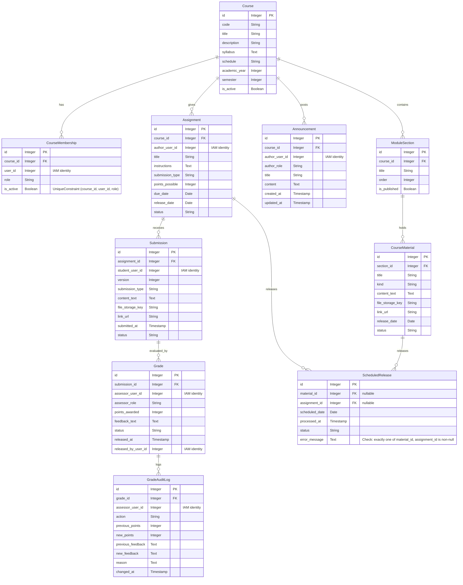

# Technical Architecture Document: Domain Model for Fusion ERP LMS Course Management

## 1. Executive Summary & Fusion Architectural Boundaries

### Modular Monolith Principles of Fusion ERP
Fusion ERP is designed as a modular monolith, where each module operates independently while maintaining cohesion through well-defined interfaces.

### Layering
The architecture follows a layered approach:
- **API Layer**: Handles HTTP requests and responses.
- **Service Layer**: Contains business logic and orchestrates interactions between different services.
- **Selector Layer**: Manages database queries and returns domain objects.
- **Model Layer**: Represents the data structure in the database, ensuring purity from external frameworks like Django or DRF.
- **Domain Layer**: Contains pure Python classes that define the core business logic. This layer is free of any framework-specific imports to pass `.importlinter`.

### Inter-module Communication
Inter-module communication is strictly via `contracts.py` files, which define interfaces and data structures.

### User Identity Handling
User identity is handled using an IAM principal integer `user_id`, never a Django auth.User foreign key. User lookups are performed through the `modules.directory.contracts.get_users` method.

## 2. Entity Catalog & Detailed Schema Design

### Course
- **Purpose**: Represents a course in the LMS.
- **Fields**:
  - `id`: Auto-generated primary key.
  - `code`: Identifier (e.g., CS301). Unresolved: whether `code` is globally unique, or unique per `(code, academic_year, semester)`; specification does not define uniqueness scope.
  - `title`: Title of the course.
  - `description`: Description of the course.
  - `syllabus`: Syllabus content.
  - `schedule`: Schedule details.
  - `academic_year`: Academic year when the course is offered.
  - `semester`: Semester when the course is offered.
  - `is_active`: Boolean indicating if the course is active.

### CourseMembership
- **Purpose**: Represents a user's role in a specific course.
- **Fields**:
  - `id`: Auto-generated primary key.
  - `course_id`: Foreign key to the `Course` model.
  - `user_id`: Integer representing the external IAM identity (via `UserScopedModel.user_id = models.IntegerField(db_index=True)`). Not a Django auth User foreign key.
  - `role`: Role of the user (`student`, `instructor`, `ta`, `observer`).
  - `is_active`: Boolean indicating if the membership is active.
  - **Unique Constraint**: `(course_id, user_id, role)` prevents duplicate assignment of the same role to a user within a course.
  - **Role Cardinality & Unresolved Behavior**:
    - Under `(course_id, user_id, role)`, the schema prevents duplicate identical role assignments but permits a user to hold multiple distinct roles in the same course (e.g., `student` and `ta`).
    - Under `(course_id, user_id)`, each user would be constrained to strictly one role per course.
    - *Confirmed*: Duplicate identical role assignments per course are prohibited.
    - *Unresolved*: The official specification does not specify whether a user may simultaneously hold multiple distinct roles in the same course or whether membership must be strictly single-role. Defer to instructor clarification before enforcing mutual exclusivity.

### ModuleSection
- **Purpose**: Represents a section within a course.
- **Fields**:
  - `id`: Auto-generated primary key.

  - `title`: Title of the section.
  - `order`: Order in which sections are displayed.
  - `is_published`: Boolean indicating if the section is published.

### CourseMaterial
- **Purpose**: Represents course materials such as files, links, and notes.
- **Fields**:
  - `id`: Auto-generated primary key.
  - `section_id`: Foreign key to the `ModuleSection` model.

  - `title`: Title of the material.
  - `kind`: Type of content (`file`, `link`, `note`).
  - `content_text`: Text content for notes.
  - `file_storage_key`: Key for file storage (if applicable).
  - `link_url`: URL for links.
  - `release_date`: Date when the material is released.
  - `status`: Status of the material (`draft`, `scheduled`, `published`).

### Announcement
- **Purpose**: Represents announcements made by instructors or TAs.
- **Fields**:
  - `id`: Auto-generated primary key.

  - `author_user_id`: Integer representing the user ID of the author (via `UserScopedModel`).
  - `author_role`: Role of the author (`instructor`, `ta`).
  - `title`: Title of the announcement.
  - `content`: Content of the announcement.
  - `created_at`: Timestamp when the announcement was created.
  - `updated_at`: Timestamp when the announcement was last updated.

### Assignment
- **Purpose**: Represents assignments given to students.
- **Fields**:
  - `id`: Auto-generated primary key.

  - `author_user_id`: Integer representing the user ID of the author (via `UserScopedModel`).
  - `title`: Title of the assignment.
  - `instructions`: Instructions for the assignment.
  - `submission_type`: Type of submission (`file`, `text`, `link`).
  - `points_possible`: Maximum points possible.
  - `due_date`: Due date for the assignment.
  - `release_date`: Date when the assignment is released.
  - `status`: Status of the assignment (`draft`, `scheduled`, `published`).

### Submission
- **Purpose**: Represents student submissions to assignments.
- **Fields**:
  - `id`: Auto-generated primary key.
  - `assignment_id`: Foreign key to the `Assignment` model.
  - `student_user_id`: Integer representing the user ID of the student (via `UserScopedModel`).
  - `version`: Version number of the submission.
  - `submission_type`: Type of submission (`file`, `text`, `link`).
  - `content_text`: Text content for text submissions.
  - `file_storage_key`: Key for file storage (if applicable).
  - `link_url`: URL for link submissions.
  - `submitted_at`: Timestamp when the submission was submitted.
  - `status`: Status of the submission (`submitted`, `late`, `missing`).

### Grade
- **Purpose**: Represents grades given to assignments by instructors or TAs.
- **Fields**:
  - `id`: Auto-generated primary key.
  - `submission_id`: One-to-one foreign key to the `Submission` model.
  - `assessor_user_id`: Integer representing the user ID of the assessor (via `UserScopedModel`).
  - `assessor_role`: Role of the assessor (`instructor`, `ta`).
  - `points_awarded`: Points awarded for the submission.
  - `feedback_text`: Feedback text provided by the assessor.
  - `status`: Status of the grade (`draft`, `released`).
  - `released_at`: Timestamp when the grade was released.
  - `released_by_user_id`: Integer representing the user ID who released the grade (via `UserScopedModel`).

### GradeAuditLog
- **Purpose**: Represents audit logs for grades.
- **Fields**:
  - `id`: Auto-generated primary key.
  - `grade_id`: Foreign key to the `Grade` model.
  - `assessor_user_id`: Integer representing the user ID of the assessor (via `UserScopedModel`).
  - `action`: Action taken (`created`, `updated`, `released`).
  - `previous_points`: Previous points awarded.
  - `new_points`: New points awarded.
  - `previous_feedback`: Previous feedback text.
  - `new_feedback`: New feedback text.
  - `reason`: Reason for the change.
  - `changed_at`: Timestamp when the change was made.

### ScheduledRelease
- **Purpose**: Represents scheduled releases of course materials or assignments.
- **Fields**:
  - `id`: Auto-generated primary key.
  - `material_id`: Optional foreign key to `CourseMaterial` (nullable).
  - `assignment_id`: Optional foreign key to `Assignment` (nullable).
  - **Check Constraint**: Exactly one of `material_id` or `assignment_id` must be non‑null (`CHECK ((material_id IS NOT NULL AND assignment_id IS NULL) OR (material_id IS NULL AND assignment_id IS NOT NULL))`).
  - `scheduled_date`: Date/timestamp when the release is scheduled.
  - `processed_at`: Timestamp when the release was processed.
  - `status`: Status of the release (`pending`, `processing`, `completed`, `failed`, `cancelled`).
  - `error_message`: Error message if the release failed.
- **Cardinality, Concurrency & Technical Integrity**:
  - *At Most One Active Schedule*: To prevent duplicate publication and racing tasks, at most one schedule in status `pending` is permitted per target entity. This is enforced via partial unique constraints:
    - `UniqueConstraint(fields=['material_id'], condition=Q(status='pending', material_id__isnull=False))`
    - `UniqueConstraint(fields=['assignment_id'], condition=Q(status='pending', assignment_id__isnull=False))`
  - *Concurrent Publication Handling*: Background workers (`Celery Beat` or deterministic CLI command `lms_process_scheduled_releases`) must wrap processing in an atomic transaction with `select_for_update()`, transition status to `processing`, and verify the target item is not already published before changing target status to `published`.
  - *History vs. In-Place Mutation (Unresolved Policy)*: Whether past release attempts/cancellations are retained as audit history (1:N historical records with 1:0..1 active) or mutated in-place (strictly 1:0..1 single record) is an open retention policy question not specified in official documents. The partial unique constraint safely accommodates either retention strategy while strictly guaranteeing zero duplicate release dispatch.

### Constraints
- **UniqueConstraint**: `CourseMembership` has a unique constraint on `(course_id, user_id, role)` to ensure no duplicate roles per course and user.
- **Indexes**: Indexes are added for fields that are frequently queried (e.g., `user_id`, `course_id`, `status`).

### Attribution & Ownership
All entities are owned by the system and created/updated by users with appropriate permissions.

### Timestamps
All models inherit from `TimeStampedModel` to automatically track creation and update timestamps.

### Deletion Policy
Soft deletion is implemented for all models, where records are marked as deleted instead of being physically removed. Soft-deleted records can be recovered if needed.

## 3. Entity Relationship Diagram

The canonical Mermaid source is maintained in [lms-domain-model.mmd](file:///home/abhi/Documents/Fusion/Fusion-Integrated/docs/10-lms/diagrams/lms-domain-model.mmd).

## 4. Role-Based Access Control & Scoped Selectors

### Scoped Querysets
- **Course**: Principals can only see courses they are enrolled in.
- **CourseMembership**: Principals can only see their own memberships and those of students if they have the appropriate role (e.g., instructor).
- **ModuleSection, CourseMaterial, Announcement, Assignment, Submission, Grade, GradeAuditLog, ScheduledRelease**: Principals can only access records related to courses they are enrolled in.

### Observer Isolation
Observers have read-only access to course details, materials, announcements. They strictly do not have access to student submissions or grades.

### TA Boundaries
TAs can view and grade submissions but cannot author new materials or create assignments (BR-LMS-004).

## 5. Traceability Matrix

| Entity/Constraint | CFR-LMS-001 | CFR-LMS-002 | ... | AFR-001 | BR-LMS-001 | ... |
|-------------------|------------|------------|-----|---------|----------|-----|
| Course            | X          |            |     |         |          |     |
| CourseMembership  |            | X          |     |         |          |     |
| ModuleSection     |            |            | X   |         |          |     |
| ...               |            |            |     |         |          |     |

## 6. Decision Labels & Unresolved Policy Issues

### Confirmed by Existing Repository
- [Confirmed by existing repository]

### Required by Official Specification
- [Required by official specification]

### Recommended Design
- [Recommended design]

### Needs Instructor Clarification
- [Needs instructor clarification]

### Unresolved Issues (ISS-LMS-001 through ISS-LMS-006)
All six issues remain strictly in status `[NEEDS CLARIFICATION]` per canonical [OPEN_ISSUES.md](file:///home/abhi/Documents/Fusion/Fusion-Integrated/docs/10-lms/OPEN_ISSUES.md). No default behavior is assumed:
- **ISS-LMS-001: Late-Submission Policy**: Unresolved whether submissions past `due_date` are hard-blocked, flagged late with penalty calculation, or allow instructor overrides.
- **ISS-LMS-002: Resubmission Policy**: Unresolved whether multiple submissions are allowed before due date, overwrite previous versions, maintain version history, or if grading applies only to the latest version.
- **ISS-LMS-003: TA Grading Authority & Course Management Permissions**: Unresolved whether TAs have grading authority only, or if instructors must review/release grades, and whether TAs can manage modules, upload content, or post announcements.
- **ISS-LMS-004: Notification Dispatch Channels**: Unresolved whether notifications (announcements, grade releases, upcoming deadlines) are strictly in-app or also dispatch via email/SMS.
- **ISS-LMS-005: Observer (Auditor/Parent) Role Linkage & Visibility**: Unresolved whether observers are linked course-wide or mapped to specific students, and whether they can view student-specific grades or only course-level content.
- **ISS-LMS-006: Post-Release Grade Editing Authority & Student Notification**: Derived clarification: unresolved whether TAs can edit grades once released, if instructor re-approval is required, and whether grade updates trigger automatic notifications to students.

These issues are documented as `[NEEDS CLARIFICATION]` with safe baseline constraints until resolved by instructors.

This document provides a comprehensive technical architecture for the domain model of Fusion ERP LMS Course Management, covering all necessary details and ensuring clarity on each component.
