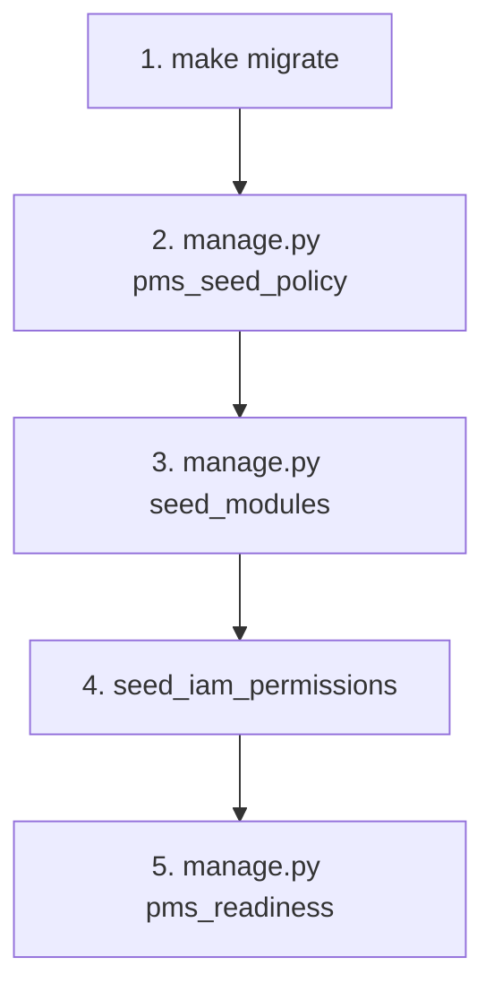

# Patent Management System (PMS) — Deployment & Operations

This document defines the production deployment order, readiness verification, background task scheduling, and operations runbook for `modules.patents` (Step 7.5).

---

## 1. Authoritative Deployment Order

Deploying the patents module requires following this strict sequence:



### Step 1: Database Migrations
Run all database schema migrations, including `modules/patents/migrations/0001_initial.py`:
```bash
make migrate
# or: .venv/bin/python manage.py migrate patents
```

### Step 2: Seed Institutional Policy
The module requires an active singleton `PatentPolicy` record configuring review SLAs, deadlines, and cost thresholds:
```bash
.venv/bin/python manage.py pms_seed_policy
```
*Creates active policy with 15-day review SLA, 60-day resubmission window, and pre-filing withdrawal states. Seeds no threshold unless `--threshold` is passed; the institute must configure this threshold before budget escalation rules are applied.*

### Step 3: Register Module & Navigation
Registers `patents` and its 11 navigation routes in the central access control registry:
```bash
.venv/bin/python manage.py seed_modules
```
*`seed_modules` automatically invokes `modules.patents.registry.readiness()`. If policy is missing, the module is registered as `status="planned"`; once prerequisites are met, it is marked `status="active"`.*

### Step 4: Seed IAM Permissions & Role Grants
From the System Administrator / IAM backend, seed the manifest generated in `registry/permissions.json`:
```bash
cd <path_to_Fusion_System_Administrator>/Backend/backend
./../venv/bin/python manage.py seed_iam_permissions --manifest /path/to/Fusion-Integrated/registry/permissions.json
```

### Step 5: Verify Deployment Readiness
Run the module readiness gate to confirm that all operational prerequisites are satisfied:
```bash
.venv/bin/python manage.py pms_readiness
```
*Exits with code 0 if ready. If prerequisites are unmet, prints actionable steps and exits with code 1.*

---

## 2. Background Task Automation (Celery Beat)

The module registers the periodic maintenance and deadline sweep task in `modules/patents/schedule.py` and `config/celery.py`:

* **Task Name:** `patents.pms_sweep_deadlines`
* **Schedule:** Daily at 00:30 UTC (`crontab(hour=0, minute=30)`)
* **Functions:**
  1. Identifies unrevised rejected/revision applications exceeding 60 days and marks them `EXPIRED` (BR-PMS-038).
  2. Evaluates approaching office action response deadlines and triggers notifications (BR-PMS-065).
  3. Sweeps post-grant annual maintenance renewal windows (BR-PMS-059..061).

---

## 3. Deployment Health Checks

Run the CI deployment security and setting check:
```bash
DJANGO_SETTINGS_MODULE=config.settings.prod DB_PASSWORD=local-check-only \
DJANGO_SECRET_KEY=local-check-only-key-long-enough-to-satisfy-the-length-check \
DJANGO_ALLOWED_HOSTS=local.invalid IAM_SERVICE_TOKEN=local \
PLACEMENT_UPLOAD_ROOT=/tmp/check-uploads \
REDIS_CACHE_URL=redis://127.0.0.1:6379/1 REDIS_BROKER_URL=redis://127.0.0.1:6380/0 \
.venv/bin/python manage.py check --deploy --fail-level WARNING
```
