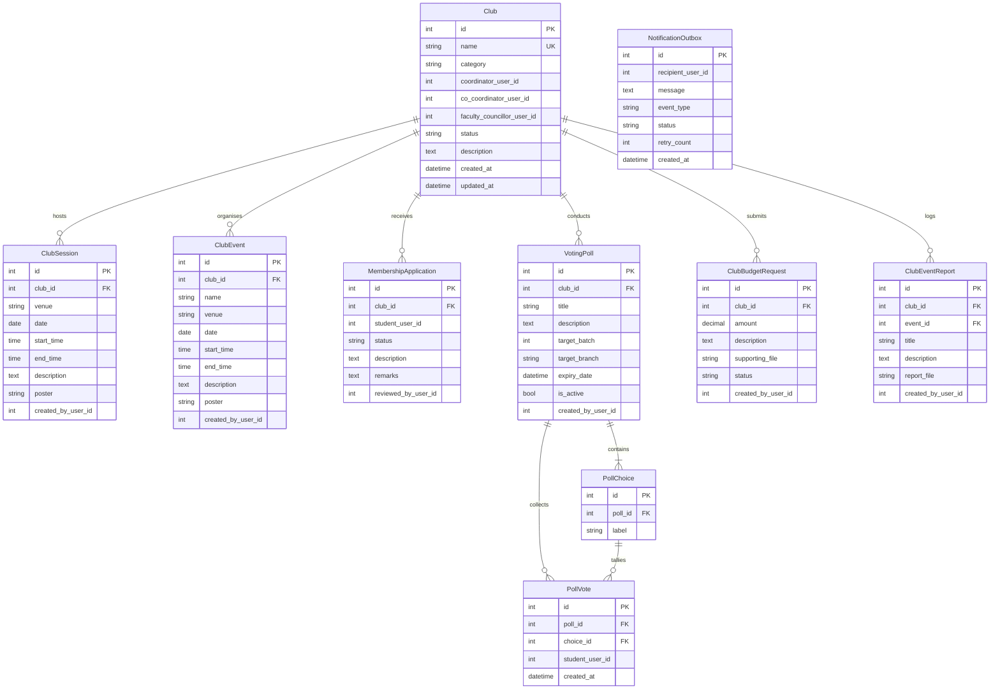
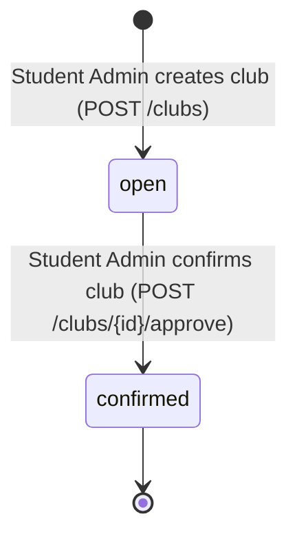
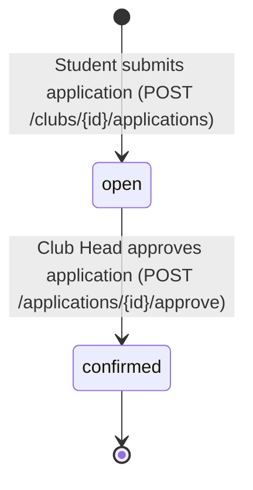

# Gymkhana Module Blueprint (Phase 2 Deliverable)

## §0 — Specification & Scope Baseline

- **Module Name**: Gymkhana
- **Module Code**: `gymkhana`
- **Spec Folder**: `18 Gmkhana` (Synchronized v1.1 bundle)
- **ID Prefixes**: `BR-GYM-`, `UC-GYM-`, `AFR-GYM-`, `BW-GYM-`
- **Environment**: `module-only`
- **Docs Directory**: `docs/18-gymkhana/`
- **Reference Module**: `modules/placement`

---

## §1 — Phase 1: Architecture Questions

### 2.1 — Bounded Context
The Gymkhana module is a single bounded context governing student club operations, memberships, venue scheduling (sessions and events), voting polls, event reporting, and budget tracking. It is fully decoupled from other domain modules (e.g. Leave / Placement).

### 2.2 — Cross-Module Dependencies
- **IAM (`fusion_auth`)**: Handles authentication, bearer token resolution, and RBAC permission checks.
- **Directory (`modules.directory`)**: Provides the `UserRef` projection used to validate student status (`kind == "student"`), faculty status (`kind == "faculty"`), batch year, and discipline/branch filtering.
- **Gymkhana Storage**: Dedicated `GymkhanaFileStorage` rooted at `GYMKHANA_UPLOAD_ROOT` for posters, budget files, and event reports.
- **Celery / Outbox**: Asynchronous dispatch of transactional notifications from `NotificationOutbox`.

### 2.3 — Identity
All institute identities remain IAM user IDs (`int`). Gymkhana owns no custom user tables, creates no user rows, and maintains no cross-module foreign keys.

### 2.4 — Roles & Authority Matrix
| Role | Authority | Key Permissions |
|---|---|---|
| **Student Admin** | Club establishment and confirmation | `gymkhana.club.manage` |
| **Club Head** (Coordinator / Co-coordinator) | Leadership replacement, venue bookings, membership approval, poll creation, budget request, event reporting | `gymkhana.club.leadership`, `gymkhana.club.operate` |
| **Club Faculty Councillor** | Event report access and review for assigned club | `gymkhana.club.faculty_review` |
| **Student** | View clubs, apply for club membership, vote in eligible polls | `gymkhana.club.view`, `gymkhana.poll.vote` |

### 2.5 — Scope & Multi-Tenancy
Club operational routes verify that the authenticated actor matches the specific club's assigned `coordinator_user_id` or `co_coordinator_user_id`. Report review routes verify the actor matches `faculty_councillor_user_id`.

### 2.6 — Time & Concurrency
- `end_time > start_time` is enforced at model and serializer levels.
- Mutual exclusivity across both sessions and events for the same `(venue, date)` is enforced using atomic transactions and database locking (`select_for_update`).
- Poll voting is restricted to active polls where `expiry_date > timezone.now()`.

### 2.7 — Money & Quotas
- Budget requests require `amount >= 0` and a non-empty supporting file.
- Exactly 1 vote per eligible student per poll is enforced by a database unique constraint on `(poll, student_user_id)`.

### 2.8 — Policy & Invariants
- Allowed club categories: `Technical`, `Sports`, `Cultural` (`BR-GYM-003`).
- Membership application requires `club.status == "confirmed"` (`BR-GYM-007`).
- Duplicate active membership applications to the same club are rejected (`BR-GYM-009`).
- Venues must be present in configured `GYMKHANA_VENUES` (`BR-GYM-020`).

---

## §2 — Phase 2: Blueprint Specifications

### 3.1 — Traceability Table

| Spec ID | Name / Obligation | Model(s) | Service / Selector | API Endpoint | Permission |
|---|---|---|---|---|---|
| **BR-GYM-001** | Valid Student Leadership | `Club` | `services.create_club` | `POST /api/v1/gymkhana/clubs` | `gymkhana.club.manage` |
| **BR-GYM-002** | Valid Faculty Councillor | `Club` | `services.create_club` | `POST /api/v1/gymkhana/clubs` | `gymkhana.club.manage` |
| **BR-GYM-003** | Allowed Categories | `Club` | `services.create_club` | `POST /api/v1/gymkhana/clubs` | `gymkhana.club.manage` |
| **BR-GYM-004** | Club Confirmation | `Club` | `services.approve_club` | `POST /api/v1/gymkhana/clubs/{id}/approve` | `gymkhana.club.manage` |
| **BR-GYM-005** | Valid Booking Time | `ClubSession`, `ClubEvent` | `services.book_session`, `book_event` | `POST /api/v1/gymkhana/clubs/{id}/sessions` | `gymkhana.club.operate` |
| **BR-GYM-006** | Cross-Type Exclusivity | `ClubSession`, `ClubEvent` | `services.check_venue_conflict` | `POST /api/v1/gymkhana/clubs/{id}/sessions` | `gymkhana.club.operate` |
| **BR-GYM-007** | Confirmed Club Required | `MembershipApplication` | `services.apply_for_membership` | `POST /api/v1/gymkhana/clubs/{id}/applications` | `gymkhana.club.view` |
| **BR-GYM-008** | Multiple Clubs Allowed | `MembershipApplication` | `services.apply_for_membership` | `POST /api/v1/gymkhana/clubs/{id}/applications` | `gymkhana.club.view` |
| **BR-GYM-009** | No Duplicate Application | `MembershipApplication` | `services.apply_for_membership` | `POST /api/v1/gymkhana/clubs/{id}/applications` | `gymkhana.club.view` |
| **BR-GYM-010** | Club Head Authorization | `Club` | `services.require_club_head` | All club operational endpoints | `gymkhana.club.operate` |
| **BR-GYM-011** | Membership Approval | `MembershipApplication` | `services.approve_membership` | `POST /api/v1/gymkhana/clubs/{id}/applications/{aid}/approve` | `gymkhana.club.operate` |
| **BR-GYM-012** | Minimum 2 Poll Choices | `VotingPoll`, `PollChoice` | `services.create_poll` | `POST /api/v1/gymkhana/clubs/{id}/polls` | `gymkhana.club.operate` |
| **BR-GYM-013** | Poll Targeting | `VotingPoll` | `services.create_poll` | `POST /api/v1/gymkhana/clubs/{id}/polls` | `gymkhana.club.operate` |
| **BR-GYM-014** | Active Poll Eligibility | `VotingPoll`, `PollVote` | `services.cast_vote` | `POST /api/v1/gymkhana/polls/{id}/vote` | `gymkhana.poll.vote` |
| **BR-GYM-015** | One Vote Per Student | `PollVote` | `services.cast_vote` | `POST /api/v1/gymkhana/polls/{id}/vote` | `gymkhana.poll.vote` |
| **BR-GYM-016** | Leadership Succession | `Club` | `services.update_leadership` | `PUT /api/v1/gymkhana/clubs/{id}/leadership` | `gymkhana.club.leadership` |
| **BR-GYM-017** | Non-Negative Budget | `ClubBudgetRequest` | `services.create_budget_request` | `POST /api/v1/gymkhana/clubs/{id}/budget` | `gymkhana.club.operate` |
| **BR-GYM-018** | Budget File Required | `ClubBudgetRequest` | `services.create_budget_request` | `POST /api/v1/gymkhana/clubs/{id}/budget` | `gymkhana.club.operate` |
| **BR-GYM-019** | Event Report File Req. | `ClubEventReport` | `services.create_event_report` | `POST /api/v1/gymkhana/clubs/{id}/reports` | `gymkhana.club.operate` |
| **BR-GYM-020** | Configured Venue Req. | `ClubSession`, `ClubEvent` | `services.validate_venue` | `POST /api/v1/gymkhana/clubs/{id}/sessions` | `gymkhana.club.operate` |
| **BR-GYM-021** | Faculty Report Review | `ClubEventReport` | `services.get_event_reports` | `GET /api/v1/gymkhana/clubs/{id}/reports` | `gymkhana.club.faculty_review` |

---

### 3.2 — Domain Model & Database Schema



---

### 3.3 — State Machines

#### 1. Club Establishment Lifecycle (`BW-GYM-03`)


#### 2. Club Membership Lifecycle (`BW-GYM-01`)


---

### 3.4 — Permission List & Role Grants (`registry.py`)

```python
PERMISSIONS = [
    ("gymkhana.club.view", "View confirmed clubs, sessions, events and polls"),
    ("gymkhana.club.manage", "Create and approve clubs (Student Admin)"),
    ("gymkhana.club.leadership", "Change club coordinator and co-coordinator"),
    ("gymkhana.club.operate", "Book venues, approve memberships, create polls, submit reports"),
    ("gymkhana.poll.vote", "Cast a vote in an active targeted poll"),
    ("gymkhana.club.faculty_review", "Access and review event reports for assigned club"),
]

ROLE_GRANTS = {
    "student": [
        "gymkhana.club.view",
        "gymkhana.poll.vote",
        "gymkhana.club.leadership",
        "gymkhana.club.operate",
    ],
    "Student Admin": [
        "gymkhana.club.view",
        "gymkhana.club.manage",
    ],
    "faculty": [
        "gymkhana.club.view",
        "gymkhana.club.faculty_review",
    ],
}
```

---

### 3.5 — REST API Endpoints

| Method | Endpoint | Permission Gate | Request / Query | Response |
|---|---|---|---|---|
| `GET` | `/api/v1/gymkhana/clubs` | `gymkhana.club.view` | `?category=&status=` | `List[ClubSerializer]` |
| `POST` | `/api/v1/gymkhana/clubs` | `gymkhana.club.manage` | `ClubCreateSerializer` | `ClubSerializer` (201) |
| `GET` | `/api/v1/gymkhana/clubs/{id}` | `gymkhana.club.view` | — | `ClubSerializer` |
| `POST` | `/api/v1/gymkhana/clubs/{id}/approve` | `gymkhana.club.manage` | — | `ClubSerializer` |
| `PUT` | `/api/v1/gymkhana/clubs/{id}/leadership` | `gymkhana.club.leadership` | `LeadershipSerializer` | `ClubSerializer` |
| `GET` | `/api/v1/gymkhana/clubs/{id}/sessions` | `gymkhana.club.view` | — | `List[SessionSerializer]` |
| `POST` | `/api/v1/gymkhana/clubs/{id}/sessions` | `gymkhana.club.operate` | `SessionCreateSerializer` (multipart) | `SessionSerializer` (201) |
| `GET` | `/api/v1/gymkhana/clubs/{id}/events` | `gymkhana.club.view` | — | `List[EventSerializer]` |
| `POST` | `/api/v1/gymkhana/clubs/{id}/events` | `gymkhana.club.operate` | `EventCreateSerializer` (multipart) | `EventSerializer` (201) |
| `GET` | `/api/v1/gymkhana/clubs/{id}/applications` | `gymkhana.club.operate` | — | `List[ApplicationSerializer]` |
| `POST` | `/api/v1/gymkhana/clubs/{id}/applications` | `gymkhana.club.view` | `ApplicationCreateSerializer` | `ApplicationSerializer` (201) |
| `POST` | `/api/v1/gymkhana/clubs/{id}/applications/{aid}/approve` | `gymkhana.club.operate` | `ApprovalRemarksSerializer` | `ApplicationSerializer` |
| `GET` | `/api/v1/gymkhana/polls` | `gymkhana.club.view` | — | `List[PollSerializer]` |
| `POST` | `/api/v1/gymkhana/clubs/{id}/polls` | `gymkhana.club.operate` | `PollCreateSerializer` | `PollSerializer` (201) |
| `POST` | `/api/v1/gymkhana/polls/{id}/vote` | `gymkhana.poll.vote` | `VoteSerializer` | `VoteResultSerializer` (201) |
| `POST` | `/api/v1/gymkhana/clubs/{id}/budget` | `gymkhana.club.operate` | `BudgetCreateSerializer` (multipart) | `BudgetSerializer` (201) |
| `GET` | `/api/v1/gymkhana/clubs/{id}/reports` | `gymkhana.club.faculty_review` | — | `List[ReportSerializer]` |
| `POST` | `/api/v1/gymkhana/clubs/{id}/reports` | `gymkhana.club.operate` | `ReportCreateSerializer` (multipart) | `ReportSerializer` (201) |
| `GET` | `/api/v1/gymkhana/files/{kind}/{id}` | Authenticated | — | Binary file stream |

---

### 3.6 — Contracts & Integration Events
- **Transaction Outbox Pattern**: When a session, event, or poll is published, rows are written to `NotificationOutbox` inside the same database transaction.
- **Payload Schema**:
  ```json
  {
    "recipient_user_id": 1001,
    "event_type": "gymkhana.session.booked",
    "message": "New session booked for Photography Club at Hall 1 on 2026-11-25."
  }
  ```

---

### 3.7 — Scheduled Work & Management Commands
- `send_gymkhana_notifications`: Dispatches pending rows from `NotificationOutbox` via Celery beat (every 1 minute) or CLI (`manage.py send_gymkhana_notifications`).

---

### 3.8 — Stated Scope Exclusions
Per synchronized specification baseline:
- No online budget approval/rejection lifecycle.
- No membership rejection/cancellation endpoints.
- No fest core-team budgets or payments.
