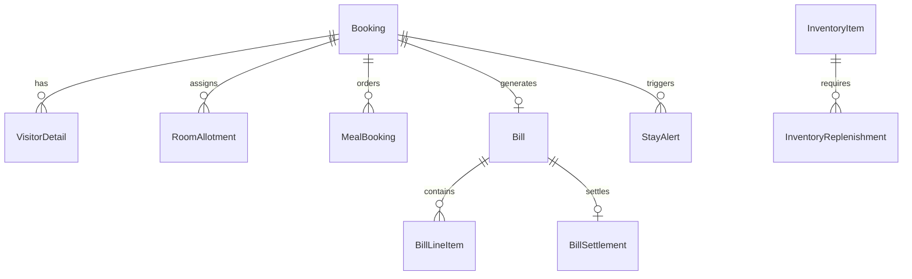
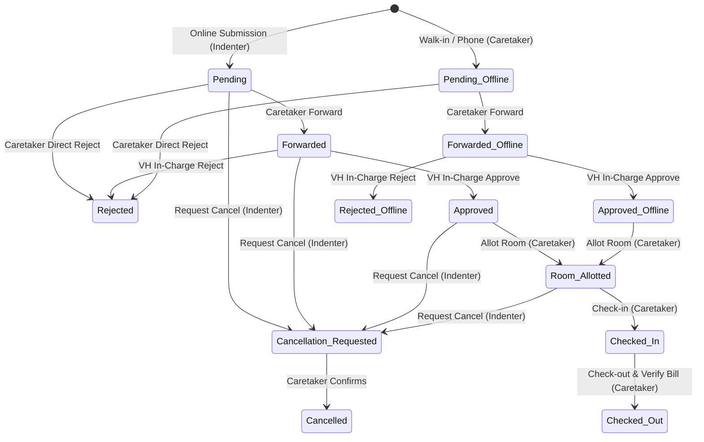

# Visitors Hostel Management System (VHMS) — Module Blueprint

**Module Code:** `vh`  
**Module Name:** Visitors Hostel Management System (VHMS)  
**Document Number:** 22 (`docs/22-vh/`)  
**Specification Baseline:** DIRECT_FINAL_v2 Baseline v1.3  
**Status:** DRAFT FOR APPROVAL (Gate §3 / Phase 2)

---

## 1. §3.1 (a) — Traceability Table

| Id | What it requires | Layer it belongs in | Enforcement point (planned) | Notes |
|---|---|---|---|---|
| **CFR-VH-001** | Indenter booking info access | `selectors` / `api` | `selectors.bookings.get_indenter_bookings`, `api.views.IndenterBookingViewSet` | AFR-001..003 |
| AFR-VH-001 | Track status & history of submitted bookings | `selectors` | `selectors.bookings.get_indenter_bookings` | Scoped by user_id |
| AFR-VH-002 | View booking and confirmation details | `selectors` | `selectors.bookings.get_booking_detail` | Scoped by user_id |
| AFR-VH-003 | Printable booking & confirmation details | `api` / `client` | `api.views.IndenterBookingViewSet.print_view` | Printable DTO / view |
| **CFR-VH-002** | Online booking request creation | `services` / `models` | `services.booking_lifecycle.create_online_booking` | AFR-005..013 |
| AFR-VH-005 | Submit online booking request via form | `services` | `services.booking_lifecycle.create_online_booking` | UC-VH-001 |
| AFR-VH-006 | Record visitor details | `models` | `models.VisitorDetail` | UC-VH-001 |
| AFR-VH-007 | Record visit purpose | `models` | `models.Booking.visit_purpose` | UC-VH-001 |
| AFR-VH-008 | Record visitor category (A, B, C, D) | `models` / `domain` | `models.Booking.visitor_category`, `domain.tariffs` | BR-VH-019 |
| AFR-VH-009 | Record stay duration and timings | `models` / `domain` | `models.Booking.arrival_date`, `departure_date`, `domain.rules.validate_dates` | Check arrival < departure |
| AFR-VH-010 | Record number of rooms and occupants | `models` | `models.Booking.number_of_rooms`, `number_of_occupants` | Min 1 room/occupant |
| AFR-VH-011 | Record billing responsibility | `models` | `models.Booking.billing_responsibility` | BR-VH-002 |
| AFR-VH-012 | Restrict billing responsibility to Visitor/Indenter/Institute/Project | `domain` / `models` | `domain.rules.validate_billing_responsibility`, `CheckConstraint` | BR-VH-002 |
| AFR-VH-013 | Set status to Pending upon submission | `services` / `domain` | `services.booking_lifecycle.create_online_booking`, `domain.state_machine` | Initial state |
| **CFR-VH-003** | Booking review, routing, and final decision | `services` / `domain` | `services.booking_lifecycle.route_booking`, `decide_booking` | AFR-014..020 |
| AFR-VH-014 | Caretaker reviews submitted requests | `selectors` | `selectors.bookings.list_pending_bookings` | Caretaker permission |
| AFR-VH-015 | Caretaker checks room availability | `selectors` | `selectors.rooms.check_room_availability` | Date range query |
| AFR-VH-016 | Caretaker directly rejects booking request | `services` | `services.booking_lifecycle.caretaker_reject_booking` | Pending -> Rejected |
| AFR-VH-017 | Caretaker forwards eligible booking to VH In-Charge | `services` | `services.booking_lifecycle.caretaker_forward_booking` | Pending -> Forwarded |
| AFR-VH-018 | VH In-Charge approves forwarded booking | `services` | `services.booking_lifecycle.incharge_approve_booking` | Forwarded -> Approved |
| AFR-VH-019 | VH In-Charge rejects forwarded booking | `services` | `services.booking_lifecycle.incharge_reject_booking` | Forwarded -> Rejected |
| AFR-VH-020 | System notifies Indenter of final decision | `services` / `tasks` | `services.notifications.notify_booking_decision` | UC-VH-023 event |
| **CFR-VH-004** | Offline booking recording & routing | `services` / `models` | `services.booking_lifecycle.create_offline_booking` | AFR-021..025 |
| AFR-VH-021 | Caretaker records telephonic bookings | `services` | `services.booking_lifecycle.create_offline_booking(source='telephonic')` | UC-VH-005 |
| AFR-VH-022 | Caretaker records walk-in bookings | `services` | `services.booking_lifecycle.create_offline_booking(source='walk_in')` | UC-VH-005 |
| AFR-VH-023 | Apply same approval routing to offline bookings | `services` / `domain` | `domain.state_machine.transition` | BR-VH-003 |
| AFR-VH-024 | Apply same room-availability checking | `selectors` | `selectors.rooms.check_room_availability` | BR-VH-004 |
| AFR-VH-025 | Clearly flag offline bookings for audit/reporting | `models` | `models.Booking.is_offline`, `models.Booking.booking_source` | BR-VH-005 |
| **CFR-VH-005** | Booking modification handling | `services` / `models` | `services.booking_lifecycle.request_booking_modification` | AFR-026, 034 |
| AFR-VH-026 | Indenter requests booking modification before arrival | `services` | `services.booking_lifecycle.request_booking_modification` | Pre-arrival check |
| AFR-VH-034 | Adjust billing info according to confirmed modification outcome | `services` | `services.billing.adjust_bill_for_modification` | BR-VH-010 |
| **CFR-VH-006** | Booking cancellation and charge handling | `services` / `domain` | `services.booking_lifecycle.request_cancellation`, `confirm_cancellation` | AFR-027..033, 035 |
| AFR-VH-027 | Indenter requests booking cancellation before arrival | `services` | `services.booking_lifecycle.request_cancellation` | Pre-arrival check |
| AFR-VH-028 | Compute cancellation charges per stated schedule | `domain` | `domain.cancellation.calculate_cancellation_charge` | BR-VH-006 |
| AFR-VH-029 | 0% charge for cancellation exactly 7 days before arrival | `domain` | `domain.cancellation.calculate_cancellation_charge` | BR-VH-007 |
| AFR-VH-030 | 25% charge for cancellation within 7 days before arrival | `domain` | `domain.cancellation.calculate_cancellation_charge` | BR-VH-008 |
| AFR-VH-031 | 50% charge for same-day cancellation or no-show | `domain` | `domain.cancellation.calculate_cancellation_charge` | BR-VH-009 |
| AFR-VH-032 | Caretaker reviews cancellation requests | `selectors` | `selectors.bookings.list_cancellation_requests` | UC-VH-020 |
| AFR-VH-033 | Caretaker confirms cancellation requests | `services` | `services.booking_lifecycle.confirm_cancellation` | UC-VH-020 |
| AFR-VH-035 | Adjust billing info per confirmed cancellation & charge | `services` | `services.billing.create_or_adjust_cancellation_bill` | BR-VH-011 |
| **CFR-VH-007** | Room allotment and room/occupancy records | `services` / `models` | `services.stays.allot_room`, `models.RoomAllotment` | AFR-036..040 |
| AFR-VH-036 | Allow room allotment only after booking approval | `services` / `domain` | `domain.rules.assert_approved_for_allotment`, `services.stays.allot_room` | BR-VH-012 |
| AFR-VH-037 | Support Single occupancy records | `models` | `models.RoomAllotment.occupancy_type = 'single'` | BR-VH-013 |
| AFR-VH-038 | Support Double occupancy records | `models` | `models.RoomAllotment.occupancy_type = 'double'` | BR-VH-014 |
| AFR-VH-039 | Support Suite room records | `models` | `models.Room.room_type = 'suite'` | BR-VH-015 |
| AFR-VH-040 | Support Non-suite room records | `models` | `models.Room.room_type = 'non_suite'` | BR-VH-016 |
| **CFR-VH-008** | Stay check-in, check-out, and stay exceptions | `services` / `tasks` | `services.stays.record_checkin`, `record_checkout` | AFR-041..044 |
| AFR-VH-041 | Record guest check-in time | `services` / `models` | `services.stays.record_checkin`, `models.Booking.checkin_time` | UC-VH-009 |
| AFR-VH-042 | Record guest check-out time | `services` / `models` | `services.stays.record_checkout`, `models.Booking.checkout_time` | UC-VH-021 |
| AFR-VH-043 | Generate alerts for guests who do not check in | `services` / `tasks` | `services.alerts.evaluate_no_shows`, `models.StayAlert` | BR-VH-017, UC-VH-024 |
| AFR-VH-044 | Generate alerts for guests overstaying beyond approved duration | `services` / `tasks` | `services.alerts.evaluate_overstays`, `models.StayAlert` | BR-VH-018, UC-VH-024 |
| **CFR-VH-009** | Visitor category and tariff control | `domain` / `models` | `domain.tariffs`, `models.TariffConfig` | AFR-045..050, 108 |
| AFR-VH-045 | Classify visitors into categories A, B, C, D | `domain` / `models` | `domain.tariffs.VisitorCategory`, `models.Booking.visitor_category` | BR-VH-019 |
| AFR-VH-046 | Maintain category-specific tariffs | `models` | `models.TariffConfig.category` | Effective-dated |
| AFR-VH-047 | Maintain occupancy-specific tariffs | `models` | `models.TariffConfig.occupancy` | Single / Double |
| AFR-VH-048 | Record effective-from dates for tariffs | `models` | `models.TariffConfig.effective_from` | Never edited past |
| AFR-VH-049 | Select applicable tariff automatically during billing | `selectors` / `domain` | `selectors.tariffs.get_applicable_tariff` | BR-VH-023 |
| AFR-VH-050 | Prevent tariff changes from affecting historical bills | `services` / `models` | `services.billing.finalize_bill`, `models.Bill.is_immutable` | BR-VH-024, snapshot |
| AFR-VH-108 | Tariff selection without ambiguity | `selectors` | `selectors.tariffs.get_applicable_tariff` | category + occ + date |
| **CFR-VH-010** | Mess and meal booking | `services` / `models` | `services.meals`, `models.MealBooking` | AFR-051..058 |
| AFR-VH-051 | Allow meal bookings for guests staying in VH | `services` / `domain` | `domain.rules.assert_active_stay_for_meals` | BR-VH-025 |
| AFR-VH-052 | Support full-day meal options | `models` / `domain` | `models.MealBooking.meal_option = 'full_day'` | UC-VH-012 |
| AFR-VH-053 | Support individual meal options | `models` / `domain` | `models.MealBooking.meal_option = 'individual'` | Breakfast/Lunch/Dinner |
| AFR-VH-054 | Support add-on meal options | `models` / `domain` | `models.MealBooking.meal_option = 'add_on'` | Tea/Milk |
| AFR-VH-055 | Restrict individual meal options to Breakfast, Lunch, Dinner | `domain` / `models` | `domain.rules.validate_meal_choice`, `CheckConstraint` | BR-VH-029 |
| AFR-VH-056 | Restrict add-on options to Tea and Milk | `domain` / `models` | `domain.rules.validate_addon_choice`, `CheckConstraint` | BR-VH-030 |
| AFR-VH-057 | Link meal bookings to guest stay duration | `services` / `domain` | `domain.rules.assert_meal_date_within_stay` | BR-VH-031 |
| AFR-VH-058 | Reflect meal bookings in VHMS billing | `services` | `services.billing.compile_bill_line_items` | BR-VH-032 |
| **CFR-VH-011** | Billing and offline settlement | `services` / `models` | `services.billing`, `models.Bill`, `models.BillSettlement` | AFR-059..066 |
| AFR-VH-059 | Generate bills based on room rent | `services` | `services.billing.calculate_room_rent` | BR-VH-033 |
| AFR-VH-060 | Generate bills based on meal consumption | `services` | `services.billing.calculate_meal_charges` | BR-VH-034 |
| AFR-VH-061 | Generate bills based on cancellation charges | `services` | `services.billing.calculate_cancellation_charge` | BR-VH-035 |
| AFR-VH-062 | Record billing responsibility for each booking | `models` | `models.Bill.billing_responsibility` | Visitor/Indenter/etc |
| AFR-VH-063 | Treat bills as settled offline in cash | `domain` / `models` | `models.BillSettlement.payment_mode = 'offline_cash'` | BR-VH-036 |
| AFR-VH-064 | Record offline bill settlement information | `services` / `models` | `services.billing.record_settlement` | UC-VH-013 |
| AFR-VH-065 | Caretaker records guest bill verification during checkout | `services` / `models` | `services.billing.record_bill_verification` | UC-VH-021 |
| AFR-VH-066 | Maintain immutable billing records for audit | `models` / `services` | `models.Bill.is_finalized`, immutable check | BR-VH-037 |
| **CFR-VH-012** | Inventory records & threshold control | `services` / `models` | `services.inventory`, `models.InventoryItem` | AFR-068..072 |
| AFR-VH-068 | Caretaker maintains VH inventory records | `services` / `selectors` | `services.inventory.update_inventory_item` | UC-VH-014 |
| AFR-VH-069 | Support items like linen, utensils, consumables | `models` | `models.InventoryItem.category` | Linen, utensils, etc. |
| AFR-VH-070 | Record current quantity for each item | `models` | `models.InventoryItem.current_quantity` | Non-negative int |
| AFR-VH-071 | Record minimum threshold level | `models` | `models.InventoryItem.minimum_threshold` | Non-negative int |
| AFR-VH-072 | Generate alerts when quantity < threshold | `services` | `services.inventory.check_threshold_alert` | BR-VH-041, UC-VH-025 |
| **CFR-VH-013** | Inventory replenishment review & approval | `services` / `models` | `services.inventory.approve_replenishment` | AFR-073, 074 |
| AFR-VH-073 | VH In-Charge reviews replenishment requirements | `selectors` | `selectors.inventory.list_replenishment_requests` | UC-VH-015 |
| AFR-VH-074 | VH In-Charge approves replenishment requirements | `services` | `services.inventory.approve_replenishment` | UC-VH-015 |
| **CFR-VH-014** | VHMS notification services | `services` / `tasks` | `services.notifications` | AFR-076..080 |
| AFR-VH-076 | Trigger notification for booking submission | `services` | `services.notifications.notify_booking_submission` | UC-VH-023 |
| AFR-VH-077 | Trigger notification for approval or rejection | `services` | `services.notifications.notify_booking_decision` | UC-VH-023 |
| AFR-VH-078 | Trigger notification for modification/cancellation | `services` | `services.notifications.notify_cancellation_update` | UC-VH-023 |
| AFR-VH-079 | Trigger notification for check-in/out reminders | `tasks` | `tasks.send_stay_reminders` | UC-VH-024 |
| AFR-VH-080 | Trigger notification for inventory threshold alerts | `services` | `services.notifications.notify_inventory_threshold` | BR-VH-043, UC-VH-025 |
| **CFR-VH-015** | VH In-Charge reporting | `selectors` | `selectors.reports.incharge_reports` | AFR-082..085 |
| AFR-VH-082 | Booking summary reports | `selectors` | `selectors.reports.get_booking_summary_report` | UC-VH-017 |
| AFR-VH-083 | Category-wise occupancy reports | `selectors` | `selectors.reports.get_category_occupancy_report` | UC-VH-017 |
| AFR-VH-084 | Revenue and billing summary reports | `selectors` | `selectors.reports.get_revenue_summary_report` | UC-VH-017 |
| AFR-VH-085 | Inventory usage reports | `selectors` | `selectors.reports.get_inventory_usage_report` | UC-VH-017 |
| **CFR-VH-016** | Caretaker reporting | `selectors` | `selectors.reports.caretaker_reports` | AFR-086..089 |
| AFR-VH-086 | Daily occupancy reports | `selectors` | `selectors.reports.get_daily_occupancy_report` | UC-VH-018 |
| AFR-VH-087 | Upcoming arrivals and departures reports | `selectors` | `selectors.reports.get_arrivals_departures_report` | UC-VH-018 |
| AFR-VH-088 | Pending approval reports | `selectors` | `selectors.reports.get_pending_approvals_report` | UC-VH-018 |
| AFR-VH-089 | No-show and overstay logs | `selectors` | `selectors.reports.get_stay_exception_logs` | UC-VH-018 |
| **CFR-VH-017** | Operational role reassignment | `services` / `models` | `services.roles.reassign_operational_role` | AFR-090..095 |
| AFR-VH-090 | Exactly one active Caretaker at a time | `models` / `domain` | `models.OperationalRoleHolder`, `UniqueConstraint` on active caretaker | BR-VH-045 |
| AFR-VH-091 | Exactly one active VH In-Charge at a time | `models` / `domain` | `models.OperationalRoleHolder`, `UniqueConstraint` on active incharge | BR-VH-046 |
| AFR-VH-092 | Time-bound role assignments | `models` | `models.OperationalRoleHolder.valid_from`, `valid_to` | BR-VH-047 |
| AFR-VH-093 | Apply role reassignment immediately | `services` | `services.roles.reassign_operational_role` | BR-VH-048 |
| AFR-VH-094 | Transfer pending records to newly assigned role holder | `services` | `services.roles.transfer_pending_records` | BR-VH-049 |
| AFR-VH-095 | Transfer ongoing records to newly assigned role holder | `services` | `services.roles.transfer_ongoing_records` | BR-VH-050 |
| **CFR-VH-018** | Actor & access boundary constraints | Architecture / Scope | Scope constraint | AFR-004, 110, 112 |
| AFR-VH-004 | No direct system access to visitors | Architecture | Visitor has no login / IAM account | Spec constraint |
| AFR-VH-110 | System not modeled as primary actor | Architecture | Event-driven triggers only | Spec constraint |
| AFR-VH-112 | Exclude direct visitor access | Architecture | Same as AFR-VH-004 | Spec constraint |
| **CFR-VH-019** | External service & execution exclusions | Architecture / Scope | Scope constraint | AFR-067, 075, 081, 111, 114, 115 |
| AFR-067/111 | Exclude online payments / gateways / ledger | Architecture | Offline cash settlement recording only | Out of scope |
| AFR-075/114 | Exclude central procurement / stock / HR / payroll | Architecture | Local VH inventory tracking only | Out of scope |
| AFR-081 | Exclude central notification infrastructure | Architecture | Event log and local dispatch only | Out of scope |
| AFR-115 | Exclude physical catering, room service | Architecture | Operational records only | Out of scope |
| **CFR-VH-020** | Role-assignment scope boundary | Architecture / Scope | Scope constraint | AFR-096..098 |
| AFR-096..098 | Role assignment limited to VH access control | `services.roles` | Manages VH role holders only; no ERP HR edits | Boundary constraint |
| **CFR-VH-021** | Authoritative record & auditability | `models` / `services` | `models.BookingAuditLog`, immutable history | AFR-099..106 |
| AFR-099..106 | Preserves auditability across all VH operational entities | `models` | Audit tables & timestamped history | Complete audit trail |
| **CFR-VH-022** | Policy, integrity, and pricing boundaries | `domain` / `models` | Domain integrity enforcement | AFR-107, 109, 113 |
| AFR-107/109 | Institute norms configured, role boundaries respected | `domain` / `api` | Permission checks + domain checks | Baseline rules |
| AFR-113 | Exclude dynamic pricing or unauthorized discounts | `domain` | Fixed tariffs only, no discount fields | Pure approved tariffs |

---

## 2. §3.2 (b) — Domain Model & Database Invariants

All models are placed under `modules/vh/models/`, one file per aggregate.
All person references use plain integer `user_id`. No cross-module ForeignKeys.



### Models & Invariants

#### 1. `Booking` (`modules/vh/models/booking.py`)
* `id`: BigAutoField (PK)
* `booking_reference`: CharField(max_length=32, unique=True, db_index=True)
* `indenter_id`: IntegerField(db_index=True) — plain integer user ID
* `is_offline`: BooleanField(default=False)
* `booking_source`: CharField(max_length=20, choices=['online', 'telephonic', 'walk_in'])
* `status`: CharField(max_length=32, default='pending', db_index=True)
* `visitor_category`: CharField(max_length=1, choices=['A', 'B', 'C', 'D'])
* `visit_purpose`: TextField()
* `arrival_date`: DateField()
* `departure_date`: DateField()
* `checkin_time`: DateTimeField(null=True, blank=True)
* `checkout_time`: DateTimeField(null=True, blank=True)
* `number_of_rooms`: PositiveIntegerField(default=1)
* `number_of_occupants`: PositiveIntegerField(default=1)
* `billing_responsibility`: CharField(max_length=20, choices=['visitor', 'indenter', 'institute', 'project'])
* `rejection_reason`: TextField(blank=True, default='')
* `cancellation_reason`: TextField(blank=True, default='')
* `cancellation_charge_percentage`: DecimalField(max_digits=5, decimal_places=2, default=0.00)
* `cancellation_requested_at`: DateTimeField(null=True, blank=True)
* `cancellation_confirmed_at`: DateTimeField(null=True, blank=True)
* **Constraints**:
  * `CheckConstraint(check=Q(departure_date__gte=F('arrival_date')), name='vh_booking_departure_after_arrival')`
  * `CheckConstraint(check=Q(number_of_rooms__gt=0), name='vh_booking_min_rooms_gt_zero')`
  * `CheckConstraint(check=Q(number_of_occupants__gt=0), name='vh_booking_min_occupants_gt_zero')`
  * `CheckConstraint(check=Q(billing_responsibility__in=['visitor', 'indenter', 'institute', 'project']), name='vh_booking_valid_billing_resp')`

#### 2. `VisitorDetail` (`modules/vh/models/visitor.py`)
* `id`: BigAutoField (PK)
* `booking`: ForeignKey('vh.Booking', on_delete=CASCADE, related_name='visitors')
* `name`: CharField(max_length=120)
* `email`: EmailField(blank=True, default='')
* `phone`: CharField(max_length=20, blank=True, default='')
* `organization`: CharField(max_length=150, blank=True, default='')
* `designation`: CharField(max_length=100, blank=True, default='')
* `gender`: CharField(max_length=10, blank=True, default='')

#### 3. `Room` (`modules/vh/models/room.py`)
* `id`: BigAutoField (PK)
* `room_number`: CharField(max_length=20, unique=True)
* `room_type`: CharField(max_length=20, choices=['suite', 'non_suite'])
* `capacity`: PositiveIntegerField(default=2)
* `is_active`: BooleanField(default=True)

#### 4. `RoomAllotment` (`modules/vh/models/room.py`)
* `id`: BigAutoField (PK)
* `booking`: ForeignKey('vh.Booking', on_delete=CASCADE, related_name='allotments')
* `room`: ForeignKey('vh.Room', on_delete=PROTECT, related_name='allotments')
* `occupancy_type`: CharField(max_length=10, choices=['single', 'double'])
* `allotted_by`: IntegerField() — plain integer caretaker ID
* `allotted_at`: DateTimeField(auto_now_add=True)
* **Constraints**:
  * `CheckConstraint(check=Q(occupancy_type__in=['single', 'double']), name='vh_allotment_valid_occupancy')`

#### 5. `TariffConfig` (`modules/vh/models/tariff.py`)
* `id`: BigAutoField (PK)
* `category`: CharField(max_length=1, choices=['A', 'B', 'C', 'D'])
* `room_type`: CharField(max_length=20, choices=['suite', 'non_suite'])
* `occupancy`: CharField(max_length=10, choices=['single', 'double'])
* `daily_rate`: DecimalField(max_digits=10, decimal_places=2)
* `effective_from`: DateField(db_index=True)
* `is_active`: BooleanField(default=True)
* **Constraints**:
  * `UniqueConstraint(fields=['category', 'room_type', 'occupancy', 'effective_from'], name='vh_tariff_unique_effective')`
  * `CheckConstraint(check=Q(daily_rate__gte=0), name='vh_tariff_daily_rate_non_negative')`

#### 6. `MealBooking` (`modules/vh/models/meal.py`)
* `id`: BigAutoField (PK)
* `booking`: ForeignKey('vh.Booking', on_delete=CASCADE, related_name='meal_bookings')
* `meal_date`: DateField()
* `meal_option`: CharField(max_length=20, choices=['full_day', 'individual', 'add_on'])
* `individual_type`: CharField(max_length=20, null=True, blank=True, choices=['breakfast', 'lunch', 'dinner'])
* `add_on_type`: CharField(max_length=20, null=True, blank=True, choices=['tea', 'milk'])
* `quantity`: PositiveIntegerField(default=1)
* `rate`: DecimalField(max_digits=8, decimal_places=2)
* `amount`: DecimalField(max_digits=10, decimal_places=2)
* **Constraints**:
  * `CheckConstraint(check=Q(quantity__gt=0), name='vh_meal_quantity_gt_zero')`
  * `CheckConstraint(check=Q(meal_option__in=['full_day', 'individual', 'add_on']), name='vh_meal_valid_option')`

#### 7. `Bill` & `BillLineItem` & `BillSettlement` (`modules/vh/models/bill.py`)
* `Bill`:
  * `id`: BigAutoField (PK)
  * `booking`: OneToOneField('vh.Booking', on_delete=PROTECT, related_name='bill')
  * `bill_number`: CharField(max_length=32, unique=True)
  * `visitor_category`: CharField(max_length=1)
  * `room_rent_total`: DecimalField(max_digits=10, decimal_places=2, default=0.00)
  * `meal_charge_total`: DecimalField(max_digits=10, decimal_places=2, default=0.00)
  * `cancellation_charge_total`: DecimalField(max_digits=10, decimal_places=2, default=0.00)
  * `total_amount`: DecimalField(max_digits=10, decimal_places=2, default=0.00)
  * `billing_responsibility`: CharField(max_length=20)
  * `status`: CharField(max_length=20, default='generated', choices=['generated', 'verified', 'settled'])
  * `is_immutable`: BooleanField(default=False)
  * `verified_by`: IntegerField(null=True, blank=True)
  * `verified_at`: DateTimeField(null=True, blank=True)
  * `created_at`: DateTimeField(auto_now_add=True)
  * `finalized_at`: DateTimeField(null=True, blank=True)
* `BillLineItem`:
  * `id`: BigAutoField (PK)
  * `bill`: ForeignKey('vh.Bill', on_delete=CASCADE, related_name='items')
  * `item_type`: CharField(max_length=20, choices=['room', 'meal', 'cancellation'])
  * `description`: CharField(max_length=255)
  * `quantity`: DecimalField(max_digits=8, decimal_places=2)
  * `unit_price`: DecimalField(max_digits=10, decimal_places=2)
  * `total_price`: DecimalField(max_digits=10, decimal_places=2)
* `BillSettlement`:
  * `id`: BigAutoField (PK)
  * `bill`: OneToOneField('vh.Bill', on_delete=PROTECT, related_name='settlement')
  * `payment_mode`: CharField(max_length=20, default='offline_cash', choices=['offline_cash'])
  * `amount_paid`: DecimalField(max_digits=10, decimal_places=2)
  * `settled_by`: IntegerField() — caretaker ID
  * `settled_at`: DateTimeField(auto_now_add=True)
  * `receipt_number`: CharField(max_length=50, blank=True, default='')

#### 8. `InventoryItem` & `InventoryReplenishment` (`modules/vh/models/inventory.py`)
* `InventoryItem`:
  * `id`: BigAutoField (PK)
  * `item_name`: CharField(max_length=100, unique=True)
  * `category`: CharField(max_length=30, choices=['linen', 'utensils', 'consumables', 'other'])
  * `current_quantity`: PositiveIntegerField(default=0)
  * `minimum_threshold`: PositiveIntegerField(default=10)
  * `unit`: CharField(max_length=20, default='pieces')
  * `is_threshold_alert`: BooleanField(default=False)
* `InventoryReplenishment`:
  * `id`: BigAutoField (PK)
  * `item`: ForeignKey('vh.InventoryItem', on_delete=CASCADE, related_name='replenishments')
  * `requested_quantity`: PositiveIntegerField()
  * `status`: CharField(max_length=20, default='pending', choices=['pending', 'approved', 'rejected'])
  * `requested_by`: IntegerField()
  * `approved_by`: IntegerField(null=True, blank=True)
  * `approved_at`: DateTimeField(null=True, blank=True)
  * `remarks`: TextField(blank=True, default='')

#### 9. `StayAlert` (`modules/vh/models/alerts.py`)
* `id`: BigAutoField (PK)
* `booking`: ForeignKey('vh.Booking', on_delete=CASCADE, related_name='stay_alerts')
* `alert_type`: CharField(max_length=20, choices=['no_show', 'overstay'])
* `status`: CharField(max_length=20, default='active', choices=['active', 'resolved', 'acknowledged'])
* `details`: TextField(blank=True, default='')
* `triggered_at`: DateTimeField(auto_now_add=True)

#### 10. `OperationalRoleHolder` (`modules/vh/models/roles.py`)
* `id`: BigAutoField (PK)
* `role_name`: CharField(max_length=30, choices=['caretaker', 'incharge'])
* `user_id`: IntegerField()
* `valid_from`: DateTimeField()
* `valid_to`: DateTimeField(null=True, blank=True)
* `is_active`: BooleanField(default=True)
* **Constraints**:
  * `UniqueConstraint(fields=['role_name'], condition=Q(is_active=True), name='vh_unique_active_operational_role')` (Guarantees BR-VH-045 and BR-VH-046)

---

## 3. §3.3 (c) — Declarative State Machine

The complete state progression is enforced in `modules/vh/domain/state_machine.py`. All moves go through a single transactional choke point `services.booking_lifecycle.transition_booking_state`.



### Declarative Transition Table

```python
TRANSITIONS: dict[tuple[str, str, str], str] = {
    # (current_state, event, actor_role) -> resulting_state
    # Online booking paths (BW-VH-01, 02, 03)
    ("pending", "caretaker_reject", "caretaker"): "rejected",
    ("pending", "caretaker_forward", "caretaker"): "forwarded",
    ("forwarded", "incharge_approve", "incharge"): "approved",
    ("forwarded", "incharge_reject", "incharge"): "rejected",

    # Offline booking paths (BW-VH-04, 05, 06)
    ("pending_offline", "caretaker_reject", "caretaker"): "rejected",
    ("pending_offline", "caretaker_forward", "caretaker"): "forwarded_offline",
    ("forwarded_offline", "incharge_approve", "incharge"): "approved_offline",
    ("forwarded_offline", "incharge_reject", "incharge"): "rejected_offline",

    # Stay paths (BW-VH-10)
    ("approved", "allot_room", "caretaker"): "room_allotted",
    ("approved_offline", "allot_room", "caretaker"): "room_allotted",
    ("room_allotted", "check_in", "caretaker"): "checked_in",
    ("checked_in", "check_out", "caretaker"): "checked_out",

    # Cancellation paths (BW-VH-07, 08, 09, CW-VH-02)
    ("pending", "request_cancellation", "indenter"): "cancellation_requested",
    ("forwarded", "request_cancellation", "indenter"): "cancellation_requested",
    ("approved", "request_cancellation", "indenter"): "cancellation_requested",
    ("room_allotted", "request_cancellation", "indenter"): "cancellation_requested",
    ("cancellation_requested", "confirm_cancellation", "caretaker"): "cancelled",
}
```

---

## 4. §3.4 (d) — Permission List & Role Grants

Exact configuration for `modules/vh/registry.py`.
Verbs strictly drawn from the closed list in `docs/02-iam/rbac-model.md`: `view`, `create`, `update`, `delete`, `approve`, `review`, `assign`, `manage`.
Designation join keys copied directly from `globals_designation`: `VhCaretaker`, `VhIncharge`, plus basic roles `student`, `faculty`, `staff`.

```python
MODULE = {
    "code": "vh",
    "label": "Visitors Hostel",
    "icon": "Buildings",
    "base_path": "/vh",
    "nav_section": "Visitors Hostel",
    "sort_order": 22,
    "status": "active",
}

NAV_ITEMS = [
    # -- Indenter / Community --
    {"code": "vh.new_booking", "label": "New Booking", "icon": "PlusCircle",
     "to": "/vh/booking/new", "required_permission": "vh.booking.create", "sort_order": 10},
    {"code": "vh.my_bookings", "label": "My Bookings", "icon": "ClockCounterClockwise",
     "to": "/vh/my-bookings", "required_permission": "vh.booking.view", "sort_order": 20},
    {"code": "vh.tariffs", "label": "Tariff Card", "icon": "Receipt",
     "to": "/vh/tariffs", "required_permission": "vh.tariff.view", "sort_order": 30},

    # -- Caretaker --
    {"code": "vh.bookings", "label": "Booking Requisitions", "icon": "Inbox",
     "to": "/vh/bookings", "required_permission": "vh.booking.review", "sort_order": 40},
    {"code": "vh.stays", "label": "Stay & Check-in", "icon": "Key",
     "to": "/vh/stays", "required_permission": "vh.stay.manage", "sort_order": 50},
    {"code": "vh.meals", "label": "Mess & Meals", "icon": "ForkKnife",
     "to": "/vh/meals", "required_permission": "vh.meal.manage", "sort_order": 60},
    {"code": "vh.billing", "label": "Billing & Cash", "icon": "CurrencyInr",
     "to": "/vh/billing", "required_permission": "vh.bill.manage", "sort_order": 70},
    {"code": "vh.inventory", "label": "Hostel Inventory", "icon": "Package",
     "to": "/vh/inventory", "required_permission": "vh.inventory.manage", "sort_order": 80},
    {"code": "vh.caretaker_reports", "label": "Operational Logs", "icon": "FileText",
     "to": "/vh/caretaker-reports", "required_permission": "vh.report.view", "sort_order": 90},

    # -- VH In-Charge --
    {"code": "vh.approvals", "label": "Executive Approvals", "icon": "CheckSquareOffset",
     "to": "/vh/approvals", "required_permission": "vh.booking.approve", "sort_order": 100},
    {"code": "vh.supervisor_reports", "label": "Executive Reports", "icon": "ChartBar",
     "to": "/vh/supervisor-reports", "required_permission": "vh.report.manage", "sort_order": 110},
    {"code": "vh.role_admin", "label": "Role Reassignment", "icon": "UsersThree",
     "to": "/vh/roles", "required_permission": "vh.role.assign", "sort_order": 120},
]

PERMISSIONS = [
    # Bookings
    ("vh.booking.create", "Submit an online booking request"),
    ("vh.booking.view", "View visible booking details and history"),
    ("vh.booking.update", "Request modification to a submitted booking"),
    ("vh.booking.delete", "Request cancellation of a booking"),
    ("vh.booking.review", "Review pending bookings, check availability, route or reject"),
    ("vh.booking.approve", "Approve or reject forwarded bookings"),
    
    # Stay & Room
    ("vh.room.assign", "Allot rooms to approved bookings"),
    ("vh.stay.manage", "Record check-in, check-out, and stay exceptions"),
    
    # Mess
    ("vh.meal.manage", "Manage mess and meal bookings for staying guests"),
    ("vh.meal.view", "View meal records"),
    
    # Billing
    ("vh.bill.create", "Generate stay and cancellation bills"),
    ("vh.bill.view", "View generated bills"),
    ("vh.bill.manage", "Record offline cash settlement and checkout verification"),
    
    # Inventory
    ("vh.inventory.view", "View inventory quantities and threshold alerts"),
    ("vh.inventory.manage", "Record and update inventory stocks"),
    ("vh.inventory.approve", "Approve inventory replenishment requirements"),
    
    # Tariffs & Roles & Reports
    ("vh.tariff.view", "View active and published tariff rates"),
    ("vh.tariff.manage", "Configure effective-dated visitor category tariffs"),
    ("vh.report.view", "View caretaker operational reports and logs"),
    ("vh.report.manage", "View supervisory summary and revenue reports"),
    ("vh.role.assign", "Reassign operational Caretaker and In-Charge roles"),
]

SYSTEM_PERMISSIONS = [
    "vh.stay.monitor",
    "vh.inventory.monitor",
]

_INDENTER_PERMS = [
    "vh.booking.create",
    "vh.booking.view",
    "vh.booking.update",
    "vh.booking.delete",
    "vh.tariff.view",
]

_CARETAKER_PERMS = [
    "vh.booking.create",
    "vh.booking.view",
    "vh.booking.review",
    "vh.room.assign",
    "vh.stay.manage",
    "vh.meal.manage",
    "vh.meal.view",
    "vh.bill.create",
    "vh.bill.view",
    "vh.bill.manage",
    "vh.inventory.view",
    "vh.inventory.manage",
    "vh.tariff.view",
    "vh.report.view",
]

_INCHARGE_PERMS = [
    "vh.booking.view",
    "vh.booking.approve",
    "vh.meal.view",
    "vh.bill.view",
    "vh.inventory.view",
    "vh.inventory.approve",
    "vh.tariff.view",
    "vh.tariff.manage",
    "vh.report.manage",
    "vh.role.assign",
]

ROLE_GRANTS = {
    "student": _INDENTER_PERMS,
    "faculty": _INDENTER_PERMS,
    "staff": _INDENTER_PERMS,
    "VhCaretaker": _CARETAKER_PERMS,
    "VhIncharge": _INCHARGE_PERMS,
}
```

---

## 5. §3.5 (e) — Endpoint List & Route Guards

All endpoints sit under `/api/v1/vh/` behind two gates:
1. `HasModuleGrant("vh")`
2. `HasPermission("<permission_code>")`

### Backend Endpoints

| Method | Path | Required Permission | Input / Parameters | Returns | Enforces |
|---|---|---|---|---|---|
| `POST` | `/api/v1/vh/bookings/` | `vh.booking.create` | Online booking requisition DTO | `BookingDetailDto` (201) | CFR-002, BR-002 |
| `GET` | `/api/v1/vh/bookings/` | `vh.booking.view` | `status`, `page`, `page_size` | Paginated `BookingListDto` (200) | Scoping: Indenter vs Caretaker |
| `GET` | `/api/v1/vh/bookings/{id}/` | `vh.booking.view` | `id` | `BookingDetailDto` (200 / 404) | Scoping: 404 if not visible |
| `POST` | `/api/v1/vh/bookings/offline/` | `vh.booking.review` | Offline booking DTO (`source`) | `BookingDetailDto` (201) | CFR-004, BR-003..005 |
| `POST` | `/api/v1/vh/bookings/{id}/route/` | `vh.booking.review` | `action`: `reject` / `forward`, `reason` | `BookingDetailDto` (200) | BW-VH-01..06, CW-VH-01 |
| `POST` | `/api/v1/vh/bookings/{id}/decide/` | `vh.booking.approve` | `action`: `approve` / `reject`, `reason` | `BookingDetailDto` (200) | BW-VH-02, 03, 05, 06 |
| `POST` | `/api/v1/vh/bookings/{id}/cancel/` | `vh.booking.delete` | `reason` | `CancellationStatusDto` (200) | CFR-006, BR-006..009 |
| `POST` | `/api/v1/vh/bookings/{id}/confirm-cancellation/` | `vh.booking.review` | Empty body | `BookingDetailDto` (200) | UC-VH-020, BR-011 |
| `POST` | `/api/v1/vh/bookings/{id}/modify/` | `vh.booking.update` | Modification details | `BookingDetailDto` (200) | CFR-005, UC-VH-006 |
| `POST` | `/api/v1/vh/bookings/{id}/allot-rooms/` | `vh.room.assign` | `room_ids`, `occupancy_type` | `AllotmentResultDto` (200) | CFR-007, BR-012..016 |
| `POST` | `/api/v1/vh/bookings/{id}/checkin/` | `vh.stay.manage` | Optional `checkin_time` | `StayStatusDto` (200) | CFR-008, BW-VH-10 |
| `POST` | `/api/v1/vh/bookings/{id}/checkout/` | `vh.stay.manage` | `verified_by_guest`, notes | `StayStatusDto` (200) | CFR-008, AFR-065 |
| `GET` | `/api/v1/vh/rooms/availability/` | `vh.booking.review` | `arrival_date`, `departure_date`, `room_type` | `AvailableRoomsDto` (200) | AFR-015, AFR-024 |
| `POST` | `/api/v1/vh/bookings/{id}/meals/` | `vh.meal.manage` | Meal order DTO | `MealBookingDto` (201) | CFR-010, BR-025..032 |
| `GET` | `/api/v1/vh/bookings/{id}/meals/` | `vh.meal.view` | `id` | List of `MealBookingDto` (200) | CFR-010 |
| `POST` | `/api/v1/vh/bookings/{id}/bill/` | `vh.bill.create` | `id` | `BillDetailDto` (201 / 200) | CFR-011, BR-033..035 |
| `GET` | `/api/v1/vh/bookings/{id}/bill/` | `vh.bill.view` | `id` | `BillDetailDto` (200) | CFR-011, BR-037 |
| `POST` | `/api/v1/vh/bills/{id}/settle/` | `vh.bill.manage` | `amount_paid`, `receipt_number` | `SettlementResultDto` (200) | BR-036, UC-VH-013 |
| `GET` | `/api/v1/vh/inventory/` | `vh.inventory.view` | `category` | List of `InventoryItemDto` (200) | CFR-012, AFR-068..071 |
| `POST` | `/api/v1/vh/inventory/` | `vh.inventory.manage` | Inventory item creation / update DTO | `InventoryItemDto` (200) | CFR-012, BR-041 |
| `POST` | `/api/v1/vh/inventory/{id}/replenish/` | `vh.inventory.manage` | `requested_quantity` | `ReplenishmentDto` (201) | UC-VH-015 |
| `POST` | `/api/v1/vh/inventory/replenishments/{id}/approve/` | `vh.inventory.approve` | `decision`: `approve` / `reject` | `ReplenishmentDto` (200) | CFR-013, UC-VH-015 |
| `GET` | `/api/v1/vh/tariffs/` | `vh.tariff.view` | `active_only` | List of `TariffDto` (200) | CFR-009, BR-023 |
| `POST` | `/api/v1/vh/tariffs/` | `vh.tariff.manage` | Tariff config DTO | `TariffDto` (201) | CFR-009, BR-024 |
| `GET` | `/api/v1/vh/reports/caretaker/` | `vh.report.view` | `report_type` (occupancy/arrivals/pending/alerts) | Report data (200) | CFR-016, AFR-086..089 |
| `GET` | `/api/v1/vh/reports/incharge/` | `vh.report.manage` | `report_type` (summary/occupancy/revenue/usage) | Report data (200) | CFR-015, AFR-082..085 |
| `POST` | `/api/v1/vh/roles/reassign/` | `vh.role.assign` | `role_name`, `new_user_id`, `valid_to` | `RoleReassignmentDto` (200) | CFR-017, BR-045..050 |

### Frontend Routes & Guards (`client/src/modules/vh/routes.tsx`)

```tsx
export const routes: RouteObject[] = [
  { index: true, element: <Navigate to="my-bookings" replace /> },
  { path: "booking/new", element: <NewBookingPage /> },
  { path: "my-bookings", element: <MyBookingsPage /> },
  { path: "tariffs", element: <TariffCardPage /> },
  { path: "bookings", element: office("vh.booking.review", <BookingRequisitionsPage />) },
  { path: "stays", element: office("vh.stay.manage", <StayManagementPage />) },
  { path: "meals", element: office("vh.meal.manage", <MessManagementPage />) },
  { path: "billing", element: office("vh.bill.manage", <BillingSettlementPage />) },
  { path: "inventory", element: office("vh.inventory.view", <InventoryPage />) },
  { path: "caretaker-reports", element: office("vh.report.view", <CaretakerReportsPage />) },
  { path: "approvals", element: office("vh.booking.approve", <ExecutiveApprovalsPage />) },
  { path: "supervisor-reports", element: office("vh.report.manage", <SupervisorReportsPage />) },
  { path: "roles", element: office("vh.role.assign", <OperationalRolePage />) },
];
```

### `Fusion-client` Hand-Maintained Sidebar Entry (`INTEGRATED_MODULES`)
```javascript
{
  id: "vh",
  label: "Visitors Hostel",
  icon: "Buildings",
  to: "/vh",
  section: "Facilities",
}
```

---

## 6. §3.6 (f) — Contracts

`modules/vh/contracts.py` exposes strictly **plural** getters to the platform:

```python
from collections.abc import Sequence
from dataclasses import dataclass
from datetime import date, datetime
from typing import Optional


@dataclass(frozen=True)
class ActiveStayDto:
    booking_id: int
    booking_reference: str
    visitor_name: str
    visitor_category: str
    room_numbers: list[str]
    arrival_date: date
    departure_date: date
    checkin_time: Optional[datetime]
    checkout_time: Optional[datetime]
    status: str


@dataclass(frozen=True)
class BookingBillingSummaryDto:
    booking_id: int
    bill_number: Optional[str]
    total_amount: float
    billing_responsibility: str
    is_settled: bool


def get_active_stays(booking_ids: Sequence[int]) -> dict[int, ActiveStayDto]:
    """Plural getter returning stay records for requested booking IDs."""
    ...


def get_billing_summaries(booking_ids: Sequence[int]) -> dict[int, BookingBillingSummaryDto]:
    """Plural getter returning billing summaries for requested booking IDs."""
    ...
```

### Dependencies on External Services
* **IAM / Directory**: Reads user profiles (`first_name`, `last_name`, `email`, `designation`) via `modules.directory` contracts or request identity. No direct joins to `auth_user` or ERP tables.

---

## 7. §3.7 (g) — Scheduled Work (`schedule.py`)

Registered with Celery beat via `config/celery.py`:

```python
from celery.schedules import crontab

BEAT_SCHEDULE = {
    "vh-evaluate-no-shows": {
        "task": "modules.vh.tasks.evaluate_no_shows",
        "schedule": crontab(minute=15),  # Hourly at :15
    },
    "vh-evaluate-overstays": {
        "task": "modules.vh.tasks.evaluate_overstays",
        "schedule": crontab(minute=45),  # Hourly at :45
    },
    "vh-send-stay-reminders": {
        "task": "modules.vh.tasks.send_stay_reminders",
        "schedule": crontab(hour=8, minute=0),  # Daily at 08:00
    },
}

TASK_ROUTES = {
    "modules.vh.tasks.*": {"queue": "default"},
}
```

* **`evaluate_no_shows`**: Evaluates bookings where `arrival_date < current_date` or expected check-in time passed and `status == 'room_allotted'`. Raises `StayAlert(alert_type='no_show')` (`BR-VH-017`, `UC-VH-024`). Failure risk: No-show guests go untracked and rooms remain blocked.
* **`evaluate_overstays`**: Evaluates checked-in bookings where `departure_date < current_date` and `checkout_time is None`. Raises `StayAlert(alert_type='overstay')` (`BR-VH-018`, `UC-VH-024`). Failure risk: Overstaying guests not billed correctly or blocking incoming bookings.
* **`send_stay_reminders`**: Dispatches check-in reminders for guests arriving today and check-out reminders for departures (`AFR-VH-079`, `UC-VH-024`).

---

## 8. §3.8 (h) — Open Questions & Policy Rulings

The following 6 domain-policy gaps were noted in the specification and are conservatively settled as follows:

1. **Tariff Configuration Authority (`UC-VH-011`)**:
   * *Gap*: Unspecified in original problem statement.
   * *Ruling*: Assigned to `VhIncharge` (`vh.tariff.manage`). Historical bills remain protected from updates via immutable snapshots (`BR-VH-024`).
2. **Booking Modification Confirmation Authority (`UC-VH-022`)**:
   * *Gap*: Initiating actor is Indenter, but confirming authority is omitted.
   * *Ruling*: Handled by the Caretaker in the review stage before check-in. If room/category changes alter charges, the billing calculator is refreshed.
3. **Operational Role Reassignment Authority (`UC-VH-019`)**:
   * *Gap*: Initiating administrative actor is unspecified.
   * *Ruling*: Handled by `VhIncharge` or platform administrator (`vh.role.assign`). Enforces exactly 1 active Caretaker and 1 active In-Charge via DB unique constraint, transferring pending/ongoing records immediately (`BR-VH-045..050`).
4. **Cancellation Timing > 7 Days Prior (`BR-VH-007`)**:
   * *Gap*: The schedule explicitly specifies 7 days before arrival (0%), within 7 days (25%), same-day (50%), but doesn't mention > 7 days.
   * *Ruling*: More than 7 days carries 0% cancellation charge.
5. **Inventory Replenishment Initiation (`UC-VH-015`)**:
   * *Gap*: Problem statement defines In-Charge approval but omits request creation actor.
   * *Ruling*: Caretaker initiates replenishment requirements based on threshold alerts (`AFR-072`); VH In-Charge approves (`AFR-074`).
6. **Time-Based Reminders Recipient Detail (`UC-VH-024`)**:
   * *Gap*: Check-in/check-out email recipient not explicitly detailed.
   * *Ruling*: Check-in and check-out reminders are routed to the Indenter and Caretaker operational log.

---

**End of Blueprint.**
